# 算法 Algorithm By wNightOvO

[TOC]

## 数据结构

### [P14676 (ICPC 2025 Seoul R) Mex Culpa](https://www.luogu.com.cn/problem/P14676)

给定大小为 $n$ 的两个正整数序列 $a$ 和 $b$，对于每个 $1 \le i \le n$ 求 $f_i$ 满足 $f_i = \operatorname{mex}(\{f_j\ |\ 1 \le j \le i-1\ ;\ a_i \le a_j+b_j\ ;\ a_j \le a_i+b_i\})$。其中 $\operatorname{mex}(A)$ 表示集合 $A$ 中的最小没有出现过的**自然数**，也称其为**最小排除数**。保证 $n \le 2.5\times 10^5$。

令 $c_i = a_i + b_i$，则第 $i$ 个集合能存在 $f_j$ 的条件为 $a_i \le c_j$ 且 $a_j \le c_i$，又因为 $b_i \ge 1$，则有 $a_i \le c_i$，所以 $a_i,a_j \le c_i,c_j$，这种形式可以自然想起线段相交（其实并不自然），设第 $i$ 条线段的范围为 $[a_i,c_i]$，则第 $i$ 个集合能存在 $f_j$ 当且仅当 $j \lt i$ 且第 $i$ 条线段与第 $j$ 条线段有交，则如果线段无交说明 $f_j$ 不在第 $i$ 个集合内。

一种方法统计每个区间与其相交的区间的 $\operatorname{mex}$，这个通常可以考虑一下值域线段树，从小到大找到第一个为 $0$ 的数就是答案，然后修改就是把一段区间上的值域设为有即可，这样就是一个带区间修改的值域树，用树套树维护即可。

还有一种方法是从小到大依次确定答案的位置。首先考虑答案为 $0$ 的位置，所有答案为 $0$ 的线段一定无交，每次找到 $[L,R]$ 范围内的**编号最小**的的线段，统计入答案之后删除，然后再往两侧递归即可保证无交。处理完答案为 $0$ 的之后所有其他答案一定大于等于 $1$，则一定与答案为 $0$ 的区间有交，此时就不用考虑这些答案为 $0$ 的区间了，处理就和答案为 $0$ 的一样，之后以此类推即可，这里需要查找满足二维偏序的最小值，并且能进行删除操作，用树状数组套平衡树即可。这里在平衡树删除的时候可能会有点问题，因为有可能有多个区间相同，给相同的区间端点映射不同的值就行了，这样会有 $2n$ 个不同的数，故最开始找答案的时候递归应从 $[1,2n]$ 开始。

### [P14638 NOIP2025 序列询问](https://www.luogu.com.cn/problem/P14638)

有一个长度为 $n$ 的整数序列 $a$，有 $q$ 次询问，每次给出 $L$ 和 $R$，对于每个 $i$，求 $f_i = \max(\{\sum_{k=l}^{r}a_i\ |\ L \le r-l+1 \le R\ ;\ 1 \le l \le r \le n\})$，你只需要输出 $\oplus_{i=1}^{n}(f_i\times i \bmod{2^{64}})$。你需要给出一个时间复杂度小于 $O(nq)$ 的算法。

首先发现对于每个 $f_i$ 应该要单独计算，统计答案的异或式子不好拆，则统计每个 $f_i$ 都需要 $O(nq)$ 的复杂度了，所以对于每个 $f_i$ 都必须 $O(1)$ 计算。

先考虑特殊性质 $A$ 的做法，对于 $L=R$ 的情况。首先区间和的形式做前缀和是显然的，记 $s_i = \sum_{j=1}^{i} a_i$，则 $f_i$ 的贡献转换为 $s_k-s_{k-L+1}$ 的最大值且 $[k,k-L+1]$ 包含 $i$。每次询问预处理每个 $s_k-s_{k-L+1}$，然后单调队列处理即可，可做到时间复杂度 $O(nq)$。

那此时我们就有了 $O(qn^2)$ 的做法了，枚举每个区间长度统计即可。

###### 单调队列维护平行四边形 RMQ

接下来的优化深度剖析了单调队列的应用。数形结合一下。

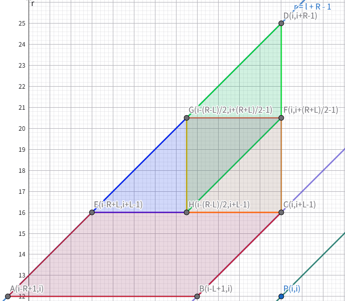

这里当前求解第 $i$ 个 $f_i$，横坐标为区间左端点 $l$，纵坐标为区间右端点 $r$，右下角为 $(i,i)$，这里形成了一个梯形，梯形中间区域的点对都是合法的 $(l,r)$，则我们要对这一个梯形求中间的点对 $s_r-s_{l-1}$ 求 $\max$。

首先容易发现当 $i$ 增加的时候这个梯形会随之上移和右移，区间具有单调性，我们考虑用单调队列进行维护。

单调队列维护一个梯形是困难的，因为信息不确定，但如果维护的是有一条边平行于坐标轴的平行四边形呢？我们假设横着切一刀，如线段 $CE$ 所示，这个时候我们发现了一个很惊人的事实，对于处在平行四边形 $ABEC$ 中的 $r$，它能取到的 $l$ 的区间长度固定的，为 $R-L+1$，这个事实在移动区间的时候也成立，故对于在平行于横坐标的平行四边形中，它的 $\max$ 为 $s_r-\min(\{s_{r-j+1}\ |\ L \le j \le R\})$，后者这个 $\min$ 是序列中固定的，用 ST 表求出即可。

但此时还有上面一个小三角形不知道怎么办？如果 $2L \ge R-1$，则再做一条竖的切线即可覆盖完全。

更一般的情况这样切会剩下的一个小三角形，不行。考虑对三角形划分，求出一个矩形是容易的，不用单调队列仅用 ST 表就能够求出，所以可以把三角形划分成上图所示的图形，划分成平行四边形 $EHFG$ 和平行四边形 $GHFD$ 以及一个矩形 $HCFG$ 即可覆盖。

### [P3747 六省联考2017 相逢是问候](https://www.luogu.com.cn/problem/P3747)

前置知识：[费马小定理、欧拉定理、扩展欧拉定理](https://oi-wiki.org/math/number-theory/fermat/)。

给出一个模数 $p$，**不保证 $p$ 为质数**，和一个整数 $c$，你需要维护一个长度为 $n$ 的序列，接下来有 $m$ 次操作，每个操作可以分为两种：

1. `0 l r` 对于所有 $l \le i\le r$，令 $a_i \gets c^{a_i}$。
2. `1 l r` 求 $\sum_{i=l}^{r}a_i \bmod{p}$。

保证 $1\le n,m\le 5\times 10^4,1\le p\le 10^8,0\lt c\lt p,0\le a_i\lt p$。

由扩展欧拉定理可以得到，对于 $k \ge \varphi(p)$ 有 $a^k\equiv a^{k\ \bmod{\ \varphi(p)}+\varphi(p)}\pmod {p}$，这里不要求 $\gcd(a,p)=1$，但是对 $k$ 有要求，必须 $\ge \varphi(p)$。

考虑每个数最后的形式，一定是如下所示：

$$
\Large{
c^{c^{c^{c^{c^{{\cdots}^{a_i}}}}}} \pmod{p}
}
$$

那么考虑这个指数塔，每往上一层就是嵌套一层 $\varphi(p)$，下假设为 $2$ 个 $c$ 的指数塔。

$$
\Large{
\begin{align}
& c^{c^{a_i}}\ \bmod{\ p}
\\
& = c^{c^{a_i}\ \bmod{\ \varphi(p)}+\varphi(p)} \ \bmod{\ p}
\\
& = c^{c^{a_i \ \bmod{\ \varphi(\varphi(p))}+\varphi(\varphi(p))}\ \bmod{\ \varphi(p)}+\varphi(p)}\ \bmod{\ p}
\end{align}
}
$$

可以发现每过一层指数塔就嵌套一个 $\varphi(p)$，我们不妨记 $\varphi^{(t)}(p)$ 表示嵌套 $t$ 层的欧拉函数，也就是 $\varphi^{(1)}(p)=\varphi(p),\varphi^{(t)}(p)=\varphi(\varphi^{(t-1)}(p))$。

引理：$\varphi^{(t)}(n)=1$ 的最小的 $t$ 不超过 $O(\log n)$。

证明：记 $n = \prod p_i^{c_i}$，也就是对 $n$ 进行质因数分解。则有：

$$
\Large{
\varphi(n) = n\prod (1-\frac{1}{p_i})
}
$$

这个可以由欧拉函数的定义进行因式分解得到，也可以用容斥原理解释。

根据以上结论可以知道 $\varphi(n)$ 必定为偶数，对于一个偶数的 $n$，必定有质因数 $2$，则 $2\varphi(n) \le n$，进行一次嵌套至少减少一半，故引理得证。

接下来再回到指数塔的部分，现在我们知道这个指数塔最高叠到 $O(\log n)$ 层，再往上就没用了，但是我们还是不能支持区间操作，毕竟这个玩意儿没有结合律。

还有一个十分重要的性质，我们的 $c$ 是固定的，这说明了什么，当指数塔叠到 $a_i$ 可以忽略的时候，就只有 $c$ 了，那么这个时候是不是再操作值就不会改变，参考[P4145 上帝造题的七分钟 2 / 花神游历各国](https://www.luogu.com.cn/problem/P4145)，考虑对于每一个数暴力单点修改，如果一整个段的值都已经固定，那么就不再对它进行修改，这样每个数至多会被修改 $O(\log n)$ 次，由于每一次都要跑一边指数塔，有 $O(\log V)$ 层，算上快速幂就是 $O(n\log n\log^2 V)$，不过因为底数只能是 $c$ 可以分段打表省去一个 $\log V$，做到时间复杂度 $O(n\log n\log V)$。

一定要注意扩展欧拉定理要 $k \ge \varphi(p)$ 才有用，$k \lt \varphi(p)$ 直接快速幂就行了，判断的话就是提前预处理出多少层指数塔才能超过 $\varphi$，这样比较好写一些。

最后可以看一下[P4139 上帝与集合的正确用法](https://www.luogu.com.cn/problem/P4139)。

### [P5048 (Ynoi2019 模拟赛) Yuno loves sqrt technology III](https://www.luogu.com.cn/problem/P5048)

给出一个长度为 $n$ 的序列 $a$，有 $m$ 次询问，求区间众数出现的次数，强制在线。保证 $n,m\le 5\times 10^5$。

如果不是强制在线，回滚莫队是显然的。

考虑分块，设块长为 $B$，我们先看看一个数能对答案有贡献是什么时候，那肯定是这个数出现的次数比答案要大啦，但是我们不能对这一整个区间都这样做，不妨先预处理第 $L$ 个块到第 $R$ 个块的答案，这个预处理的时间复杂度是 $O(\frac{n^2}{B})$，询问的时候直接得到中间整块的答案，对于零散块，我们考虑每一个数能不能对答案有贡献，考虑答案什么时候能够 $+1$，假设当前是在左侧的零散块，就是当前这个数在区间内，且下 $ans$ 个相同的数也在区间内（右侧零散块同理，上 $ans$ 个相同的数在区间内），这样就说明这个数在区间内一定出现了 $ans+1$ 次，令 $ans$ 自增即可，用 `vector` 维护相同的数出现的位置即可。还有一个细节，零散块枚举的时候需要从块的一个端点（也就是靠近中间的部分）开始枚举，不然会漏答案，或者用桶存起来，每次看一下前面已经扫了几个数也可以。时间复杂度 $O(\frac{n^2}{B}+mB)$，取 $B = \frac{n}{\sqrt{m}}$ 可以得到最优复杂度 $O(n\sqrt{m})$。

### [P4168 Violet 蒲公英](https://www.luogu.com.cn/problem/P4168)

给定长度为 $n$ 的序列 $a$，有 $m$ 次询问，查询区间众数（若有多个输出最小的一个）。

和[这一题](#P5048 (Ynoi2019 模拟赛) Yuno loves sqrt technology III)是一样的，区别在于求众数的时候顺便求出最小的就行了。

### 维护区间（历史）最值（吉司机线段树 Segment Tree Beats）

~~我也不懂为什么叫这个名字~~。

吉如一——论文：[国家集训队2016论文集](https://github.com/OI-wiki/libs/blob/master/%E9%9B%86%E8%AE%AD%E9%98%9F%E5%8E%86%E5%B9%B4%E8%AE%BA%E6%96%87/%E5%9B%BD%E5%AE%B6%E9%9B%86%E8%AE%AD%E9%98%9F2016%E8%AE%BA%E6%96%87%E9%9B%86.pdf)。

OIWiKi：[区间最值操作 & 区间历史最值](https://oi-wiki.org/ds/seg-beats/#%E5%8E%86%E5%8F%B2%E6%9C%80%E5%80%BC%E9%97%AE%E9%A2%98)。

区间最值操作，指的就是对于一个区间所有的值都取 $\min$ 或 $\max$ 操作。

历史最值操作，维护两个数组 $A$ 和 $B$，每次对 $A$ 数组进行操作过后，都令 $B_i \gets \min(A_i,B_i)$ 或 $B_i\gets \max(A_i,B_i)$，就称 $B$ 为 $A$ 的历史最小（大）值。

### [HDU5306 Gorgeous Sequence](https://acm.hdu.edu.cn/showproblem.php?pid=5306)

给出一个大小为 $n$ 的序列 $a_i$，有 $q$ 次操作：

1. 区间取 $\min$：对于 $l\le i\le r$，$a_i\gets \min(a_i,x)$。
2. 区间 $\max$：输出 $\max_{i=l}^r a_i$。
3. 区间和：输出 $\sum_{i=l}^r a_i$。

区间取 $\min$ 就意味着它只对 $\gt x$ 的数有影响，我们不妨记录一下每个区间的最大值（记为 $M$）、严格次大值（记为 $S$）、最大值出现的个数（记为 $C$）和区间和（记为 $sum$）。

下面考虑修改操作。

1. 若 $M \le x$，则区间取 $\min$ 对这个区间没有任何影响，直接返回。
2. 若 $S \lt x \lt M$，则区间取 $\min$ 对这个区间只会影响最大值，区间和 $sum \gets sum-C(M-x)$，最大值 $M\gets x$。注意 $x$ **必须严格大于** $S$，因为 $S$ 是严格最次值，$x = S$ 时会影响 $S$。然后打一个标记返回。
3. 若 $x \le S$，则此时无法确定，向左右儿子递归求解。

这样做的复杂度是 $O(n\log n)$，证明之后再来补（显然我现在不会）。

### [P10639 BZOJ4695 最假女选手](https://www.luogu.com.cn/problem/P10639)

给出一个长度为 $n$ 的序列，你需要支持 $6$ 种操作：

1. 区间加 $x$。
2. 区间对 $x$ 取 $\min$。
3. 区间对 $x$ 取 $\max$。
4. 求区间和。
5. 求区间 $\max$。
6. 求区间 $\min$。

这里我们需要维护很多东西：区间和（记为 $sum$），区间最大值（记为 $mx$），区间严格次大值（记为 $smx$），区间最大值个数（记为 $cmx$），区间最小值（记为 $mn$），区间严格次小值（记为 $smn$），区间最小值个数（记为 $cmn$），以及它们对应的标记。

对于 2. 操作和 3. 操作与上一题的维护方式类似。

因为这里有三个标记，我们需要考虑它们之间的互相影响。区间加的标记对其他两个标记的影响比较好做，我们让区间加的标记优先级最高（最先下传，下传的同时更新对 $\max$ 和 $\min$ 标记的影响），具体地，我们区间 $+v$ 的时候把最大值、次大值、最小值、次小值、$\max$ 标记、$\min$ 标记都同时 $+v$，这样就处理好了。

其他两个标记（$\max$ 标记和 $\min$ 标记）的优先级相同，但是有几点需要注意：

1. 用 $\max$ 标记更新区间的 $mn$ 的时候，如果 $mx = mn$ 或 $smx = mn$ 也要顺便更新 $mx$ 或 $smx$，因为它们两个值相同，所表示的数就是相同的（$\min$ 标记同理）。
2. 要考虑 $\min$ 标记的值不大于 $\max$ 标记的值的情况，此时 $\max$ 标记会影响 $\min$ 标记，整个区间的值都是一样的，如果当前更新的是 $\max$ 标记（值为 $w$）且 $\min$ 标记的值 $\le v$，则整个区间都为 $w$，相当于把 $\le w$ 的数变为 $w$，把 $\ge w$ 的数也变为 $w$，相当于 $\min$ 标记强行被 $\max$ 标记变大了，变成了 $w$（$\min$ 标记对 $\max$ 标记的影响同理）。

这个线段树的时间复杂度上界是 $O(n\log^2 n)$ 的，用势能分析可证（我不会）。

### [P4314 CPU 监控](https://www.luogu.com.cn/problem/P4314)（待完成）

### 维护历史版本和

Sktn0089：[线段树维护区间历史版本和 ](https://www.cnblogs.com/Sktn0089/p/17755836.html)。

历史版本和问题常常配合扫描线食用。

可以快速求解类似 $\sum \sum f(l,r)$ 一类的问题，详细请见扫描线。

一个问题，你需要维护一个数列 $A_i$（初始全为 $0$），支持区间加，区间求和，**区间求历史版本和**（相当于维护一个序列 $B_i$，每次区间加后，都令 $B_i\gets A_i + B_i$）。

#### 解法一

一个比较简单的办法，我们维护一个时间 $t$，每次区间加后令 $t\gets t+1$，我们维护一个序列 $C_i$，每一次区间 $+v$ 后令 $C_i\gets C_i - t\times v$（这里的 $t$ 是加之前的时间），$A_i\gets A_i + v$，这样我们就有 $B_i=C_i + t\times A_i$。不过这个做法局限性比较大，需要考虑每一次修改对后续询问的影响。

#### 解法二

本题的操作只有区间加一个，对于普通区间加操作直接维护就行了，我们考虑两个历史版本和标记队列如何合并（pushdown 时需要合并标记），对于一个区间，假设当前有两个历史版本和标记队列 $q_1$ 和 $q_2$ 需要合并（即 $q_2$ 产生对该区间的影响），我们发现这个区间的和还会对版本和贡献 $|q_2|$ 次（$|q_2|$ 是 $q_2$ 中区间加操作的个数），并且版本和还要加上 $q_2$ 中的版本和的贡献，故我们需要维护区间和、区间加标记和、当前区间加标记的个数、当前区间加标记造成的历史版本和的贡献 $4$ 个元素。

### 扫描线

OI-WiKi：[扫描线 - OI Wiki](https://oi-wiki.org/geometry/scanning/)。

[Dregen_Yor](https://www.luogu.com.cn/user/478585)的洛谷日报：[浅谈扫描线 - 洛谷专栏](https://www.luogu.com.cn/article/f8q5bmnz)。

[liduoduo2021](https://www.luogu.me/user/529398)：[扫描线好题集](https://www.luogu.me/article/riw03n4n)。

[KazamaRuri](https://www.luogu.com.cn/user/776873)：[深入扫描线](https://www.luogu.com.cn/article/twzht4pt)。

对于一般二维数点问题（如求一个静态矩形内的点权和），可以离线后使用扫描线进行维护。

#### 单点加矩阵查询

给出一个长度为 $n$ 的数组 $a_i$，有 $q$ 次询问一个区间 $[l,r]$ 中有多少个 $a_i \in [x,y]$。

$1 \le n,q,a_i,l,r,x,y \le 10^6$

可以把每个询问拆分成 $2$ 条“线”，即拆分成位于 $[1,r]$ 中 $a_i \in [x,y]$ 的数量减去位于 $[1,l-1]$ 这个位置中 $a_i \in [x,y]$ 的数量（即差分），这样区间查询就转换为了两个前缀查询，离线下来后可做。然后对于这两个问题可以使用数据结构或分治解决。在这个问题中我们可以使用树状数组（或线段树）维护这两条线，具体地，先将询问的线按照右端点位置排序，每扫到一个位置就把 $a_i$ 所对应的位置加 $1$，询问时区间查询这个位置中 $[x,y]$ 上的权值和即可。 

``` cpp
#include <iostream>
#include <cstdio>
#include <cstring>
#include <vector>
#include <algorithm>
#include <cassert>
using namespace std;
typedef long long LL;
const int MAX_N = 1e6+15;
namespace bit_tree {
	int n, t[MAX_N];
	void init (int x) {
		n = x;
		memset(t, 0, sizeof t);
	}
	inline int lb (int x) {
		return x & (-x);
	}
	void add (int xy, int val) {
		if(xy <= 0) return;
		for(int i = xy; i <= n; i += lb(i)) {
			t[i] += val;
		}
	}
	int query (int xy) {
		int ans = 0;
		for(int i = xy; i > 0; i -= lb(i)) {
			ans += t[i];
		}
		return ans;
	}
}
struct Ques {
	int idx, x, y, qid, vals;
};
Ques qs[MAX_N*2];
int n, m, a[MAX_N], ans[MAX_N];
inline bool cmp (Ques &x, Ques &y) {
	if(x.idx != y.idx) return x.idx < y.idx;
	return x.vals < y.vals;
}
int main () {
	scanf("%d%d",&n,&m);
	for(int i = 1; i <= n; i ++) {
		scanf("%d",&a[i]);
	}
	for(int i = 1; i <= m; i ++) {
		int l, r, x, y;
		scanf("%d%d%d%d",&l,&r,&x,&y);
		qs[i].idx = l-1;
		qs[i].x = x;
		qs[i].y = y;
		qs[i].qid = i;
		qs[i].vals = -1;
		qs[i+m].idx = r;
		qs[i+m].x = x;
		qs[i+m].y = y;
		qs[i+m].qid = i;
		qs[i+m].vals = 1;
		assert(l >= 1 && l <= n && r >= 1 && r <= n && l <= r);
	}
	sort(qs+1, qs+1+m*2, cmp);
	bit_tree::init(1000003);
	for(int i = 0, j = 1; i <= n; i ++) {
		bit_tree::add(a[i], 1);
		while(j <= 2*m && qs[j].idx <= i) {
			ans[qs[j].qid] += qs[j].vals * (bit_tree::query(qs[j].y) - bit_tree::query(qs[j].x-1));
			++ j;
		}
	}
	for(int i = 1; i <= m; i ++) {
		printf("%d\n",ans[i]);
	}
	return 0;
}
```

#### 矩形加单点查询

对矩形做一个差分即可，把一个矩形加拆成两条“线”然后做个差分，第二维用数据结构维护即可。

#### $\sum \sum f(l,r)$

假设有 $q$ 次询问，每一次询问都形如 $\sum_{l=L}^{R} \sum_{r=l}^{R} f(l,r)$ 的形式，可以考虑扫描线，考虑当前右端点扫到 $r$，对于每一个 $l\in [1,r-1]$，我们需要加上一个数（或其他操作）使得 $f(l,r-1)\to f(l,r)$。考虑固定 $l$，这个 $l$ 产生的贡献即 $\sum_{r=l}^R f(l,r)$，这就是一个 $l\sim R$ 的版本历史和问题，由于在 $r \lt l$ 时没有任何贡献，所以也可以看作是 $1\sim R$ 的版本历史和问题，这样就转化为历史版本和了。

### [P8512 Ynoi Easy Round 2021 TEST_152](https://www.luogu.com.cn/problem/P8512)

你有一个大小为 $n$ 的操作序列 $(l_i,r_i,v_i)$，意思是对一个大小为 $m$ 的序列区间 $[l_i,r_i]$ 全部覆盖为 $v_i$。现在有 $q$ 次询问，每一次询问给出 $L,R$，问只进行 $[L,R]$ 内的操作后序列的和为多少（序列初始时全为 $0$）？保证 $1\le n,m,q\le 5\times 10^5$。

考虑离线下来后扫描线。

我们进行以右端点 $r$ 移动的扫描线，对操作序列进行扫描，定义 $f(l,r)$ 为只经过 $[l,r]$ 范围内的操作的序列和。考虑右端点向右移动会发生什么吧，我们需要计算第 $r$ 个操作对每一个左端点答案产生的影响，对一个数 $x$ 改成 $v$ 可以看作 $-x+v$，所以对 $[1,r]$ 内的左端点的序列和都先加上 $v$，再减去原来的数的和。

考虑修改时每一个数是什么，容易发现要么是 $0$，要么是最后一次修改的值。那么这样就好做了，区间覆盖考虑[珂朵莉树](https://oi-wiki.org/misc/odt/)，对于每一个值域段记录一个最后一次修改的位置 $t$，则在 $[1,t]$ 时有这个值，$t+1$ 到现在值为 $0$，给左端点在 $[1,t]$ 这个区间的答案减去这个区间值的和就行了，树状数组维护，总修改的次数均摊是 $O(n)$ 的（用颜色段均摊的结论），这里还是证明一下吧。

证明：定义一个势能函数 $\phi(S)$ 为当前珂朵莉树中连续段的个数，我们在询问区间之后立马区间覆盖，则假设覆盖到了 $x$ 个连续段，则 $\phi(S_i) = \phi(S_{i-1})-x+1$，实际访问到的连续段个数 $c_i = x$，则 $\hat{c_i}=c_i+\phi(S_i)-\phi(S_{i-1})=1$，所以总共的均摊复杂度为 $\sum \hat{c_i}=O(n)$。

总时间复杂度 $O((m+n)\log n)$。

### 整体二分

ydtz博客园：[整体二分——二分的进阶版！](https://www.cnblogs.com/ydtz/p/16611664.html)。

[Miko35](https://www.luogu.com.cn/user/78372)：[整体二分](https://www.luogu.com.cn/article/wff0kib6)。

对于答案具有二分性质的询问（或者可以转换为有二分性质的询问，如将数组 $k$ 大或 $k$ 小问题可以二分后把大于 $mid$ 的数设为 $1$，小于或等于 $mid$ 的数设为 $0$ 后转换为二分答案问题）可以考虑整体二分。

如果题目有修改操作，需要满足修改对查询时的贡献相互独立。并且贡献需要满足交换律、结合律、可加性。

具体而言，每一次我们记录当前需要处理的操作区间 $[l,r]$ 和当前的答案区间 $[L,R]$，对于 $L=R$ 的情况就说明已经知道答案了，直接赋值即可。

接下来考虑 $L\ne R$ 的情况，我们二分一个 $M = \frac{L+R}{2}$，通过一些处理把所有操作都划分成左右两个区间，这个处理根据具体题目而不同。

当然还有整体二分维护不可加贡献。

### [P3332 ZJOI2013 K大数查询](https://www.luogu.com.cn/problem/P3332)

整体二分模板题。

$n$ 个可重集，区间加入一个数，求区间并集（不去除重复元素）的 $k$ 大值。

看到 $k$ 大值可以考虑二分。单次询问可以考虑二分一个数 $mid$，把大于 $mid$ 的数设为 $1$，小于或等于 $mid$ 的数设为 $0$，若区间和等于 $k-1$ 则说明当前的 $mid$ 即为答案。对于此思路可以使用树套树进行维护，时间复杂度 $O(q\log^3n)$。

既然对于每一个询问我们都是通过二分寻找答案，并且区间和满足上述特性，则可以使用整体二分。以下用操作代替修改和查询。

先将操作按照时间顺序排序（当然输入就是按时间输入的）。

对于当前的区间 $(l,r,L,R)$ 表示当前处理的操作（修改和查询）为 $[l,r]$ 并且当前答案的范围是 $[L,R]$。

若 $L=R$ 说明所有 $[l,r]$ 中的询问操作的答案均为 $L$ 或 $R$，直接扫一遍赋值即可。

否则二分一个 $mid = \frac{L+R}{2}$，维护当前区间大于 $mid$ 的数有多少个。

考虑将大于 $mid$ 的修改操作改为区间加（即在这一个修改区间中多了一个大于 $mid$ 的数），并把本次操作划分到右侧的集合当中（因为这个修改操作会对所有答案处于 $[L,mid]$ 的都产生 $1$ 的贡献，可以直接处理）；否则就将本次操作划分到左侧的集合当中（不进行修改）（这个操作不会对 $[mid+1,R]$ 的询问产生任何贡献）。

对于询问操作，如果询问区间中大于 $mid$ 的数 $c$ 个，若 $c \ge k$ 则说明答案应该在 $[mid+1,R]$ 中，则将本次操作划分到右侧的集合中；否则说明 $c \lt k$，则把 $k \gets k-c$，表明右侧所有当前大于 $mid$ 的数都对这次询问产生了贡献，划分到左侧的集合当中。

这样的话每一次操作只会出现在 $\log V$ 层当中，并且这个操作只会在出现的层当中会被统计，也就是说每一个操作只被统计 $O(\log V)$ 次，每一次统计时间复杂度 $O(\log n)$，也就是时间复杂度 $O(q\log n\log V)$。

### [P3242 HNOI2015 接水果](https://www.luogu.com.cn/problem/P3242)

整体二分和扫描线的结合运用（我还没 ${\color{green}\text{Accepted}}$）。

$\text{Update on 2025/11/18}$，死在了 $80$ 分。

给出大小为 $n$ 的一棵树和 $p$ 条树上的路径（盘子），这些路径都有权值 $v_i$，$q$ 次询问，每次询问树上的一条路径（水果）中第 $k$ 小的被这条路径完全包含的那 $p$ 条路径（盘子）的值 $v$。

先考虑把树上问题转换为序列上的问题。可以考虑每个盘子会影响几个水果，或者考虑水果中有几个盘子，考虑前者比较好做。

对于一个盘子，会影响到的水果完全包含这个盘子，有以下两种情况。设当前盘子的两个端点为 $x,y$，水果的两个端点为 $u,v$。且 $\text{dfn}_x \lt \text{dfn}_y , \text{dfn}_u < \text{dfn}_v$。

- 若 $x,y$ 的 $\text{lca}$ 不是 $x,y$ 中的一个，即 $x,y$ 不为祖先儿子关系，则此时 $u$ 在 $x$ 的子树内，$v$ 在 $y$ 的子树内，则 $u \in [\text{dfn}_x,\text{dfn}_x+\text{size}_x-1], v \in [\text{dfn}_y,\text{dfn}_y+\text{size}_y-1]$。
- 若 $x,y$ 的 $\text{lca}$ 为 $x$，即 $x$ 是 $y$  的祖先（$y$ 不可能是 $x$ 的祖先不然不满足 $\text{dfn}$ 序的大小关系），则此时一个点一定在 $y$ 的子树内，另一个点在除了 $x$ 到 $y$ 这条链所在子树的其他位置。比如说 $x$ 的一个直接儿子 $z$ 且 $y$ 在 $z$ 的子树内，则另一个点不在 $z$ 的子树内，即在 $[1,\text{dfn}_z-1] \cup [\text{dfn}_z+\text{siz}_z,n]$ 中。

整体二分后只考虑权值大于等于 $mid$ 的盘子，观察上述相当于一个二维数点问题，钦定一个 $\text{dfn}$ 的顺序然后二次离线下来扫描线即可。

### [P1527 国家集训队 矩阵乘法](https://www.luogu.com.cn/problem/P1527)

静态矩形 $k$ 小值。

整体二分+扫描线。

把每一个原本在矩形上的数全部看作一次单点修改的操作，这样二分答案之后就转换为单点修改，查询矩形权值和，扫描线做就行了。

时间复杂度 $O((n^2+q)\log n\log V)$。

### [P5163 WD与地图](https://www.luogu.com.cn/problem/P5163)

给出 $n$ 个城市和 $m$ 条边的**有向图**，每个城市有各自的发达程度 $s_i$，有 $q$ 次操作，每次操作都是以下 三种之一：

1. 删除一条边，保证删除前这条边存在。
2. 使一个城市的发达程度增加 $x$。
3. 询问一个城市所在的**强连通分量**中发达程度前 $k$ 大的发达程度之和，若不足 $k$ 个则输出所有城市发达程度之和。

保证图在任意时刻均无重边（反边不算重边）和自环，$1\le n \le 10^5,1\le m,q\le 2\times 10^5$。

整体二分维护不可加贡献的典型例子。

把询问离线后反转询问序列是显然的，毕竟加入一条边总比删除要好做的多，并且剩下两个操作也很好处理。

首先需要一个转换，强连通分量是具有传递性的，也就是说只要 $x,y$ 强连通，$y,z$ 强连通，那么 $x,z$ 必定强连通，证明显然。

我们构建一个新图，新图中的连通块表示原图中的强连通块，那么每次在新图中连接一条边就表明了原图中两个强连通块的合并，而我们要求前 $k$ 大权值和，这可以和[P3224 HNOI2012 永无乡](https://www.luogu.com.cn/problem/P3224)做法一样，线段树合并。

那么现在我们要维护这一个新图，就需要知道每一条边什么时候被加进去，首先新图的边是原图的边的子集（当然也可以不是，但这个条件是充分的），我们考虑求出每一条边被加进新图的时间，由于反转操作序列以后只有加边操作，故新图的边不会消失，对于单条边可以二分之后跑一个 tarjan 解决，那对于 $m$ 条边可以考虑一下整体二分。

首先假设当前的出现时间范围为 $[L,R]$，当前处理到的边在 $[l,r]$ 中，二分一个 $M = \frac{L+R}{2}$，把 $[l,r]$ 中的边出现时间 $\le M$ 的加入到图中然后跑 tarjan（这里的 tarjan 只遍历有边的点，时间复杂度是 $O(m)$ 的），然后一条边如果两端处于同一个强连通块中则分配到左区间，否则分配到右区间。但是这样会带来一个问题，处理右区间的时候我们需要左区间强连通块的信息，否则再去跑 tarjan 的时候会不正确，可以发现丢失的边的信息一定处于一个强连通分量内，我们可以把一个强连通分量用一个特殊点代替，这样就忽略了那些丢失的边，然后跑完 tarjan 后把分配到右区间的边所连的点用特殊点重新代替一下就可以了，这里特殊点的编号直接沿用强连通分量的编号即可。

下图举个例子：

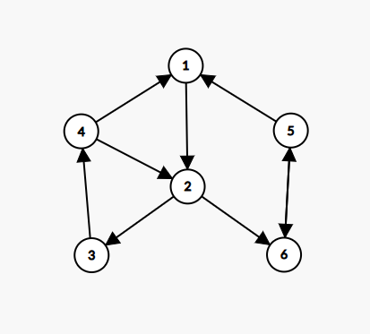

这里假设 $\{(1,2),(2,3),(3,4),(4,1),(5,6),(6,5),(2,6)\}$ 为可以被本层加入跑 tarjan 的边（即出现时间 $\le M$ 的边），$\{(4,2),(5,1)\}$ 为本层不能加入的边（即出现时间 $\gt M$ 的边）。

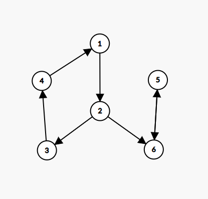

那么把出现时间 $\le M$ 的边加入后图长这个样子，这里形成了两个强连通分量，我们给这两个强连通分量标号，记 $A$ 为强连通分量 $\{1,2,3,4\}$，记 $B$ 为强连通分量 $\{5,6\}$，那么我们可以把 $\{(1,2),(2,3),(3,4),(4,1),(4,2),(5,6),(6,5)\}$ 向左递归（因为这些边的两个端点均在同一个强连通分量内），$\{(2,6),(5,1)\}$ 向右递归并重新编号（$\{(A,B),(B,A)\}$）。

求完之后利用并查集和线段树合并，每次要合并两个强连通分量时合并权值树上的信息，修改可以看作单点插入和单点删除，查询线段树二分就好啦。

这样就做完啦这一道题，整体二分部分每一条边都只会被跑 $O(\log q)$ 次 tarjan，而每一次 tarjan 算法均摊到每一条边上就是 $O(1)$ 的，故时间复杂度 $O(m\log q)$，线段树合并部分时空复杂度 $O((n+q)\log V)$。总时间复杂度 $O(m\log q+(n+q)\log V)$，空间复杂度 $O((n+q)\log V)$。

### 分块&根号分治

分块&根号分治基于根号平衡的思想均摊复杂度，有很多分块变种，有些时候根号分治和分块搭配食用更佳！

### [Xenia and Tree](https://codeforces.com/problemset/problem/342/E)

洛谷链接：[CF342E Xenia and Tree](https://www.luogu.com.cn/problem/CF342E)。

操作分块入门题。本题正解为动态点分治，详见题解，这里给出操作分块做法。

给出一颗大小为 $n$ 的树，最初第一个节点为红色，其余所有节点均为蓝色，有 $q$ 次操作，每次操作为如下两种操作之一。

1. 将指定的蓝色节点涂成红色。
2. 查询指定节点的距离最近的红色节点，并输出最短距离。

保证 $1\le n,q \le 10^5$。

先操作分块，每 $B$ 个操作分成一个块，对于块内的修改—查询，直接枚举然后求出最短的距离，这里的时间复杂度是 $O(B^2\log n)$，如果用 $O(1)$ 的最近公共祖先算法可以做到 $O(B^2)$，而一共有 $O(\frac{q}{B})$ 个整块，所以这一部分的时间复杂度为 $O(qB)$。然后对于跨块的，考虑对每一个点维护一个 $d$ 数组，$d_x$ 表示 $x$ 到最近的红色节点的距离，对于一个整块，可以使用多源 BFS $O(n)$ 更新所有 $d$ 数组，而又有 $O(\frac{q}{B})$ 个整块，故这里跨块的时间复杂度为 $O(\frac{nq}{B})$，直接取 $B = \sqrt{n}$，得到时间复杂度 $O(q\sqrt{n})$。

### [P12506 「ROI 2025 Day2」沼泽里的青蛙](https://www.luogu.com.cn/problem/P12506)

二维分块好题。

[A2ure_Sky](https://www.luogu.com.cn/user/665592)：[这个题解](https://www.cnblogs.com/-AzureSky-/p/19098355)讲得很好。

一个二维平面内有 $n$ 个点 $(x_i,y_i)$，每个点可以向与之欧几里得距离不超过 $r$ 的点连无向边，求最后哪些点所在的连通块包含奇环。保证 $2\le n\le 10^5,1\le r\le 10^9,0\le x_i,y_i\le 5\times 10^8$。

一个一个连边显然有点慢，考虑快速合并信息，如果存在三个点两两互相可达，则这三个点的连通块存在三元环（奇环），并且如果两个连通块均已存在奇环且有边连接这两个连通块，则这两个连通块的边可以删除（因为已经存在奇环了，连不连边不影响答案）。

考虑在平面内分成若干个正方形，使得每个正方形内的点均可相互到达，比较好的选法是取边长为 $\frac{\sqrt{2}}{2}r$，当然为了方便这里取边长 $b = \lceil\frac{r}{2}\rceil$，如果一个正方形中存在三个及以上的点，那么这个正方形中已经存在三元环（奇环），否则这个正方形至多有两个点。考虑正方形与正方形之间的连边，首先由上文的性质可以知道已经存在奇环的正方形与已经存在奇环的正方形不用相互连边，那么能连边的就是没有奇环的正方形连存在奇环的正方形或另一个没有奇环的正方形，而又因为我们取的 $b = \lceil\frac{r}{2}\rceil$，所以只有以一个正方形为中心，向周围 $5\times 5$ 的正方形才能连上边，不然一定超过 $r$ 的范围，故每个正方形最多向周围 $25$ 个正方形连边，并且有奇环的正方形（点数 $\ge 3$）连的全都是点数 $\le 2$ 的正方形，也就是说每个点至多连接 $50$ 条边，故边数为 $O(n)$ 带一个 $50$ 倍常数，最后跑一个黑白染色判断二分图即可。

时空复杂度 $O(n)$，带 $50$ 倍常数。

### [P5309 Ynoi2011 初始化](https://www.luogu.com.cn/problem/P5309)

根号分治和分块好题。

给定一个长度为 $n$ 的序列 $A_i$，有 $m$ 次操作：

1. 给出 $x,y,z$，对于所有 $y+kx\le n$ 的**非负整数** $k$，令 $A_{y+kx}\gets A_{y+kx}+z$，即对 $A_y,A_{x_y},A_{2x+y}\cdots A_{kx+y}$ 都加上 $z$。保证 $y \le x$。
2. 询问 $[l,r]$ 的 $A_i$ 的和，对 $10^9+7$ 取模。

保证 $n,m\le 2\times 10^5$。

这一个操作 1. 相当于对 $i\bmod{x}=y$ 的 $i$ 进行 $+z$ 操作（如果 $y=x$ 则令 $y\gets 0$，下同），这一看不就很根号分治的样子。

我们设定一个阈值 $B$，对于操作 1.，若 $x \gt B$，则暴力修改，我们用树状数组维护前缀和，则时间复杂度 $O(\frac{n\log n}{B})$；否则我们用一个数组记录一下此次操作，令 $d_{x,y}\gets d_{x,y}+z$，查询的时候先区间查询 $[l,r]$ 的和，然后统计 $x\le B$ 的答案，我们只需要枚举 $x,y$，直接统计有多少个数在 $[l,r]$ 中 $i\bmod{x}=y$ 的个数（实际上就是 $\lfloor\frac{r}{x}\rfloor - \lfloor\frac{l}{x}\rfloor + 1 - [l\bmod{x} \gt y] - [r\bmod{x} \lt y]$），再乘上 $d_{x,y}$ 即可。查询的时间复杂度就是 $O(\log n+B^2)$。那么我们取 $B=\sqrt[3]{n\log n}$，可以得到时间复杂度 $O(\log n+q\sqrt[3]{n^2\log^2 n})$，能获得 $65$ 分。

考虑优化。

首先我们发现树状数组修改复杂度比较慢导致我们多一个 $\log n$，而查询复杂度反而不是瓶颈所在，故我们用 $O(1)$ 修改 $O(\sqrt{n})$ 查询的分块代替树状数组，就能做到 $O(q\sqrt{n}+q\sqrt[3]{n^2})$ 了。

能发现我们查询的复杂度是 $O(\sqrt{n}+B^2)$ 的，考虑如何做到 $O(\sqrt{n}+B)$。我们发现在查询 $d_{x,y}$ 时，对于同一个 $x$，乘的系数只有 $3$ 种，直接对 $d_{x,y}$ 做个前缀和，这样就能 $O(1)$ 计算同一个 $x$ 的 $d_{x,y}$ 了，这样我们就做到了 $O(\sqrt{n}+\frac{n}{B})$ 修改，$O(\sqrt{n}+B)$ 查询的复杂度，取 $B=\sqrt{n}$ 就得到了 $O(q\sqrt{n})$ 的算法，足以通过本题。

### bitset（位集合）

[Eterna](https://www.luogu.com.cn/user/1348260)：[DAG 可达性问题小记](https://www.luogu.com.cn/article/cci9pev7)。

bitset 具有优良的时空复杂度，对 bitset 进行位运算的时间复杂度为 $O(\frac{n}{\omega})$，储存的空间复杂度为 $O(\frac{n}{\omega})$，其中 $\omega$ 取决于计算机，一般为 $32$ 或 $64$。

下文中用 $\lor$ 指代逻辑运算符或，用 $\operatorname{or}$ 指代按位或；用 $\land$ 指代逻辑运算符与，用 $\operatorname{and}$ 指代按位与；用 $\lnot$ 同时指代逻辑运算符非和按位取反。

### [P10480 DAG 可达性统计](https://www.luogu.com.cn/problem/P10480)

给出一个 $n$ 个点 $m$ 条边的**有向无环图**（DAG），问每个点能到达的点的个数，**特别的**每个点均可以到达自己。保证 $n,m \le 3\times 10^4$。

维护 $f_{i,j}$ 表示是否存在一条 $x \to y$ 的路径，则有转移 $f_{i,j} \gets f_{i,k} \land f_{k,j}$。时间复杂度 $O(nm)$，考虑把第二维压成 bitset，对于一条有向边 $(x,y)$，所有 $y$ 能到达的地方 $x$ 都能到达，故有转移 $f_x \gets f_x \ \operatorname{or} \ f_y$，拓扑反边转移或者 dfs 转移都可以，时间复杂度 $O(\frac{nm}{\omega})$。

### [Range Reachability Query](https://qoj.ac/problem/4420)

给出一个 $n$ 个点和 $m$ 条边的**有向无环图**，有 $q$ 次询问，每次询问给出两个点 $x$ 和 $y$，只经过**边的编号**在 [l,r] 中的边能否从 $x$ 到达 $y$。保证 $n,q \le 5\times 10^4,m \le 10^5$。

记一次询问为 $(x_i,y_i,l_i,r_i)$，直接记录两个点的可达性并不好，因为每次询问有 $[l_i,r_i]$ 的限制。考虑记 $f_{x,i}$ 表示从 $x$ 点出发能不能只经过编号在 $[l_i,r_i]$ 的边到达 $y_i$， 记 $g_{x,i}$ 表示 $x$ 是否在 $[l_i,r_i]$ 中。把 $f$ 和 $g$ 的第二维压成 bitset。

则对于一条边 $(x,y,\text{id})$，有 $f_x \gets f_x \ \operatorname{or} \ (f_y \ \operatorname{and} \ g_{\text{id}})$，如果已经得到了 $g$，则可以在 $O(\frac{mq}{\omega})$ 求出 $f$。现在考虑求出 $g$，$x \in [l_i,r_i]$ 的形式好像区间修改？而我们又需要单点的值，这让我们想起了差分，考虑令 $g_{l_i,i} = g_{r_i+1,i} = 1$，则对 $g$ 的第一维求一个前缀异或和即可得到每个 $g_x$。

然而这样的空间是 $O(\frac{mq}{\omega})$ 比较爆炸，考虑每 $B$ 个询问分一块，这样空间就是 $O(\frac{mB}{\omega})$，时间 $O(\frac{mq}{B}+\frac{mq}{\omega})$，但是这里取 $B=\omega$ 过不了，猜测是因为后面的 $O(\frac{mq}{\omega})$ 为初始化复杂度，常数较小，占大头还是前面的 $O(\frac{mq}{B})$，取 $B=1024$ 可以通过。

### [P11831 省选联考 2025 追忆](https://www.luogu.com.cn/problem/P11831)

这里给出其他 OJ 的链接。

UOJ：[#953. 统一省选2025 追忆](https://uoj.ac/problem/953)。

QOJ：[#10148. 追忆](https://qoj.ac/problem/10148)。

>我常常追忆过去。
生命瞬间定格在脑海。我将背后的时间裁剪、折叠、蜷曲，揉捻成天上朵朵白云。
云朵之间亦有分别：积云厚重，而卷云飘渺。生命里震撼的场景掠过我的思绪便一生无法忘怀，而更为普通平常的记忆在时间的冲刷下只留下些许残骸。追忆宛如入梦，太过清楚则无法愉悦自己的幻想，过分模糊却又坠入虚无。只有薄雾间的山水，面纱下的女子，那恰到好处的朦胧，才能满足我对美的苛求。
追忆总在不经意间将我裹进泛黄的纸页里。分别又重聚的朋友，推倒又重建的街道，种种线索协助着我从一个具体的时刻出发沿时间的河逆流而上。曾经的日子无法重来，我只不过是一个过客。但我仍然渴望在每一次追忆之旅中留下闲暇时间，在一个场景前驻足，在岁月的朦胧里瞭望过去的自己，感受尽可能多的甜蜜。美好的时光曾流过我的身体，我便心满意足。
过去已经凝固，我带着回忆向前，只是时常疏于保管，回忆也在改变着各自的形态。这给我的追忆旅程带来些许挑战。
我该在哪里停留？我问我自己。

给出 $n$ 个点 $m$ 条边的有向图，且每条边都是编号小的点连向编号大的点，也就是说这个图是一个有向无环图。给出两个 $1 \sim n$ 的排列 $a$ 和 $b$，有 $q$ 次询问。

- `1 x y`：交换 $a_x$ 和 $a_y$。
- `2 x y`：交换 $b_x$ 和 $b_y$。
- `3 x l r`：求出 $x$ 能到达的点 $y$ 中满足 $l \le a_y \le r$ 中 $b_y$ 的最大值。

保证 $n,q\le 10^5,m\le 2\times 10^5$。空间限制 2 GB，时间限制 6 秒。

空间给这么大~~不是树套树就是 bitset~~，好吧太暴论了~~还有大分块~~。

首先肯定要求出连通性，即求出 $d_i$ 集合为 $i$ 能到达的点，这里是有向无环图用 bitset 复杂度 $O(\frac{n^2}{\omega})$。我们如果要知道能对一个点造成贡献的集合，则还要求出 $A = \{i \ | \ l \le a_i \le r\}$，这样 $C = d_x\ \operatorname{and}\ A$ 就是可以对 $x$ 造成贡献的集合。考虑如何求出 $A$，$A$ 的表示方法还可以用类似于前缀异或和的方法表示，即 $A = \{i \ | \ 1 \le a_i \le l-1\}\ \operatorname{xor}\ \{i \ | \ 1 \le a_i \le r\}$，这里的集合表示 bitset 中 1 的位置。如果是静态的这样就求出来了，但是 $a$ 是要修改的。考虑对 $a$ 值域分块，每 $B_a$ 个分成一个块，第 $i$ 个块表示 $\{i\ |\ a_i \le i\times B_a\}$，这样修改是 $O(\frac{n}{B_a})$ 的，查询的话对于 $\{i\ |\ 1\le i\le x\}$ 先把前面的整块直接或上即可，后面的散块暴力加入，时间复杂度 $O(\frac{n}{\omega}+B_a)$，取 $B_a = \sqrt{n}$ 最优。这样我们就用 $O(\frac{n}{\omega}+\sqrt{n})$ 的复杂度求出所有能够产生贡献的集合 $C$。接下来求出与 $C$ 有交的 $b_i$ 最大值，和上面思路类似，考虑对 $b$ 值域分块，每 $B_b$ 个分成一个块，第 $i$ 块表示 $\{i\ |\ b_i \ge (i-1)\times B_b\}$，这样修改就是 $O(\frac{n}{B_b})$ 的，查询的时候可以二分，找到最后一个与 $C$ 有交集的块，然后块内暴力枚举，可以做到 $O(\frac{n}{\omega}\log n+B_b)$，取 $B_b=\sqrt{n}$ 即可。做完了，这种做法实现简单细节较少，时间复杂度 $O(\frac{nm+qn\log n}{\omega}+q\sqrt{n})$，也有用手写 bitset 双指针优化到 $O(\frac{nm+qn}{\omega}+q\sqrt{n})$ 的，实现更快，具体见[此文章](https://www.luogu.com.cn/article/98go4qk6)。

## 字符串

### 后缀数组（SA）

OI-WiKi：[后缀数组和 height 数组](https://oi-wiki.org/string/sa/)。

[P3809 【模板】后缀排序](https://www.luogu.com.cn/problem/P3809)。

[P10469 【模板】后缀数组](https://www.luogu.com.cn/problem/P10469)。

下面是一些定义。

对于从 $1$ 编号长度为 $n$ 一个字符串 $s$，定义 $suf[i]$ 为 $s$ 的字串 $[i\cdots n]$。$rk[i]$ 为 $suf[i]$ 在 $\{suf[1],suf[2],\cdots,suf[n]\}$ 中的排名（按字典序），$sa[i]$ 为排名为 $i$ 的后缀串的开头下标，即 $sa[rk[i]] = rk[sa[i]] = i$。

现在考虑 $O(n\log n)$ 求出 $sa$ 数组。

最朴素的办法是把所有的 $n$ 个后缀提取出来，排一个序，复杂度 $O(n^2\log n)$，用哈希优化字符串比较可以做到字符串 $O(\log n)$ 的比较，优化到 $O(n\log^2n)$ 求后缀数组。

倍增优化，我们考虑每次求出以 $i$ 为开头长度为 $k = 2^s$ 的排名，即所有 $s$ 的字串 $[i\cdots i+k-1]$ 在其中的排名，若 $i+k-1 \gt n$ 则取 $n$，这样当倍增到 $k = 2^s \ge n$ 时就结束。

排名怎么求呢，因为我们是倍增，所以 $k' = 2^{s-1}$ 的排名已经求出来了，此时 $[i\cdots i+k-1] = [i\cdots i+k'-1] + [i+k'\cdots i+k-1]$，拆出来的这两个部分上一轮已经确定了排名，此时就变成了两个关键字的比较，用[基数排序](https://oi-wiki.org/basic/radix-sort/)可以做到 $O(n)$ 的排序，而倍增有 $O(\log n)$ 次，故总的时间复杂度为 $O(n\log n)$。

```cpp
void SA () {
	int m = 130;
	for(int i = 1; i <= m; i ++) tt[i] = 0;
	for(int i = 1; i <= n; i ++) rk[i] = s.at(i-1);
	for(int i = 1; i <= n; i ++) ++ tt[rk[i]];
	for(int i = 2; i <= m; i ++) tt[i] += tt[i-1];
	for(int i = n; i >= 1; i --) sa[tt[rk[i]] --] = i; // 1
	for(int w = 1;; w <<= 1) {
		int num = 0;
		for(int i = n-w+1; i <= n; i ++) y[++ num] = i; // 2
		for(int i = 1; i <= n; i ++) if(sa[i] > w) y[++ num] = sa[i] - w; // 2
		for(int i = 1; i <= m; i ++) tt[i] = 0;
		for(int i = 1; i <= n; i ++) ++ tt[rk[i]]; // 3
		for(int i = 2; i <= m; i ++) tt[i] += tt[i-1];
		for(int i = n; i >= 1; i --) sa[tt[rk[y[i]]] --] = y[i]; // 4
		for(int i = 1; i <= n; i ++) y[i] = rk[i]; // 5
		num = 1;
		rk[sa[1]] = 1;
		for(int i = 2; i <= n; i ++) {
			if(y[sa[i]] != y[sa[i-1]] || y[sa[i]+w] != y[sa[i-1]+w]) ++ num; // 6
			rk[sa[i]] = num;
		}
		if(num == n) break; // 7
		m = num;
	}
}
```

> 写后缀数组就要写 $25$ 行的，不写 $24$ 行也不写 $26$ 行。 ——胡开棣。

稍微解释一下。下文中的序号和代码中注释序号等价。

1. 这里是按照 $rk[i]$ 为关键字排序，因为要保证桶排序的稳定性（即相同的数靠后的排名大），所以倒序枚举存进 $sa$ 数组中。
2. 这里的 $y$ 数组存的是第二关键字的 $sa$（但是整体往前了 $w$），辅助后面的排序，如果第二关键字**完全**处于字符串外面（相当于字典序为 $0$），那么它一定最小，此时就只用按照顺序加入即可（因为要保证排序的稳定性）。
3. 表示按照 $rk[i]$ 为第一关键字排序，也就是合并为大字符串的前面的字符串的排名（前 $w$ 个）。
4. 把第二关键字的 $sa$ 即 $y$ 存进 $sa$ 数组中，这里已经默认按照 $rk$ 为第一关键字了，第二关键字的 $sa$ 也就是 $y$ 已经提前处理过了，所以这样是对的。
5. 此时 $y$ 的含义变化为旧的 $rk$ 数组，此时我们要更新 $rk$ 数组。
6. 我们要让相同字符串的 $rk$ 数组相同，这里按照 $sa$ 的顺序处理 $rk$，所以只有 $sa[i]$ 和 $sa[i-1]$ 这两个字符串完全相同的才说明 $rk[sa[i]]=rk[sa[i-1]]$，因为 $y$ 为旧的 $rk$ 只有前 $w$ 个，所以也要特别判断一下后 $w$ 个也要一样。**千万要注意 $y$ 数组要开两倍**。
7. 如果所有 $rk$ 都不同，就说明已经排序完成。否则要把桶的大小更新为 $num$，因为 $rk[i]\le num$。

### Height 数组

接下来来求 $height$ 数组。定义 $\operatorname{lcp}(X,Y)$ 为 $X$ 和 $Y$ 的最长公共前缀。$height[i]=\operatorname{lcp}(sa[i],sa[i-1])$，也就是第 $i$ 名的后缀和第 $i-1$ 名的后缀的最长公共前缀，$height[1]=0$。

下文我们用 $\operatorname{lcp}(i,j)$ 表示 $\operatorname{lcp}(s[i\cdots n],s[j\cdots n])$。

对于 $height[rk[i]]$ 有 $height[rk[i]] \ge height[rk[i-1]]-1$，即 $\operatorname{lcp}(i,sa[rk[i]-1]) \ge \operatorname{lcp}(i-1,sa[rk[i-1]-1])-1$。

证明：若 $height[rk[i-1]] \le 1$，则显然成立。考虑 $height[rk[i-1]] \ge 2$，即 $\operatorname{lcp}(i-1,sa[rk[i-1]-1]) \ge 2$，设 $s[i-1\cdots n]=\text{aAB}$，且 $s[sa[rk[i-1]-1]]=\text{aAD}$，其中 $\text{a}$ 为一个任意字符，$\text{A},\text{B},\text{D}$ 均为一个字符串且 $\text{A},\text{B}$ 非空且 $\text{B} \gt \text{D}$。则 $s[i\cdots n]=\text{AB},s[sa[rk[i-1]-1]+1]=\text{AD}$，因为 $s[sa[rk[i]-1]]$ 的字典序仅次于 $s[i\cdots n]$，所以有 $s[sa[rk[i-1]-1]+1] \le s[sa[rk[i]-1]] \lt s[i\cdots n]$，即 $\text{AD} \le s[sa[rk[i]-1]] \lt \text{AB}$，故 $s[sa[rk[i]-1]]$ 至少有前缀 $\text{A}$，故 $height[rk[i]]\ge |A|=height[rk[i-1]]-1$。

通过这个式子，按照 $rk$ 求 $height$，每次继承上一次的 $height-1$，之后暴力扩展即可，暴力扩展最多做 $2n$ 次，故时间复杂度 $O(n)$。

```cpp
void Height () {
	for(int i = 1, k = 0; i <= n; i ++) {
		if(rk[i] == 1) {
			height[1] = k = 0;
			continue;
		}
		if(k > 0) -- k;
		while(i+k-1 < n && sa[rk[i]-1]+k-1 < n && s.at(i+k-1) == s.at(sa[rk[i]-1]+k-1)) ++ k;
		height[rk[i]] = k;
	}
}
```

这样就求完啦。

后缀数组应用：

其实可以见 OI-WiKi：[后缀数组的运用](https://oi-wiki.org/string/sa/#%E5%90%8E%E7%BC%80%E6%95%B0%E7%BB%84%E7%9A%84%E5%BA%94%E7%94%A8)。

### [P4051 (JSOI2007) 字符加密](https://www.luogu.com.cn/problem/P4051)

给定一个长度为 $n$ 的字符串 $s$，求出把 $s$ 循环重构后得到的集合按照字典序从小到大排序后每一个字符串最后一个字符按顺序组成的字符串。保证 $2\le n \le 10^5$。

令 $t = s + s$，其中加号表示字符串的拼接，对 $t$ 求出后缀数组，之后对 $t$ 字符串的前 $n$ 个字符按字典序排序（直接借助 $sa$ 数组可以 $O(n)$ 排序）然后再取出长度为 $n$ 的前缀即可。

### [P9482 NOI2023 字符串](https://www.luogu.com.cn/problem/P9482)（未写完）

给出一个长度为 $n$ 的字符串 $s$，编号为 $1\sim n$，记 $s[x:y]$ 为 $x\sim y$ 的子串，$s^R[x:y]$ 为 $x\sim y$ 的子串翻转后的字符串。

现在有 $q$ 组询问，每次询问给出 $b$ 和 $L_r$，求满足 $1\le i\le L_r$ 且 $s[b:b+i-1] < s^R[b+i:b+2i-1]$ 的 $i$ 的个数。保证 $1\le n,q\le 10^5,1\le b+2L_r-1\le n$。

首先 $O(qn^2)$ 的做法是显然的，用哈希和二分优化字符串比较过程可以优化至大常数 $O(qn\log n)$，此外，用后缀数组和 ST 表可以做到 $O(1)$ 的字符串比较（OI-WiKi 上面写有，先拼成字符串 $t=s[1:n]+c+s^R[1:n]$ 求后缀数组，然后具体是先根据这两个串的 $\operatorname{lcp}$ 进行分类，如果其中一个串是另一个串的后缀则长度小的字符串较小，否则比较 $rk$ 即可），时间复杂度 $O(qn)$，这三种算法都能拿到 $36$ 分（据说压位之后可以拿到 $44$，我不会）。

利用后缀数组比较 $rk$ 给我们一种启发，令 $t = d+s[1:n]+c+s^R[1:n]+d$ 其中 $c,d$ 是不在 $s$ 的字符集中的字符，然后求后缀数组。这样的话我们就能做到快速比较一个串和一个串的反串的 $rk$ 了。

考虑特殊性质 B，此时相邻两个字符串互不相同，则在比较的时候不可能出现 $s[b:b+i-1] = s^R[b+i:b+2i-1]$ 的情况，直接比较它们的 $rk$ 即可，然后我们可以发现，$s[b:b+i-1]$ 所在前缀的排名为 $rk[b]$，$s^R[b+i:b+2i-1]$ 在 $f$ 中所在前缀的排名为 $rk[2n-2i-b+3]$，前一个的 $rk$ 是定值，那么就只需要考虑有多少 $rk[2n-2i-b+3] \gt rk[b]$ 即可，用可持久化值域线段树（奇偶分开做）就行。

现在推广到一般情况，此时就需要考虑相同字符串的问题了，我们不妨容斥一下，用所有满足 $rk[2n-2i-b+3] \gt rk[b]$ 的 $i$ 的个数减去满足 $rk[2n-2i-b+3] \gt rk[b] \land s[b:b+i-1] = s^R[b+i:b+2i-1]$ 的个数就行，我们发现后面这一个串相等的形式是不是有一点像回文的感觉？我们对每一个空位求出最长回文半径，设 $(i,i+1)$ 中间空格的回文半径为 $R_i$，这样想要满足 $s[b:b+i-1] = s^R[b+i:b+2i-1]$ 必须要在 $(b+i-1,b+i)$ 的回文半径内，也就是 $i \le R_{b+i-1}$，并且我们再考虑一下什么时候还能满足 $rk[2n-2i-b+3] \gt rk[b]$，实际上比较的就是第一个不同的字符的大小。对一个空格 $(i,i+1)$，它们向左右第一个不同的位置分别是 $s[i-R_i]$ 和 $s[i+R_i+1]$，如果 $s[i+R_i+1] \lt s[i-R_i]$ 才有可能被错误统计，

### [P14719 (RMI 2025) Cheap AI](https://www.luogu.com.cn/problem/P14719)

给定一个字符串 $s$ 和一个整数 $k$，你可以构造一个长度不超过 $k$ 的字符串 $t$，你可以进行若干次操作，每一次选择一个 $s$ 中的字串使得其与 $t$ 相同，然后把这个字串替换成 `#`，求最后 $s$ 的最小长度，注意 $t$ 字符串只能构造一次。保证 $1\le k\le |s|\le 2\times 10^5$。

下文假设 $n$ 和 $k$ 同阶。

朴素做法是枚举 $t$ 的左右端点然后再替换，替换的时候从左到右依次贪心地区替换，这样地时间复杂度是 $O(n^3)$。

考虑枚举 $m=|t|$，问题转换为最多有多少个长度为 $m$ 且互不相交的子串，记答案为 $f[m]$，用哈希表维护每个长度为 $m$ 的子串和其最后出现的位置，如果位置有交则抛弃后面的，则最终的答案为 $\min_{1\le m\le k}(n-(m-1)f[m])$。时间复杂度 $O(n^2)$ 带哈希表的大常数。

接下来我们挖掘一下 $f[m]$ 的性质，首先 $f[m] \le \lfloor \frac{n}{m} \rfloor$ 是显然正确的，记 $S = \{f[1],f[2],\cdots,f[k]\}$，则 $S$ 中本质不同的元素一共有 $O(\sqrt{n\log n})$ 个，简单证明一下，$\sum_{1\le i\le k} f[i] \le \sum_{1\le i\le k} \lfloor \frac{n}{i}\rfloor \le O(n\log n)$，则本质不同的 $f[i]$ 就有 $O(\sqrt{n\log n})$ 个。实际上，还有 $f[m] \ge f[m+1]$，即 $f[i]$ 单调不升，对于 $f[1]\sim f[\sqrt{n}]$ 一共有 $O(\sqrt{n})$ 个本质不同的 $f[i]$，对于 $f[\sqrt{n}]\sim f[n]$ 有 $f[i] \le \sqrt{n}$，故也有 $O(\sqrt{n})$ 个本质不同的 $f[i]$，所以 $S$ 中本质不同的元素个数为 $O(\sqrt{n})$ 的。

推出这个性质之后，可以像数论分块那样，对于本质相同的 $f[i]$ 确定左端点，找到右端点，因为 $f[i]$ 具有单调性，直接二分即可，一共有 $O(\sqrt{n})$ 个本质不同的段，时间复杂度 $O(n\sqrt{n}\log n)$。

但是用哈希表的话常数非常大，这里可以用后缀数组优化，我们可以利用 $height$ 数组，$O(n)$ 预处理出在 $height$ 上所有值都 $\ge m$ 的连续段，每个连续段都有一个相同的长度为 $m$ 的前缀，用这一段的开头下标作为这一个前缀的关键字，这样就可以用数组代替掉哈希表了，常数快了很多~~虽然还是过不去~~。~~虽然但是卡时可以过去~~，我们需要一个正大光明的方法通过这一道题。

我们可以发现瓶颈在于二分右端点，会导致复杂度多一个 $O(\log n)$，回顾一下证明本质不同的 $f[i]$ 的个数为 $O(\sqrt{n})$ 的过程，对于 $f[1]\sim f[\sqrt{n}]$ 可以跑暴力，不用二分，后面主要是利用了 $f[\sqrt{n}]\sim f[n]$ 的取值不超过 $\sqrt{n}$，这一部分有没有可能优化呢？考虑分治，对于一段连续的区间 $[l,r]$，如果左右端点的 $f[l]=f[r]$，则终止分治，否则继续向左右两边分治找答案，每分治一次代表左右端点有不同的值，而一共只有 $O(\sqrt{n})$ 个不同的值，故时间复杂度 $O(n\sqrt{n})$。

### [P4070 (SDOI2016) 生成魔咒](https://www.luogu.com.cn/problem/P4070)

请注意：本题强制在线版本为后缀自动机，后缀数组做法仅限于离线版本。

一开始你有一个空的序列 $s$，每一次向序列末尾加入一个数字 $x_i$，一共加入 $n$ 次，每次加入后求出序列中**本质不同**的**连续子序列**（或者称其为**子串**）的个数。保证 $1\le n\le 10^5,1\le x_i\le 10^9$。

两个序列本质不同，当且仅当序列长度不同或者存在一个位置，对应的数字不同。

一个序列是另一个序列的连续子序列（或者说子串），当且仅当可以通过删除序列的首尾若干个数字得到。

首先考虑单次询问，对于长度为 $n$ 的序列，其本质不同的子串的个数为 $\frac{n\times (n+1)}{2}-\sum_{i=1}^n height[i]$，可以这么理解，全部子串的个数减去重叠部分（也就是每个后缀（排好序）的公共前缀长度之和），可以得到一个 $O(n^2)$ 的算法。记 $f[x] = \sum height[i]$ 为加入前 $x$ 个数字的重叠部分的和，考虑先求出 $f[n]$ 后倒推回 $f[1]$，我们发现，如果直接正着建串，那么删除（或者增加）在末尾的时候对 $sa$ 和 $rk$ 数组变化很大，不利于求出 $height$ 的变化量，但是我们倒着建串呢（即按照读入顺序反着建串），就能发现删除掉最后一个数字的时候（也就是删掉倒着建串的第一个数字），串的前面的 $sa$ 和 $rk$ 相对大小不变，故前面求出的 $height$ 还是有用的，只是要去除掉前面这个串的贡献罢了（这个贡献影响到的 $height$ 只有两个），利用 $height$ 的性质可以做到非常优秀的复杂度（很小常数很难卡满的 $O(n)$），利用数据结构维护可以做到 $O(\log n)$，这样就解决了。

### [P6640 BJOI2020 封印](https://www.luogu.com.cn/problem/P6640)

给出只包含小写字母的两个字符串 $s$ 和 $t$（下标从 $1$ 开始编号），$q$ 次询问，每次询问 $s[l:r]$ 和 $t$ 的最长公共子串长度。保证 $1\le |s|,|t|,q\le 2\times 10^5$。

先预处理出所有 $s$ 的后缀和所有 $t$ 的后缀的 $\operatorname{lcp}$ 的最大值，即预处理出 $p_i = \max_{j=1}^{|t|} \operatorname{lcp}(s[i:|s|],t[j:|t|])$，这个可以 $O(n)$ 处理出来，具体方法是先对 $f = s + \text{c}+t$ 求后缀数组，这里的 $\text{c}$ 为一个不在 $s$ 和 $t$ 的字符集中的特殊字符，目的是分割，然后 $\operatorname{lcp}$ 就转变为了对 $height$ 数组的 RMQ，容易发现对于一个后缀 $s[i:|s|]$，只有在 $height$ 数组中的左右两边最接近它 $t[j:|t|]$ 的才可能对 $p_i$ 产生贡献，否则一定不优（这个比较显然），那么对于一个 $t[j:|t|]$，直接暴力更新与其直接或间接相邻的 $s[i:|s|]$ 就行，遇到另一个 $t$ 的后缀就停止，这样每个 $s$ 的后缀都只会被访问 $O(1)$ 次，这一段时间复杂度为 $O(|s|+|t|)$ 也就是 $O(n)$。

然后对于一次询问，因为有右端点的限制不好直接处理，考虑二分答案，设当前二分到的答案为 $m$，则查询 $[l,r-m+1]$ 的最大的 $p_i$，若 $\max_{i=l}^{r-m+1} p_i \ge m$，则说明这个答案成立。

最终时间复杂度 $O(|s|+|t|+(|s| + q)\log |s|)$ 即 $O((n+q)\log n)$。

### 后缀自动机（SAM）（待完成）

### AC 自动机（Aho-Corasick automaton）

OI-WiKi：[AC 自动机](https://oi-wiki.org/string/ac-automaton/)。

可以理解为树上的 KMP。常用于解决多模式串匹配问题。

### [P2444 POI2000 病毒](https://www.luogu.com.cn/problem/P2444)

AC 自动机好题。

给出 $n$ 个 01 字符串 $s_i$，请问是否能够构造出一个无限长的 01 串 $t$，使得这 $n$ 个字符串在 $t$ 种没有出现（不存在 $t$ 的子串为 $s_i$）。保证 $1\le n\le 2000,\sum_{i=1}^{n} |s_i|\le 3\times 10^4$。

下文记 $L = \sum |s_i|$。这里可以看作在 $t$ 上对这 $n$ 个串进行匹配，任何一个位置匹配都不成功，这启发我们建立 AC 自动机。

考虑对这 $n$ 个串建立 AC 自动机，以匹配边建图（这里的匹配边指的不是失配指针，而是在每一个点接受一个字符后能转移到的下一个字符），因为我们这里不能匹配成功，我们定义一个 $mark_x = \{0,1\}$ 表示 AC 自动机在 $x$ 结点时是否可以匹配上其中一个字符串（注意这里如果 $mark_{fail_x}=1$ 则也有 $mark_x = 1$），然后我们建边，如果一个点 $x$ 在 AC 自动机上能转移到 $y$，且 $mark_x=mark_y=0$，则建一条 $x\to y$ 的边，最后从根节点出发判断有没有环就行，如果有环说明可以在不匹配任何一个串的情况下一直加入字符，即可以构造无限长的串，时间复杂度 $O(n+L)$。

## 树上问题

### 重链剖分

每个节点的儿子分为轻儿子和重儿子，重儿子为该子树内子树大小最大的儿子节点（如有多个取任意一个），重儿子与子树根的连边称为重边，其余为轻儿子，与子树根的连边称为轻边，若干条首尾衔接的重边构成重链。

重链剖分有一个重要的性质：**向下跳儿子时每经过一条轻边都会使子树大小至少减半**，反过来可以说**向上跳父亲时每经过一条轻边都会使子树大小至少翻倍**。也就是说一条树上的链至多经过 $\log n$ 条轻边，我们对于一条重链用数据结构区间维护，轻边直接修改即可保证复杂度（因为走完重链后下一条边一定是轻边，不然不符合重链的定义，这样轻重边交替一共最多走 $2\log n$ 条边）。

注意这条性质也可以用于树上启发式合并（DSU on Tree）。

### 长链剖分

定义每个节点的儿子分为重儿子和轻儿子，该子树的根的儿子中子树深度最大的定义为重儿子，子树的根与重儿子的连边称为重边，其余为轻儿子，其与子树的根的连边称为轻边，若干条首尾衔接的重边构成重链。

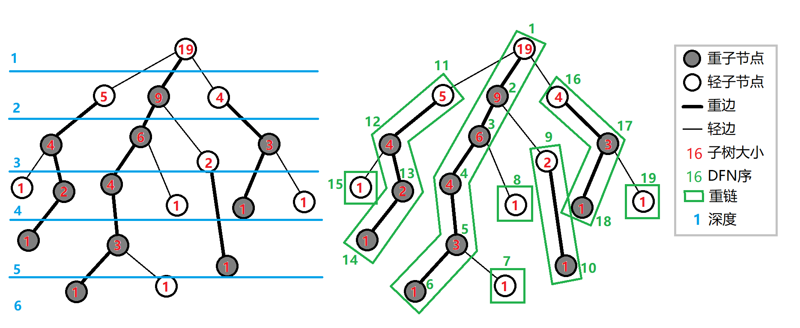

长链剖分一个重要性质：从一个节点到根节点最多经过 $O(\sqrt{n})$ 条轻边。

证明：假设当前节点到该子树内深度最大的节点的距离为 $k$，则每经过一条轻边都会使子树大小至少 $+k$（因为重儿子至少要有 $k$ 个节点），使得到该子树内深度最大的节点的距离 $+1$（经过一条轻边），也就是 $k \gets k + 1$，那么到根节点的时候这个距离至多为 $n-1$，也就是 $1+1+2+3+\cdots=n-1$，则至多有 $O(\sqrt{n})$ 个，证毕。

### [P5903 【模板】树上 K 级祖先](https://www.luogu.com.cn/problem/P5903)

给出一个大小为 $n$ 的树，$q$ 次询问某个节点的 $k$ 级祖先，**强制在线**。保证 $n\le 5\times 10^5,q\le 5\times 10^6$。

长链剖分模板题。~~既然是模板题肯定要长链剖分啊。~~

首先倍增求 $k$ 级祖先是显然的，时间复杂度 $O(n\log n+q\log n)$ 当然过不了。上文我们学习了重链剖分，可以使用重链剖分求 $k$ 级祖先，时间复杂度 $O(n+q\log n)$，查询是复杂度瓶颈也过不了~~其实不用卡卡也能过~~。我们需要 $O(1)$ 查询的算法。

对于一次查询，我们先往上跳 $t=2^{\lfloor\log_2 k\rfloor}$ 级祖先（这个 $t$ 相当于是 $k$ 在二进制下的最高位，即有 $t\le k\lt 2t$），这个可以倍增预处理做到 $O(1)$ 跳。此时我们会在一条长链上，我们考虑两件事情。

如果 $k$ 级祖先在当前位置到长链的顶部节点中间，这个时候我们可以预处理出每条长链顶部节点往下跳 $x$ 次能跳到的地方，因为边的总数为 $O(n)$ 的，所以这个预处理为 $O(n)$，然后稍微计算一下就可以 $O(1)$ 求出来了。

如果 $k$ 级祖先在长链的顶部节点到根节点的位置，则它到长链顶部节点的距离不超过长链的大小（长链大小一定 $\ge t$，因为从下面向上跳了 $t$ 次父亲，而又有 $k \lt 2t$，则再次向上跳的距离不超过 $t$），所以我们预处理出每个节点向上跳 $x$ 次的父亲是谁就可以了（$x\le$ 其链长），这一部分预处理也为 $O(n)$，这样这一部分也 $O(1)$ 求出来了。

总复杂度 $O(n\log n+q)$。

### [CF1009F Dominant Indices](https://www.luogu.com.cn/problem/CF1009F)（未写完）

Codeforces 链接：[F. Dominant Indices](https://codeforces.com/problemset/problem/1009/F)。

给定一颗大小为 $n$ 的树，求每个节点为根的子树的所有节点到它的距离的众数，如有多个输出最小的。保证 $2\le n\le 10^6$。


### 树上启发式合并（DSU on tree）

[Ein_Niemand](https://www.luogu.com.cn/user/122407)的洛谷日报：[dsu on tree学习笔记 - 洛谷专栏](https://www.luogu.com.cn/article/6028aw8w)。

OI-WiKi：[树上启发式合并 - OI Wiki](https://oi-wiki.org/graph/dsu-on-tree/)。

DSU on tree 可以通过 预处理或者离线解决一类不带修改的子树信息统计查询或路径信息统计查询问题，常规做法可能需要大数据结构或者树分治，拥有优秀的时间复杂度和常数。

算法实现。

1. 树链剖分。
2. 假设现在正在求解节点 $u$，先求解 $u$ 的轻儿子，求解结束后**不保留**轻儿子的贡献。
3. 求解 $u$ 的重儿子，求解结束后**保留**重儿子的贡献。
4. 统计节点 $u$ 的答案（再统计一遍轻儿子的贡献，和保留的贡献合并）。
5. 若当前节点 $u$ 为轻儿子，则清除当前节点的贡献（相当于为父节点清除）。

> 那么这里有人可能就要问了，为什么不保留求出的所有答案呢？这样复杂度就更优了啊？

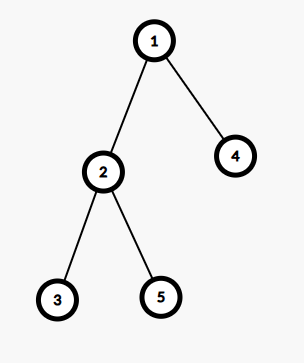

如上图所示，如果我们先求解节点 $4$，求解完成之后不清空，那么在求解节点 $2$ 时贡献就会串了。由于重儿子是最后才进行求解的，所以保留重儿子的贡献并不会和求解其他子树时的贡献串在一起，对于每个节点都如此就不会错啦。

时间复杂度分析。

考虑每个节点被统计的次数。

>  对于树链剖分，有个经典的结论：一个节点到根的路径上最多只会经过 $O(\log n)$ 条轻链。
>
> 证明：每次经过一条轻链都会使子树大小减半，最多减小 $\log n$ 次，得证。

对于一个节点 $u$，若 $v$ 的轻儿子 $w$ 是 $u$ 的祖先，则在 $v$ 节点 $u$ 会被额外暴力统计一次，根据链剖分原理，如果暴力统计一次的复杂度为 $O(1)$，则 DSU on tree 的复杂度为 $O(n\log n)$。

### [U41492 树上数颜色（模板）](https://www.luogu.com.cn/problem/U41492)

一颗 $n$ 个节点的树，每个节点上有一种颜色 $c_i$，$m$ 次询问，每次询问查询节点 $x$ 中不同颜色的数量。

###### 常见树上 trick：子树的 dfs 序连续

先进行 dfs 求出 dfs 序，对于这个数颜色问题显然可以离线之后莫队（甚至不用上树直接在 dfs 序里面求解即可）或者离线树状数组（参见 [P1972 SDOI2009\] HH 的项链](https://www.luogu.com.cn/problem/P1972)），或者使用在线方法（如可持久化线段树）进行求解。有没有更简单的方法呢？

###### DSU on tree

考虑维护一个桶 $cnt$，表示当前遇到的颜色和次数。

计算节点的贡献时令 $cnt_{c_i} \gets cnt_{c_i}+1$，消除贡献时 $cnt_{c_i} \gets cnt_{c_i}-1$，维护一下答案即可。

``` cpp
#include <cstdio>
#include <iostream>
#include <algorithm>
#include <vector>
using namespace std;
typedef long long LL;
const int MAX_N = 1e5+7;
int n, m, c[MAX_N], cnt[MAX_N], now_ans, ans[MAX_N];
vector<int> e[MAX_N];
int siz[MAX_N], fa[MAX_N], hson[MAX_N];
// 树链剖分
void dfs_tree (int u, int fat) {
	fa[u] = fat;
	siz[u] = 1;
	hson[u] = 0;
	for(auto v : e[u]) {
		if(v == fat) continue;
		dfs_tree(v, u);
		if(hson[u] == 0 || siz[v] > siz[hson[u]]) hson[u] = v;
	}
}
// 计算贡献或消除贡献
void effect (int u,int dont, int val) {
	if(val > 0) {
		if(!cnt[c[u]]) ++ now_ans;
		cnt[c[u]] += val;
	}
	else {
		if(cnt[c[u]] + val == 0) -- now_ans;
		cnt[c[u]] += val;
	}
	for(auto v : e[u]) {
        // 特判一下是不是 u 的重儿子，是就跳过（已经保留了）
		if(v == fa[u] || v == dont) continue;
		effect(v, dont, val);
	}
}
// 求解节点（keep表示是否是重儿子/是否保留）
void dfs (int u, bool keep) {
	for(auto v : e[u]) {
		if(v == fa[u] || v == hson[u]) continue;
		dfs(v, 0); // 不是重儿子
	}
	if(hson[u] > 0) dfs(hson[u], 1); // 是重儿子
	effect(u, hson[u], 1); // 统计当前节点的贡献（不走重儿子）
	ans[u] = now_ans;
	if(!keep) effect(u, 0, -1); // 不保留就清除
}
int main () {
	ios::sync_with_stdio(false);
	cin.tie(nullptr), cout.tie(nullptr);
	cin >> n;
	for(int i = 1; i <= n-1; i ++) {
		int u, v;
		cin >> u >> v;
		e[u].push_back(v);
		e[v].push_back(u);
	}
	for(int i = 1; i <= n; i ++) {
		cin >> c[i];
	}
	dfs_tree(1, 0);
	dfs(1, 0);
	cin >> m;
	for(int i = 1; i <= m; i ++) {
		int x;
		cin >> x;
		cout << ans[x] << "\n";
	} 
    return 0;
}
```


### [P7118 Galgame](https://www.luogu.com.cn/problem/P7118)（待完成）

## 图论

### [P4366 Code+#4 最短路](https://www.luogu.com.cn/problem/P4366)

给出一个 $n$ 个点和 $m$ 条边的带权有向边，除此之外对于两个点 $i$ 和 $j$，可以花费 $(i \operatorname{xor} j)\times C$ 的代价从 $i$ 前往 $j$，其中 $C$ 是一个给定的常数，问从 $A$ 到 $B$ 的最少代价。保证 $1\ le n\le 10^5,1\le m\le 5\times 10^5$。

直接连边的边数是 $O(n^2+m)$ 的，但是其中有一些边是不必要的，例如 $(1100)_2 \to (0101)_2$ 这两个点的边的代价为 $9C$，可以拆成 $(1100)_2 \to (0100)_2$ 和 $(0100)_2 \to (0101)_2$ 这两条边，也就是说我们只需要保留二进制位上仅差 $1$ 个二进制位的数的连边即可。

### [P1668 USACO04DEC Cleaning Shifts S](https://www.luogu.com.cn/problem/P1668)

本题的 $O(n+T)$ 的做法值得思考。

给出 $n$ 个线段 $[l_i,r_i]$，你需要用最少的线段铺满 $[1,T]$，求最少需要的线段个数。保证 $n \le 2.5\times 10^4,1\le T\le 10^6$。

朴素排序 $O(n\log n)$ 的做法是比较容易的，这里就不提的，提一个 $O(n+T)$ 的图论做法。

本题可以看作：从 $0$ 号结点出发，到达 $T$ 号结点的最小代价问题，容易发现和上面的问题等价。接下来考虑如何连边，最朴素的连边方式是对于每一条线段，连 $l_i-1\to x,l_i\le x\le r_i$ 边权为 $1$ 的边，但是这样是 $O(nT)$ 的（也可以用线段树优化建图，但是更复杂了），我们发现本质上是对一个区间进行整体连边，我们可以简化为 $l_i-1\to r_i$ 连边权为 $0$ 的边，然后对于 $1\le i\le n$ 都连一条 $i\to i-1$ 边权为 $0$ 的边，这样做就可以相当于往 $[l_i,r_i]$ 连边了，实际上是 $l_i-1\to x,0\le x\le r_i$ 连边，但是由于已经能到达 $l_i-1$ 了说明前面 $[1,l_i-1]$ 一定也能到达，所以这样也无妨，最后跑一个 01bfs 即可。

### [P1841 JSOI2007 重要的城市](https://www.luogu.com.cn/problem/P1841)

给出一张 $n$ 个点 $m$ 条边的带权无向图，定义一个结点 $c$ 是关键的，当且仅当存在两个**不同于 $c$ **的城市 $a$ 和 $b$，使得去掉结点 $c$ 后 $a$ 到 $b$ 的最短路变长，求所有的结点 $c$。保证 $n\le 200,m\le \frac{n\times(n-1)}{2}$。

首先可以先跑一遍 Floyed 求出两两之间的最短路，记为 $d(i,j)$。考虑建出最短路图，枚举一个点 $s$ 建最短路图，对于一条边权为 $w$ 的边 $(u,v)$，若 $d(s,u)=d(s,v)+w$ 则加入**有向边** $(v,u)$，反之同理。其中一条 $s\to x$ 的路径表示一条 $s\to x$ 的最短路，那么现在就需要知道随意去掉此最短图上的一个点（除 $s$ 外）和其所连的边会不会改变 $s$ 到其他点的连通性。首先原本 $s$ 无法到达的点不用管，它们不会影响答案。考虑如果一个结点的入度为 $1$，那么去掉它的入度结点（前提是不为 $s$）一定会使得其无法到达，直接把他加入答案就行了。

### Kruskal 重构树

[ImmortalWatcher](https://www.luogu.com.cn/user/157857)：[Kruskal 重构树——洛谷专栏](https://www.luogu.com.cn/article/jsyjaruc)。

> 顾名思义，Kruskal 重构树就是基于 Kruskal 的最小生成树算法在无向图中得出的树所构造而成的树。——ImmortalWatcher。

考虑从小到大构建一颗 Kruskal 重构树的过程，假设原图为 $G$，大小为 $n$，原图的最小生成树为 $G'$，从小到大排序 $G'$ 中的边，对于一条边 $(u,v,w)$，我们新建一个虚拟结点，权值为 $w$，作为一颗新的树的根节点，其左右儿子分别为 $u$ 和 $v$ 所在树的根结点，不难发现，当合并完 $G'$ 中的 $n-1$ 条边后会形成一颗新树，大小为 $2n-1$ 条边，这一棵新树称为 Kruskal 重构树。实际上构建这一棵 Kruskal 重构树可以不用显示建出最小生成树，只需要仿照最小生成树的方式在原图上构建即可。

这是原图 $G$。

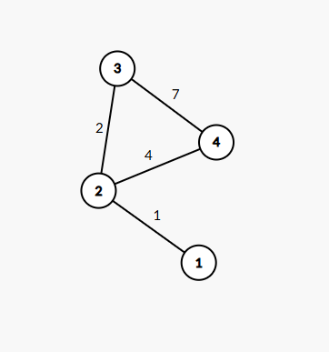

现在从小到大合并最短的一条边 $(1,2,1)$，新建一个点权为 $1$ 的结点记为 $A$。

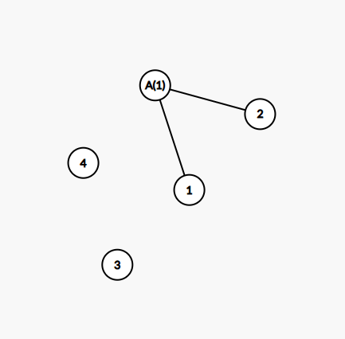

再合并 $(2,3,2)$。

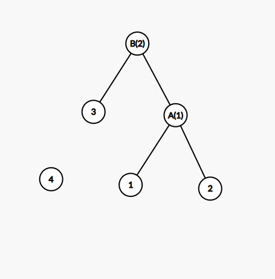

再合并 $(2,4,4)$。

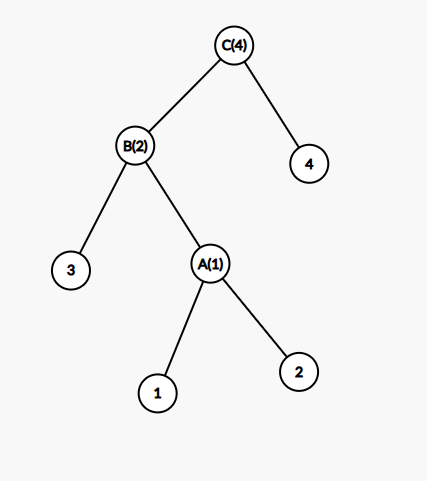

这样就构建好了。

从小到大构建的 Kruskal 重构树的性质：
1. 这是一棵完满二叉树，且所有非叶子节点都是虚点，所有叶子节点都是原图中的结点。
2. 这是一个大根堆（如果从大到小构建则是小根堆）。
3. 两个叶子结点的 $\operatorname{lca}$ 的权值是原图 $G$ 中这两点之间的简单路径的最大边权的最小值（从大到小建树则为最小边权的最大值），这是一个很重要的性质。

### [P4768 NOI2018 归程](https://www.luogu.com.cn/problem/P4768)

给出一个 $n$ 个结点 $m$ 条边的无向图（保证两两之间连通），每一条边有两个参数 $l$ 和 $a$ 分别表示长度和海拔。有 $Q$ 次询问，每次给出两个参数 $v$ 和 $p$，表示你拥有一辆车，从 $v$ 结点出发，车辆可以经过海拔**严格高于** $p$ 的边，如果你需要经过海拔低于 $p$ 的边，你只能弃车逃离了（并且接下来你都只能步行），求从 $v$ 到 $1$ 结点的最少步行距离。**强制在线**，保证 $n\le 2\times 10^5,m,q\le 4\times 10^5$。

本题正解之一应该是 kruskal 重构树，这里提供一种其他的（歪门邪道）思路。

首先考虑树的情况，我们可以想到一种做法：以 $1$ 结点为根树剖，从 $v$ 开始往上跳，跳到一个 $\le p$ 的结点就停下，这个离散化后用可持久化线段树容易做到，时间复杂度 $O(n\log^2 n)$。

如何推广到图上呢？我们想到[P1967 NOIP2013提高组 货车运输](https://www.luogu.com.cn/problem/P1967)这一题，对于一个环去掉一个一定没有贡献的边，之后就形成了一棵树。我们能不能仿照这一题的思路呢？考虑对于一个环，去掉一条海拔 $a$ 最小的一条边，我们发现这样本质上就是对原图以海拔为关键字求出一个最大生成树，我们记原图为 $G$，原图以海拔为关键字的最大生成树为 $G'$。在 $G'$ 中对于一个 $p$，一个点乘车能到达的所有点和 $G$ 中是一致的！那现在我们就只用考虑最短路的问题了，考虑在图 $G$ 中以 $1$ 为源点跑一遍最短路，记 $d_x$ 为 $x$ 到 $1$（或 $1$ 到 $x$）的最短路径长度，则在积水高度 $p$ 的情况下，$v$ 到 $1$ 的最短路就是点 $v$ 在图 $G'$ 中所有可以乘车前往的点的 $d_x$ 的最小值（相当于 $v$ 所在连通块的 $d_x$ 的最小值，这里的连通块是指车子可以到达的所有点），根据树上的做法，我们很容易求出 $v$ 向父亲跳的 $d_x$ 的最小值，那 $v$ 子树下的结点怎么统计呢？貌似没有特别好的方法，尝试一下按照 $a$ 的顺序倒序往 $G'$ 中加入边，由于我们会向上跳的特性，可以把子树中 $d_x$ 的最小值挂到当前连通块的根上，每次加入一条边时，就把两个连通块的根的最小值合并，并且挂到比较靠上的根上面去（也就是新连通块的根上），这个用一个路径压缩并查集维护一下根，然后用可持久化线段树维护每一个水位高度时每一个结点挂着的 $d_x$ 的最小值，这样向上跳的时候就能一并求出它的子树中 $d_x$ 的最小值啦。时间复杂度 $O(n\log^2 n)$，超级大常数（但是实际上瓶颈只在于往上跳的过程），我写了 $500$ 多行有 $8\text{kb}$，大家应该不会想看吧，~~成功跑进最优解最后一页~~。

接下来介绍 Kruskal 重构树做法。如果可以离线，我们可以按照询问的 $p$ 从大到小排序，最开始图中没有边，之后对于 $\gt p$ 的边动态加入到图中，之后动态维护每个连通块的 $d_x$ 的最小值就行了，我们发现这个动态维护也可以看作动态的最大生成树，在建树的过程中维护信息。但是题目不能离线怎么办呢？我们考虑从大到小建出一颗 Kruskal 重构树，根据 Kruskal 重构树的性质可以知道，$v$ 在只经过海拔 $\gt p$ 的边能到达的所有点就等价于 $v$ 的最后一个点权 $\gt p$ 的祖先为根的子树中的所有叶子结点（这句话有点绕，可以结合图看一下），那么我们维护一下 Kruskal 重构树中的每一个子树的 $d_x$ 的最小值，并且把它挂在它的根上，这个用 dfs 可以 $O(n)$ 实现，查询的时候往上跳找到这一个结点就行啦，时间复杂度 $O(n\log n)$。

### 2-SAT

[OIWiKi：2-SAT](https://oi-wiki.org/graph/2-sat/)。

> SAT 是适定性（Satisfiability）问题的简称。一般形式为 k - 适定性问题，简称 k-SAT。当 $k \gt 2$ 时此问题是  NP 完全的，所以我们只研究 $k=2$ 的情况。—— OIWiKi。

2-SAT 问题通常是给出 $n$ 个布尔变量，并且有若干个限制条件形如 $(\lnot)a\lor (\lnot)b$ 的形式，也就是 $a$ 变量为真（假）或 $b$ 变量为真（假），组成的一个布尔方程。

对于 $a\lor b$，我们连 $\lnot a\to b$ 和 $\lnot b\to a$ 的边，表示如果 $a$ 不满足则 $b$ 必须满足，$b$ 不满足则 $a$ 必须满足。

对于这样连边构成的图 $G$，应有 $2n$ 个结点，我们在图 $G$ 上缩点，得到一个有向无环图记为 $G'$。

> 推论 1. 如果存在一个变量 $x$，$x$ 和 $\lnot x$ 均处于同一个强连通分量中，则原布尔方程无解。

由图 $G$ 的定义知，在一个强连通分量中，里面所有变量要么全部满足，要么全部不满足，而 $x$ 和 $\lnot x$ 不可能同时满足或者同时不满足。

> 推论 2. 若布尔方程有解，则对于每一个变量，取其对应的强连通分量在图 $G‘$ 中对应拓扑序较大的那一个，一定能构造出一种合法的解。

先考虑如下引理。

> 引理 1. 如果存在图 $G$ 上的一条单向边 $(u,v)$，则必定存在一条 $(\lnot v,\lnot u)$。

如果 $u$ 满足，则 $v$ 必定满足，那么就说明 $u \Rightarrow v$，根据高中所学知识可以知道 $\lnot v\Rightarrow \lnot u$，故存在 $(\lnot v,\lnot u)$。

> 引理 2. 若图 $G$ 中存在一条单向路径 $p(u,v)$，则必定存在一条单向路径 $p'(\lnot v,\lnot u)$。

对路径 $p$ 上的每一条边运用引理 1. 即可得到。

现在考虑推论 2.。我们不妨假设 $f(u)$ 为 $u$ 所在强连通分量在 $G'$ 上的拓扑序。

考虑反证法，假设存在 $f(u) \gt f(\lnot u),f(\lnot v) \gt f(v)$ 且存在单向路径 $p(u, v)$，则可以知道 $f(u)\lt f(v)$。

则根据引理 2. 可知同样也存在单向路径 $p'(\lnot v,\lnot u)$，则有 $f(\lnot v)\lt f(\lnot u)$，联立上述四个式子可得到 $f(u)\lt f(\lnot u),f(v)\lt f(\lnot v)$ 这与假设相矛盾，故假设不成立，也就是说我们选择拓扑序较大的变量并不能推出选择其他拓扑序较小的变量，说明全选拓扑序较大的变量一定可以作为一组解。

实际上，在用 tarjan 求解强连通分量时的强连通分量编号可以看作是**反拓扑序**，可以选取所在强连通编号较小的作为解。

### [P4782 【模板】2-SAT](https://www.luogu.com.cn/problem/P4782)

根据上述过程求解 2-SAT 的时间复杂度为 $O(n)$。

## 动态规划

### [P9669 [ICPC 2022 Jinan R] DFS Order 2 - 洛谷](https://www.luogu.com.cn/problem/P9669)


### [2026 省选模拟赛 Day 3 #A. 直方图](https://newoj.daimayuan.top/p/P4485?tid=694912d3d27d9bf7b2533eb9)

笛卡尔树上 dp 好题。

前置知识：[笛卡尔树](https://oi-wiki.org/ds/cartesian-tree/)。

给出 $n$ 个高为 $h_i$ 的宽为 $1$ 的连续排列的矩形（类似于直方图的感觉），**保证 $h_i$ 为随机生成**。从直方图中至多选出 $k$ 个不重叠的矩形，这些矩形被直方图所包含且下底边平行于底面，使得这些矩形的面积之和最大，这个值记为 $f(k)$。

现在你要求出 $f(1) \sim f(n)$，多测，保证 $n \le 1000,\sum n^2 \le 10^7$。

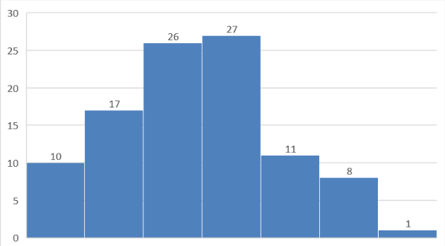

类似于这样。首先我们可以得到一个比较显然的观察，如果选择的一个矩形的宽的范围为 $[l,r]$，则高度一定是 $\min(h_l,h_{l+1},h_{l+2},\cdots,h_r)$。由此我们可以把选择区间的问题转换为选择点的问题，用单调栈求出每个点向左向右第一个比它小的位置，则可以产生的矩形的面积为 $S = h_k\times (r_k-l_k-1)$，其中 $l_k$ 和 $r_k$ 分别为向左和向右第一个比它小的数的位置。但是这样有个问题，可能面积计算会有重叠，不能使用贪心法进行求解，需要排除重叠部分的影响。

再继续观察一下有什么性质，我们发现如果从小到大选择了第 $k$ 个数为最小点，那么之后的选择就分割成了左右两个区域，因为此后的矩形都不会跨过第 $k$ 个数。

###### 笛卡尔树上动态规划

如果一次操作可以分割序列，且分割完成后的序列与分割点都存在某种大小关系，则可以考虑笛卡尔树上 dp。

这里建立的笛卡尔树中序遍历为序列 $1 \sim n$，键值 $h_i$ 按小根堆建树。

设 $dp[i][j][k]$ 表示当前以 $i$ 为根，且至多划分 $j$ 个矩形，在这矩形下已经划分的矩形的高为 $k$，容易发现 $k$ 只能是 $0$ 或 $h_1 \sim h_n$，离散化一下可以做到即可。状态转移如下，记 $s_i$ 为第 $i$ 个点的子树大小，$ls_i$ 和 $rs_i$ 分别为其左右儿子。 

若不选第 $i$ 个数，则

$$
\Large{
dp[i][a+b][k] \overset{\max}{\leftarrow} dp[ls_i][a][k] + dp[rs_i][b][k]
}
$$

若选第 $i$ 个数，则

$$
\Large{
dp[i][a+b+1][k] \overset{\max}{\leftarrow} dp[ls_i][a][h_i] + dp[rs_i][b][h_i] + (h_i - k)\times s_i
}
$$

然后发现炸空间了，注意到每个点的 dp 值只依赖它的儿子，而最终答案只依赖根的值，所以第一维就可以压掉啦。注意到 $h_i$ 是随机生成的，所以树高期望是 $O(\log n)$ 的，且每个点的 $k$ 值只可能是其祖先的 $h$ 值，故 $k$ 只有期望 $\log n$ 个，然后转移第二维的时间复杂度是 $\sum s_i^2 = O(n^2)$，具体不会证，看网上大佬说只要上下界都卡满就是 $O(n^2)$。最后时空复杂度 $O(n^2\log n)$。

### [P6622 省选联考2020A/B卷 信号传递](https://www.luogu.com.cn/problem/P6622)（未写完）

给出三个数 $n,m,k$，然后给出一个长度为 $n$ 的序列 $S$，其中 $1\le S_i\le m$，你可以构造一个 $1\sim m$ 的排列 $p_i$，并令 $S_i \gets p_{S_i},i\in [1,n]$，注意你只能构造一个排列 $p$。然后对于 $2\le i\le n$，若 $S_{i-1} \le S_i$，则产生 $S_i-S_{i-1}$ 的贡献，否则产生 $k\times (S_i+S_{i-1})$ 的贡献，求贡献和的最小值。保证 $n\le 10^5,m\le 23,k\le 100$。

考虑每一个数能产生的贡献。

### [P5985 PA 2019 Muzyka pop](https://www.luogu.com.cn/problem/P5985)

定义 $\operatorname{popcount}(x)$ 为 $x$ 在二进制表示下 $1$ 的个数，现在给定一个长度为 $n$ 整数序列 $a_i$，构造一个非负整数序列 $b_i$，满足 $0\le b_1\lt b_2\lt\cdots\lt b_n\le m$，且使得 $\sum_{i=1}^{n}\operatorname{popcount}(b_i)\times a_i$ 最大，求出它的最大值。保证 $n\le 200,n-1\le m\le 10^{18},|a_i|\le 10^{14}$。

考虑在[字典树（Trie）](https://oi-wiki.org/string/trie/)上进行处理，设 $f[u][l][r]$ 为当前以 $u$ 为根，且处理下标在 $[l,r]$ 的答案，那么往字典树的右儿子跳会经过 $1$，此时所有跳过去的 $b_i$ 都要 $+1$，也就是说要加上跳过去的所有 $a_i$ 的和，可以得出状态转移 $f[u][l][r] = \max_{k=l}^{r-1} (f[ls][l][k]+f[rs][k+1][r]+s_r-s_k)$，其中 $s_k$ 表示 $\sum_{i=1}^{k} a_i$，这样做的复杂度是 $O(mn^3)$。

稍微观察一下转移的状态，可以发现如果当前所在子树的结点个数是满的，也就是满的二叉树，那么这两个转移的状态实质上没有任何区别。如果是不满的，那么有两种情况：一是只能往左儿子跳，这种情况下没啥好说的，只能往那里跳；二是可以往左儿子跳也能往右儿子跳，那么往左儿子跳之后以其为根的子树是一颗满结点的子树，可以沿用之前的分析，往右儿子跳还是不满的。

这样我们设 $g[i][l][r][0/1]$ 表示当前在 Trie 树的第 $i$ 层，处理的下标区间是 $[l,r]$，并且以当前结点为根的子树是否是满的二叉树。根据上面的分析可以得到转移 $g[i][l][r][0] = \max_{k=l}^{r-1}(g[i-1][l][k][0]+g[i-1][k+1][r][1]+s_r-s_k)$，对于不满的根结点先处理出是否只能往左儿子跳，如果左儿子右儿子都能跳则有转移 $g[i][l][r][1] = \max_{k=l}^{r-1}(g[i-1][l][k][0]+g[i-1][k+1][r][1]+s_r-s_k)$。上面的两个转移都需要特判一下全走左子树或者右子树的情形，边界条件为 $g[0][i][i][0] = g[0][i][i][1] = 0$，时间复杂度 $O(n^3\log m)$。

###  [P13795 SWERC 2023 Flag performance](https://www.luogu.com.cn/problem/P13795)

给定一个整数 $n$ 和数据组数 $T$，每组数据给出一个大小为 $n$ 的排列 $p$ 和一个整数 $k$，每次操作可以交换 $p$ 任意两个不同的数，求进行**恰好** $k$ 次操作后使得此排列变成单位排列（即 $p_i=i$）的操作序列的数量，对 $10^9+7$ 取模，保证 $n \le 30,T \le 10000,k\le 1000$。

考虑一个最暴力的做法，记录每一种排列的状态 $S$，然后记忆化搜索或者动态规划求出方案数即可，状态总数 $O(n!k)$，总时间复杂度 $O(n!kn^2+Tn)$，可以通过 $n \le 5$ 的测试点（赛时脑抽没打出来）。

考虑把序列放到图上，若 $p_i=j$ 则有一条 $i$ 指向 $j$ 的一条有向边，则会形成若干个有向环。**交换序列中的两个数等价于交换它们在图上的出边**。最后要求的就是要有 $n$ 个自环，即为单位排列。

若交换的两个数在同一个环上，则此时这个环会断裂成两个环。若交换的两个数不在同一环上，则此时会合并两个环。且有一个非常好的性质，这些环的大小之和为 $n$，且我们不需要考虑具体的排列，只需要考虑环的大小分布情况，因为相同大小的环的方案数一定一样。

我们用 $f_{S,i}$ 表示当前状态为 $S$，且已经走了 $i$ 步的方案数。记 $cnt_i$ 表示大小为 $i$ 的环的个数。

- 若合并了两个大小分别为 $x$ 和 $y$ 的环，且 $x \ne y$，则会合并出一个大小为 $x+y$ 的环，选出两个环合并，合并时每个环选出一个位置交换合并，则可能的方法有 $cnt_x\times cnt_y\times x\times y$ 种。
- 若合并了两个大小均为 $x$ 的环，则会合并出 $2x$ 的一个环，此时方法有 $\frac{cnt_x(cnt_x-1)}{2}\times x^2$ 种。
- 若分裂了一个大小为 $x+y$ 的环成 $x$ 和 $y$ 的环，且 $x \ne y$，则可能的方法有 $cnt_{x+y}\times (x+y)$ 种。
- 若分裂了一个大小为 $2x$ 的环成两个大小为 $x$ 的环，则可能的方法有 $cnt_{2x}\times x$ 种。

转移就考虑完了，接下来考虑如何设计状态，如果直接记录每个环的大小总的方案数为 $O(n^nk)$ 比暴力还要劣。

###### 整数分拆的状态设计 trick

可以用二进制表示整数分拆优化状态到 $O(2^nk)$，具体而言 $a_k$ 在二进制表示中前面应该有 $a_k-1$ 个 $0$。比如说 $1+1+3+4+6=15$ 可表示为 $(1001010011)_2$，有 $2$ 个二进制位为 $1$ 的前面有 $0$ 个 $0$，有 $1$ 一个二进制位为 $1$ 的前面有 $2$ 个 $0$，有 $1$ 一个二进制位为 $1$ 的前面有 $3$ 个 $0$，有 $1$ 一个二进制位为 $1$ 的前面有 $5$ 个 $0$。这样极端情况就是全是 $1$ 或者只有一个 $n$，最坏状态数为 $O(2^n)$ 个，再加上有 $k$ 步总状态数就有 $O(2^nk)$。

然后打表可以发现总的状态数只有 $5600$ 个左右，用 map 转移即可，时间复杂度 $O(Skn^3+Tn)$，预处理转移可以做到 $O(Skn^2+Tn)$。

### 排列计数的动态规划

一些计数问题也放在了下面的[计数题杂题](##计数题杂题)中。

[wjyppm1403](https://www.luogu.com.cn/user/578829)：[浅谈排列DP计数](https://www.luogu.com.cn/article/xt2szowt)。

一般方法：

1. 若统计的排列和相对大小关系有关，可以记录前缀/后缀相对大小关系进行转移。

### [P14568 【MX-S12-T3】排列](https://www.luogu.com.cn/problem/P14568)（待完成）

### [P14364 CSP-S 2025 员工招聘](https://www.luogu.com.cn/problem/P14364)

[_Ad_Astra_](https://www.luogu.com.cn/user/317622)：[题解](https://www.luogu.com.cn/article/e5jzfdyn)。

正赛题。赛时 $\color{red}{\text{12 pts}}$，还得加油啊。

给出 $n$ 个面试者和一个目标录用人数 $m$，有 $n$ 天的面试，第 $i$ 天的面试难度为 $s_i \in \{0,1\}$，如果 $s_i = 0$ 意为着当天试题极难，来面试的面试者都不能通过面试，如果 $s_i = 1$ 意为着当天试题级简单，来面试的面试者都可以通过面试。每个面试者还有一个耐心值 $c_i(0 \le c_i \le n)$，若第 $x$ 天的面试者的耐心值为 $c_x$ 且 $[1,x-1]$ 天有至少 $c_x$ 名面试者没有通过面试或放弃面试，则第 $x$ 天的面试者也会放弃面试。求有多少种面试者面试顺序的排列，使得面试通过的人数 $\ge m$，输出对 $998244353$ 取模后的结果。


考虑动态规划。一个朴素的状态设计是 $dp(i,j)$ 表示当前考虑了前 $i$ 个数，且当前已经寄了（跑路了）$j$ 个人的方案数。考虑这个方程的转移发现非常不好转移，你不知道你要填的数有没有用过，考场上这么转移死完了（是我啦）。

###### 一个计数 trick：贡献延后计算

我们不在转移的那个时候直接计算转移到的数的贡献，而是在后面的某一个“有用”地方统一计算贡献（这样做有什么好处呢？）。

考虑 $f(i,j,k)$ 表示当前考虑到第 $i$ 个位置，已经有 $j$ 个人寄了，且有 $k$ 个已经面试过人的 $c_x \gt j$。我们让只有当 $c_x = j$ 的时候才对 $x$ 面试者进行转移，每次 $j$ 改变时都进行转移。

第一种情况，第 $i+1$ 天的面试者通过面试，则必须 $s_{i+1}=1$ 且 $c_x \gt j$，因为我们钦定了一个人 $c_x \gt j$ 在第 $i+1$ 天面试，故此时 $k$ 要 $+1$，此时有转移：

$$
\Large{
f(i,j,k) \overset{+}{\rightarrow} f(i+1,j,k+1)
}
$$

第二种情况，第 $i+1$ 天的面试者来了但是没有通过面试，则必须有 $s_{i+1}=0$ 且 $c_x \gt j$，此时 $j$ 要 $+1$，因为我们钦定了一个人 $c_x \gt j$ 在第 $i+1$ 天面试所以 $k$ 也要 $+1$，这个时候我们清算一下 $c_x=j+1$ 的贡献，记 $cnt_j$ 表示 $c_x=j$ 的数量，枚举一个 $l$ 表示前 $i+1$ 天有 $l$ 天的面试者 $c_x=j+1$,这 $l$ 天一定出现在了钦定的这 $k+1$ 天之中，则有方案为 $\binom{k+1}{l}$，又因为一共有 $cnt_{j+1}$ 个 $c_x=j+1$ 的面试者，所以面试者有 $\binom{cnt_{j+1}}{l}\times l!$ 可能的排列，此时有转移：

$$
\Large{
f(i,j,k)\times \binom{k+1}{l}\times \binom{cnt_{j+1}}{l}\times l! \overset{+}{\rightarrow} f(i+1,j+1,k+1-l)
}
$$

第三种情况，第 $i+1$ 天的面试者直接跑路了（放弃了面试），则有 $c_x \le j$，此时 $j$ 要 $+1$，除了上面的转移以外，我们只延后转移来面试的人的贡献，没有来面试的贡献直接进行转移。记 $pre_j$ 为 $c_x \le j$ 的数量，由于第 $i$ 天前有 $k$ 个面试者 $c_x \gt j$，则有 $i-k$ 个面试者 $c_x \le j$，则我们需要在 $pre_j-i+k$ 个人中再选一个出来作为第 $i+1$ 天的面试者，此时有转移：

$$
\Large{
f(i,j,k)\times (pre_j-i+k)\times \binom{k}{l}\times \binom{cnt_{j+1}}{l}\times l! \overset{+}{\rightarrow} f(i+1,j+1,k-l)
}
$$

至此转移就完成了。统计答案就直接枚举有多少个人寄了就行。因为此时还有 $k$ 个位置的元素还没有确定，由于这些数 $c_x \gt j$ 所以他们在排列中的位置可以互相互换也不影响，故最后还需要乘上一个 $(n-pre_i)!$。

$$
\Large{
\sum_{i=0}^{n-m}f(n,i,n-pre_i)\times (n-pre_i)!
}
$$

~~真恶心~~。由于 $\sum cnt_j \le n$，所以枚举 $j$ 和 $l$ 的总时间复杂度不超过 $O(n)$，故总时间复杂度为 $O(n^3)$。

### [AtCoder DP Contest T Permutation](https://atcoder.jp/contests/dp/tasks/dp_t) 

排列计数 dp 的题。

给出一个长度为 $n-1$ 的字符串 $s$，其中仅包含 `>` 和 `<` 两种字符，求满足以下条件的排列 $p$ 的数量（对 $10^9+7$ 取模）。

对于每个 $1 \le i \le n-1$，若 $s_i$ 为 `<` 则 $p_i \lt p_{i+1}$；若 $s_i$ 为 `>` 则 $p_i \gt p_{i+1}$。

###### 排列计数 trick：对于和相对大小关系有关的排列计数，可以用前缀/后缀相对大小进行设计状态比绝对大小更好。

如果设计 dp 状态为 $f(i,j)$ 表示当前考虑到第 $i$ 个数，当前填的数是 $j$ 的话就会发现不好进行下一步的转移了，不妨考虑相对大小关系。

我们设计状态为 $f(i,j)$ 表示当前考虑到第 $i$ 个数，当前填的数在前 $i$ 个数中的是第 $j$ 小的（有 $j-1$ 个数比它小）的方案数。

此时有 $f(1,1) = 1$。
$$
\Large{
f(i,j)=
\left\{\begin{matrix}
\sum_{k=j}^{k \le i-1} f(i-1,k) &,s_{i-1} = "<" \\ 
\sum_{k=1}^{k \lt j} f(i-1,k) &,s_{i-1} = ">"
\end{matrix}\right.}
$$
对转移的 $f$ 数组做一个前缀和即可做到 $O(n^2)$ 的复杂度。

### [AtCoder Beginner Contest G Similar Permutation](https://atcoder.jp/contests/abc282/tasks/abc282_g)

给出三个数 $N$，$K$ 和 $P$。定义两个序列 $A$ 和 $B$ 的相似度为满足 $1 \le i \le N-1,(A_i - A_{i+1})\times (B_i - B_{i+1}) \gt 0$ 的 $i$ 的数量，$A$ 和 $B$ 均为 $\{1,2,\cdots,N\}$ 的排列，求 $A,B$ 序列相似度**恰好**为 $K$ 的数量对 $P$ 取模后的结果。

和上面一样的套路，设 $dp(i,j,o_1,o_2)$ 表示当前枚举到第 $i$ 个数，相似度恰好是 $j$，第 $i$ 个数 $A_i$ 在 $\{A_1,A_2,\cdots,A_i\}$ 中是第 $o_1$ 小，$B_i$ 在 $\{B_1,B_2,\cdots,B_i\}$ 中是第 $o_2$ 小。然后用二维前缀和优化转移即可。

### [P14381 【MX-S9-T4】「LAOI-16」顽疾](https://www.luogu.com.cn/problem/P14381)（关底大 BOSS）（待完成）

### Slope Trick 优化

OI-Wiki：[Slope Trick 优化](https://oi-wiki.org/dp/opt/slope-trick/)。

rui_er 的博客：[Slope Trick 总结](https://www.cnblogs.com/ruierqwq/p/18017106/slope-trick)。

[NOI_Winner](https://www.luogu.com.cn/user/747900) 的洛谷专栏：[浅谈 Slope Trick：神奇的 DP 优化方法](https://www.luogu.com.cn/article/bn3a465i)。

[Lance ](https://www.zhihu.com/people/yu-long-shan-yls)的知乎：[保持凸函数性质的运算](https://zhuanlan.zhihu.com/p/348880379)。

###### 请注意这不是斜率优化。

> Slope Trick 通常用于维护具有如下性质的函数：
> - 二维函数且第二维连续。
> - 第二维是分段的一次函数。
> - 是凸函数或凹函数（上凸或下凸）。
> - 斜率的变化量较小，在 $O(n)$ 级别左右。

由于这个函数是下凸函数（或者上凸函数），此时斜率一定具有单调性，下文以下凸函数举例。

维护这个函数某一个段（一般是最左边或者最右边）一次函数的斜率 $k$ 和截距 $b$，以及每个斜率改变 $1$ 的分段点的可重集合（如果某个点的斜率变化量超过 $1$ 则加入这个点多次）。

假设现在有一个下凸函数。

$$
\Large{
f(x) = 
\left\{\begin{matrix} 
-x+4 &x \le -2 \\
-2 &-2 \lt x \le 3 \\
2x-3 &x \gt 3
\end{matrix}\right.}
$$

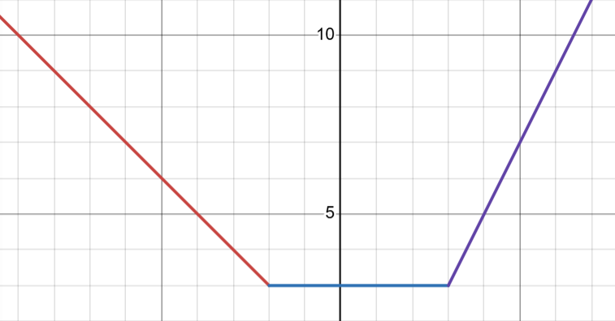

我们维护最右边的斜率 $k=2$，截距 $b=-3$，斜率分段点的可重集合 $\{-2,3,3\}$，因为在 $x_0=3$ 的地方斜率变化量为 $2$ 所以分段点的集合中有两个 $3$。

上述函数有几个常用的性质：

- 下凸函数和下凸函数相加仍是下凸函数，上凸函数同理。对于函数相加，直接把对于的 $k$ 和 $b$ 分别相加，斜率分段点的集合合并即可维护。
- 两个连续函数进行加、减、乘运算后仍然连续，除法运算当分母不为 $0$ 时仍然连续。
- 斜率每增加 $1$，则对于的截距减少 $x$，则对于对应分段点的截距可以通过维护分段点集合中的前缀和维护（这一部分通常使用数据结构，如平衡树或对顶堆维护）。相反，斜率每减少 $1$，截距就增加 $x$。**仅当函数连续时才使用，这也是 Slope Trick 优化的前提，但不等于函数不连续就不能用这个思想维护**。
- 对于下凸函数，每个点的斜率单调不降。对于斜率为 $0$ 处的截距即为该函数最小值。维护斜率等于 $0$ 的位置相当于维护一段大小为 $|k|$ 的连续段，$k$ 为最左边或最右边那一段的斜率。
- 对于下凸函数，如果取前缀 $\min$，即对于每个点 $x_0$ 变化为横坐标小于等于 $x_0$ 的最小值则相当于去掉所有斜率大于 $0$ 的位置的分段点。取后缀 $\min$ 同理。取前缀/后缀 $\min$ 后凸性不变。**注意更新 $k$ 和 $b$**。
- 对于函数的上下平移，改变截距 $b$ 即可。左右平移对分段点打上平移的 $tag$ 即可。
- 对于函数翻转同理打 $tag$。

### [P4597 序列 sequence（模板）](https://www.luogu.com.cn/problem/P4597)

Slope Trick 模板题。
给出一个长度为 $n$ 的序列 $a$，每次可以给一个数 $+1$ 或 $-1$，求使得 $a$ 序列不降的最小次数。

容易写出状态转移方程 $f(i,j)=\min_{k=-10^9}^{j}f(i-1,k)+|a_i-j|$，其中 $f(i,j)$ 表示当前考虑到第 $i$ 个数，当且这个数为 $j$ 的方案最小值。时间复杂度 $O(nV)$，其中 $V$ 为值域，考虑优化。

设 $g_i(x)=f(i,x)$。$g_1(x)=|a_i-x|$ 为下凸函数，假设 $g_i(x)$ 为下凸函数，则 $g_{i+1}(x)$ 可以看作是对 $g_i(x)$ 取前缀 $\min$ 后加上 $|a_{i+1}-x|$ 得到，这两个均是下凸，由数学归纳法，$g_i(x)$ 都为下凸函数。

根据上面的，$g_i(x)$ 可以由 $g_{i-1}(x)$ 取前缀 $\min$ 后加上 $|a_i-x|$ 得到。我们可以使用对顶堆维护分段点的集合，和**最右边**那一段的 $k$ 和 $b$。

具体的，维护一个大小为 $|k|$ 的小根堆（维护斜率大于等于 $k$ 的位置）和一个大根堆（维护斜率小于 $k$ 的位置）存分段点的下标，保证小根堆的堆顶（最小值）大于或等于大根堆的堆顶（最大值），然后加入一个点的时候直接加入小根堆，此时小根堆若有 $|k|+1$ 个元素，我们需要弹出小根堆的堆顶放到大根堆中，这样就可以保证最大的 $|k|$ 个数在小根堆中，此时小根堆的堆顶的元素就是斜率 $k=0$ 的位置。若改变 $|k|$ 的大小，把小根堆的元素弹入大根堆中或把大根堆的元素弹进小根堆即可。 

~~对顶堆真 tm 容易写假，服了~~。一定要注意对顶堆的小根堆扩容的时候要先维护，不然会假复杂度成 $O(n^2 \log n)$。这下对了。

``` cpp
#include <cstdio>
#include <queue>
#include <vector>
using namespace std;
typedef long long LL;
const int MAX_N = 5e5+5;
int n, a[MAX_N];
LL kk, bb;
priority_queue<int> qmax;
priority_queue<int, vector<int>, greater<int> > qmin;
void ins (int x) { // 往对顶堆中插数 
	if((int)qmin.size() < kk || x >= qmin.top()) {
		qmin.push(x);
		while((int)qmin.size() > kk) {
			qmax.push(qmin.top());
			qmin.pop();
		}
	}
	else qmax.push(x);
}
int main () {
	scanf("%d",&n);
	for(int i = 1; i <= n; i ++) {
		scanf("%d",&a[i]);
		while(!qmin.empty()) { // 前缀 min 
			-- kk;
			bb += qmin.top();
			qmin.pop();
		}
		++ kk; // 维护斜率 
		// 扩容小根堆的时候先维护小根堆 
		while(!qmax.empty() && (int)qmin.size() < kk) {
			qmin.push(qmax.top());
			qmax.pop();
		}
		bb -= a[i]; // 维护截距 
		ins(a[i]);
		ins(a[i]);
	}
	while(!qmin.empty()) {
		-- kk;
		bb += qmin.top();
		qmin.pop();
	}
	printf("%lld\n",bb);
	return 0;
}
```

### [P4331 BalticOI 2004\] Sequence (Day1)](https://www.luogu.com.cn/problem/P4331)

题目和上题差不多，区别在于本题求得的目标序列必须**严格递增**，并且需要输出方案。

###### 一个递增变不降的 trick：序列 $a_i$ 递增等价于序列 $a_i-i$ 不降

所以把所有的初始序列 $a_i$ 和目标序列 $b_i$ 都减去 $i$ 就成了上一题的不降序列。

思考如何输出方案。对于最后一个函数 $f_n(x)$ 取到最小值的 $x$ 就是 $b_n$，但对于前面的 $b_i$ 不能用此方法求解，因为后面的会影响前面的取值。由于函数下凸，所以 $b_I$ 离 $f_i(x)$ 的最小值的点越近 $b_i$ 越优，但是由于不降 $b_i \le b_{i+1}$，所以 $b_i$ 的取值应为 $b_{i+1}$ 和 $f_i(x)$ 的最小值点的 $\min$。

### [P11598 NOISG 2018 Finals Safety](https://www.luogu.com.cn/problem/P11598)

给出一个长度为 $n$ 的序列 $a$ 和一个数 $h$，构造一个序列 $b$ 且对于 $1 \le i \le n-1$ 都有 $|b_i-b_{i+1}| \le h$，定义序列 $b$ 的代价为 $\sum_{i=1}^n |a_i-b_i|$，求最小代价。

定义 $dp(i,j)$ 表示当前处理到第 $i$ 个数，且 $b_i=j$ 的前缀最小代价。

有转移 $dp(i,j)=\min_{|j-k|\le h} dp(i-1,k) + |a_i-j|$，初始状态 $dp(1,j)=|a_1-j|$。

令 $f_i(x)=dp(i,x)$，观察 $f_i(x)$ 好像是下凸函数？首先 $f_1(x)$ 一定是下凸函数。对于 $f_i(x) = \min_{|x-x_0|\le h} f_{i-1}(x_0)$ 数形结合一下，对于斜率 $k \ge 0$ 的点相当于向右平移 $h$ 个单位，对于斜率 $k \le 0$ 的点相当于向左平移 $h$ 个单位 ，容易发现平移后函数仍是一个下凸函数（实际上这个是一个 $(\min,+)$ 卷积，也可以得到下凸函数的结论，参见 OI-Wiki）。故 $f_i(x)$ 为下凸函数。

下图是函数平移后的示例。

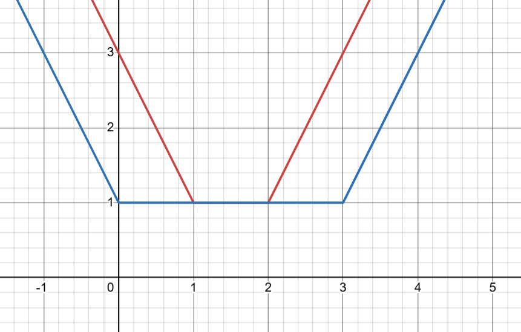

可以发现平移后斜率 $k \lt 0$ 的分段点向左平移 $k$ 个单位，斜率 $k \gt 0$ 的向右平移，用平衡树维护平移即可。注意：**平移时维护的截距 $b$ 也要改变**，若维护的是最右端的截距 $b$ 和斜率 $k$，则截距 $b \gets b-k\times h$。

``` cpp
#include <iostream>
#include <cstdio>
#include <cstring>
#include <random>
#include <ctime>
using namespace std;
typedef long long LL;
typedef unsigned int u32;
mt19937 RAND(time(NULL));
const int MAX_N = 2e5+5;
int n, kk, d_size; 
LL a[MAX_N], h; 
__int128 bb;
struct Treap_Node {
	int ch[2], siz;
	__int128 sum, tag, val;
	u32 rnd;
	Treap_Node () {
		sum = 0; ch[0] = ch[1] = val = tag = siz = 0; rnd = 0;
	}
};
namespace fhq {
	int root, node_cnt; Treap_Node t[MAX_N*2];
	void init () {
		for(int i = 0; i <= node_cnt; i ++) t[i] = Treap_Node();
		root = node_cnt = 0;
	}
	inline void pushup (int x) {
		t[x].siz = t[t[x].ch[0]].siz + t[t[x].ch[1]].siz + 1;
		t[x].sum = t[t[x].ch[0]].sum + t[t[x].ch[1]].sum + t[x].val;
	}
	inline void pushdown (int x) {
		if(t[x].tag) {
			t[t[x].ch[0]].tag += t[x].tag; t[t[x].ch[0]].val += t[x].tag;
			t[t[x].ch[0]].sum += t[x].tag * t[t[x].ch[0]].siz;
			t[t[x].ch[1]].tag += t[x].tag; t[t[x].ch[1]].val += t[x].tag;
			t[t[x].ch[1]].sum += t[x].tag * t[t[x].ch[1]].siz;
			t[x].tag = 0;
		}
	}
	void split_val (int x, int &u, int &v, LL vals) {
		if(!x) {
			u = v = 0;
			return;
		}
		pushdown(x);
		if(t[x].val <= vals) {
			u = x; split_val(t[x].ch[1], t[u].ch[1], v, vals);
			pushup(u);
		}
		else {
			v = x; split_val(t[x].ch[0], u, t[v].ch[0], vals);
			pushup(v);
		}
	}
	void split_rnk (int x, int &u, int &v, int rnk) {
		if(!x) {
			u = v = 0;
			return;
		} pushdown(x);
		if(t[t[x].ch[0]].siz+1 <= rnk) {
			u = x; split_rnk(t[x].ch[1], t[u].ch[1], v, rnk-t[t[x].ch[0]].siz-1);
			pushup(u);
		}
		else {
			v = x; split_rnk(t[x].ch[0], u, t[v].ch[0], rnk);
			pushup(v);
		}
	}
	int merge (int x, int y) {
		if(!x || !y) return x | y;
		if(t[x].rnd < t[y].rnd) {
			pushdown(x); t[x].ch[1] = merge(t[x].ch[1], y); pushup(x);
			return x;
		}
		pushdown(y); t[y].ch[0] = merge(x, t[y].ch[0]); pushup(y);
		return y;
	}
	void insert_node (LL val) {
		++ node_cnt; t[node_cnt] = Treap_Node();
		t[node_cnt].val = val; t[node_cnt].rnd = RAND();
		t[node_cnt].siz = 1; t[node_cnt].sum = val;
		int x, y; split_val(root, x, y, val);
		x = merge(x, node_cnt); root = merge(x, y);
	}
	void make_tag (int rk, __int128 h) {
		int x, y;
		split_rnk(root, x, y, rk);
		if(x) {
			t[x].val -= h;
			t[x].tag -= h;
			t[x].sum -= h * t[x].siz;
		} if(y) {
			t[y].val += h;
			t[y].tag += h;
			t[y].sum += h * t[y].siz;
		} root = merge(x, y);
	}
	__int128 query_sum (int rnk) {
		int x, y; split_rnk(root, x, y, rnk);
		__int128 ans = t[y].sum; root = merge(x, y);
		return ans;
	}
}
inline void write (__int128 x, bool out) {
	if(x == 0) {
		if(out) putchar('0');
		return;
	}
	write(x/10, 0); putchar('0'+x%10);
}
int main () {
	scanf("%d%lld",&n,&h);
	for(int i = 1; i <= n; i ++) scanf("%lld",&a[i]);
	kk = bb = d_size = 0; fhq::init();
	for(int i = 1; i <= n; i ++) {
		fhq::make_tag(d_size-kk, h);
		bb -= a[i] + kk * h; ++ kk; d_size += 2;
		fhq::insert_node(a[i]); fhq::insert_node(a[i]);
	} write(bb+fhq::query_sum(d_size-kk), 1);
	return 0;
}
```

### 连续段动态规划

连续段 dp。基本思想：把 dp 状态看作若干个连续段，每次可以新建连续段、往一个连续段的两旁插入、合并连续段，在新建连续段的时候可以确定顺序也可以在合并的时候再确定顺序。连续段 dp 可以用于往两旁加入数比较方便的动态规划问题。

有时候连续段 dp 也是一种排列计数 dp，一个排列如果从一个连续段的两端加入的时候比较方便，那么可以用连续段动态规划。

连续段动态规划题单：[连续段 dp](https://www.luogu.com.cn/training/353260#problems)。

### [Phoenix and Computers](https://codeforces.com/problemset/problem/1515/E)

洛谷链接：[CF1515E Phoenix and Computers](https://www.luogu.com.cn/problem/CF1515E)。

有 $n$ 台电脑，初始时全部未打开，每次你可以手动打开一台**还未打开**的电脑。若第 $i-1$ 台电脑和第 $i+1$ 台电脑已经打开，且第 $i$ 台电脑未打开，则第 $i$ 台电脑会自动打开（$2 \le i \le n-1$），求有多少种手动打开电脑的方案使得电脑全部打开，两种方案不同当且仅当有手动打开的次数不同或存在一次手动打开的电脑不同，对一个质数 $M$ 取模。保证 $3 \le n \le 400,10^8 \le M \le 10^9$。

可以发现最终的状态为：一段手动点亮+自动点亮+一段手动点亮+自动点亮+......。

考虑设计连续段 dp，设 $f[i][j]$ 表示已经点亮了 $i$ 个数，且有 $j$ 个连续段，连续段中都是已经确定点亮（这里为了保证转移不重复，我们只考虑插入时候的转移）。

若考虑新增连续段，这个连续段可以放在原来 $j-1$ 个连续段的首尾或任意两端之间，一共有 $j$ 个位置，有如下转移

$$
\Large{
f[i][j] \gets f[i][j] + f[i-1][j-1]\times j
}
$$

若考虑把当前这个数加入到连续段中，可以插入在左边右边都可以

$$
\Large{
f[i][j] \gets f[i][j] + f[i-1][j]\times 2\times j
}
$$

当然插入也可以隔一个插入，这样会自动点亮一个

$$
\Large{
f[i][j] \gets f[i][j] + f[i-2][j]\times 2\times j
}
$$

若考虑合并两个连续段，此时有两种情况：

两个连续段中间有两个没有点亮，则点亮任意一个位置都可以

$$
\Large{
f[i][j] \gets f[i][j] + f[i-2][j+1]\times 2\times j
}
$$

两个连续段中间有三个没有点亮，则点亮中间的那一个

$$
\Large{
f[i][j] \gets f[i][j] + f[i-3][j+1]\times j
}
$$

这样就做到不重不漏了。

```cpp
#include <cstdio>
using namespace std;
typedef long long LL;
const int MAX_N = 405;
int n, m;
LL f[MAX_N][MAX_N];
int main () {
	scanf("%d%d",&n,&m);
	f[0][0] = 1;
	for(int i = 1; i <= n; i ++) {
		for(int j = 1; j <= i; j ++) {
			f[i][j] = f[i-1][j-1] * j % m;
			f[i][j] = (f[i][j] + f[i-1][j] * 2 * j) % m;
			if(i >= 2) f[i][j] = (f[i][j] + f[i-2][j+1] * 2 * j + f[i-2][j] * 2 * j) % m;
			if(i >= 3) f[i][j] = (f[i][j] + f[i-3][j+1] * j) % m;
		}
	}
	printf("%lld\n",f[n][1]);
	return 0;
}
```


### [P5999 (CEOI 2016) kangaroo](https://www.luogu.com.cn/problem/P5999)

你是一只袋鼠，有 $n$ 个草丛编号为 $1\sim n$，你初始在 $s$，你需要经过恰好 $n-1$ 次跳跃到达 $t$，且途中经过每个草丛恰好一次，每次跳跃你可以跳跃到任意一个草丛，但是你每次跳跃必须遵守如下规则：

- 如果你上一次向左跳跃，即草丛编号变小，则这一次跳跃必须向右跳跃，即草丛编号变大。
- 如果你上一次向右跳跃，则这一次必须向左跳跃。

第一次跳跃你可以任意向左或者向右，求跳跃的方案数对 $10^9+7$ 取模。保证有解。

可以把问题转换为求一个排列 $p$，有 $p_1=s,p_n=t$ 且对于 $2 \le i \le n-1$ 有 $p_{i-1} \lt p_i \land p_{i+1} \lt p_i$ 或 $p_{i-1} \gt p_i \land p_{i+1}\gt p_i$。

我们试一下用连续段能不能做？考虑从小到大往排列中填数，我们发现如果一个连续段是类似于“小大小大小大小”这样的东西是不错的，加数的时候合并就是填在两个段中间，并且最终答案也类似于这种连续段，但有一些不同。

考虑令 $f[i][j]$ 表示当前填的是 $i$ 这个数，且当前有 $j$ 个连续段。

若 $i = s$ 或 $i = t$，这两个数只能是排列的左右两端，所以要么加在左右两个连续段的两边，要么新加一个连续段。如果加在左右两边的连续段的话，那么左右连续段就是以“大”开头或者结尾的，此时“大”的那一端就不能合并了，因为合并必须是两个“小”，中间填一个“大”（从小到大填的数），但是我们本身就不需要合并，因为它们必须是在两端的。

$$
\Large{
f[i][j] \gets f[i][j] + f[i-1][j-1] + f[i-1][j](i \in \{s,t\})
}
$$

对于其他数，我们首先不能添加到一个段的开头或末尾，因为这样会使得段的一段不能合并，而我们最终要使得段全部合并成一个，故不能添加。

若新建一个段，这个段必须考虑 $s$ 和 $t$ 的影响，如果已经填了 $s$，则新加入的段不能在第一个段的左边，已经填了 $t$ 同理。

$$
\Large{
f[i][j] \gets f[i][j] + f[i-1][j-1]\times (j - [i\gt s] - [i\gt t])
}
$$

合并段直接合并即可。

$$
\Large{
f[i][j] \gets f[i][j] + f[i-1][j+1]\times j
}
$$

初始状态 $f[0][0] = 1$，答案为 $f[n][1]$。这样就做完了。时间复杂度 $O(n^2)$。

这道题还有多项式的 $O(n)$ 做法，可以看一下题解。

### [P14956 字符串的迹象](https://www.luogu.com.cn/problem/P14956)（待完成）


## 计数题杂题

计数题太难了qwq。

HEOI-动动的博客：[组合数学入门](https://www.cnblogs.com/My-flurry/p/11096302.html)。

李34的计数题单：[计数](https://www.luogu.com.cn/training/145494)。

部分计数题目在其他栏目。[排列计数的动态规划](###排列计数的动态规划)。

对于计数问题，我们应该把要计数的条件罗列出来，针对每一种条件分别讨论，做到不重不漏，不然可能会边界调到死。

### [P4071 SDOI2016 排列计数](https://www.luogu.com.cn/problem/P4071)

求所有**恰好**有 $m$ 个互不相同的下标 $i$ 使得 $A_i=i$ 的 $\{1,2,\cdots,n\}$ 的排列 $A$ 的数量对 $10^9+7$ 取模。

记 $D_n$ 为一个 $\{1,2,\cdots,n\}$ 的排列 $B$ 且对于所有 $i$ 都有 $B_i \ne i$ 的 $B$ 序列的数量，即排列的**错排**数量。

那么答案就是 

$$
\Large{
\binom{n}{m}\times D_{n-m}
}
$$

现在的问题是如何求出 $D$ 序列。

###### 错排方案数递推式（组合数常用）

错排有一个等价的定义：有一个确定的排列 $D$，对于所有的 $i$ 都有 $C_i \ne D_i$ 的排列 $C$ 序列的方案数等价于错排方案数。

先给出结论：

$$
\Large{
D_n = (n-1)\times (D_{n-1} + D_{n-2})
}
$$

假设我们从 $a$ 开始确定错排，则一开始 $a$ 有 $n-1$ 种选择方案（$a$ 不能选择 $a$ 自己）。

假设 $a$ 选择了 $b$，且 $a \ne b$。

- 若 $b$ 选择的数为 $a$，则此时 $a$ 和 $b$ 这两个数已经被选过了，对后面的选择没有任何影响，所以此时的方案数为 $(n-1)\times D_{n-2}$。
- 若 $b$ 选择的数不是 $a$，此时我们观察一下剩下的数。由于 $b$ 已经被 $a$ 选过了，剩下的数都不能选 $b$。对于 $b$ 来说，有 $n-2$ 个数可以选，不能选的数是 $a$，对于其他非 $a$ 非 $b$ 的数，不能选的数是它自己，我们发现不能选的数没有重复，则我们可以把剩下的 $n-1$ 个数看作一个错排，那么方案数就是 $(n-1)\times D_{n-1}$。

根据加法原理，直接相加上述两种情况就得到了上面的递推式。

### [P14636 NOIP2025 清仓甩卖 / sale](https://www.luogu.com.cn/problem/P14636)（未写完）

### [P1450 HAOI2008 硬币购物](https://www.luogu.com.cn/problem/P1450)

计数好题。容斥的应用。

给出你有 $4$ 种硬币，第 $i$ 种硬币面值为 $c_i$，两枚硬币除了面值外其他完全相同，有 $q$ 次询问，每次给出第 $i$ 种硬币的个数 $d_i$ 和需要凑出的价值 $n$，求有多少种方案使得恰好凑出价值 $n$。

如果没有硬币个数的限制，那么一个完全背包即可搞定，考虑有硬币限制的怎么做。

稍微观察一下发现直接算合法方案不好求，考虑对其进行容斥，合法方案等于总方案数减不合法方案数，总方案数用完全背包即可求出，现在考虑求不合法的方案数。

对于一个不合法的方案，一定有某一个硬币选的个数超出了 $d_i$，那么先假设选了该种硬币 $d_i+1$ 个，那么就变成了价值为 $n-(d_i+1)\times c_i$ 的完全背包了。当然，对于每一种硬币都求一次的话，有某两种或者某几种硬币超过个数就会重复计算，此时容斥一下即可。

### [P3214 HNOI2011 卡农](https://www.luogu.com.cn/problem/P3214)（待完成）

众所周知卡农是一种复调音乐的写作技法，小余在听卡农音乐时灵感大发，发明了一种新的音乐谱写规则。

他将声音分成 $n$ 个音阶，并将音乐分成若干个片段。音乐的每个片段都是由 $1$ 到 $n$ 个音阶构成的和声，即从 $n$ 个音阶中挑选若干个音阶同时演奏出来。

为了强调与卡农的不同，他规定任意两个片段所包含的音阶集合都不同。同时为了保持音乐的规律性，他还规定在一段音乐中每个音阶被奏响的次数为偶数。

现在的问题是：小余想知道包含 $m$ 个片段的音乐一共有多少种。
两段音乐 $a$ 和 $b$ 同种当且仅当将 $a$ 的片段重新排列后可以得到 $b$。例如：假设 $a$ 为 $\{\{1,2\},\{2,3\}\}$，$b$ 为 $\{\{2,3\},\{1,2\}\}$，那么 $a$ 与 $b$ 就是同种音乐。

答案对 $10^8+7$ 取模。

###### 计数的小小小 trick：无序统计转有序统计

本题要求的 $m$ 个片段是无序的，也就是说本质相同的片段的组合只算 $1$ 次，这种形式不好进行答案计算，所以我们对于每一种片段都统计一次，最后答案除以 $m!$ 即可。

我们来分析一下计数的条件吧。把 $n$ 个音符抽象成一个有 $n$ 位二进制数，每一个片段都是这个二进制数的子集。

1. 最终 $m$ 个片段（子集）的每一个音符（二进制位）都出现偶数次。
2. 任意两个片段（子集）都不一样。
3. 任意片段（子集）非空。

我们考虑每次加入一个片段（子集），设 $f(i)$ 表示当前有 $i$ 个片段的合法方案数，最终答案即是 $\large{\frac{f(m)}{m!}}$。

首先如果前 $i-1$ 个片段（子集）已经确定了，那么最后一个片段根据条件 $1$ 是唯一确定的，考虑进行容斥，用总方案数减去不合法的方案数，此时总方案数为 $\large{A_{2^n-1}^{i-1}}$。

考虑不合法的方案数，如果方案不满足条件 $2$，由于前 $i-1$ 个是从 $2^n-1$ 个子集中挑选 $i-1$ 个组成的排列，

### [P6146 USACO20FEB Help Yourself G](https://www.luogu.com.cn/problem/P6146)（待完成）

## Ad-hoc

这是一类没有固定解法，需要具体情况具体分析的一类题目，通常不会用到一些高级算法知识，但是思维难度较高的题目。

遇到这类题目没有固定做法，只能不断总结经验。

### 交互题的策略

交互题找不到思路时，可以尝试一些数据规模较小的数据，手玩摸索一下。或者把所有情况都问一遍，看看能够得到什么信息。

### [测测 spj](https://newoj.daimayuan.top/p/4482?tid=693e25cc9892c4c9133715b0)

视频题解见 `F:\CodeNote\Code\代码源\2026 省选模拟赛 Day 1 (Testing Round, Div 2.5)`。

给一个长度为 $n$ 的排列 $p$ 和权值 $w$，$q$ 次询问，每次询问 $[l,r]$ 中权值和最大的最长上升子序列。**注意，由于题目很困难，你只需要回答标准答案的 $1.5$ 近似即可，即你的答案为 $x$，标准答案为 $y$，只需要满足 $\max(\frac{x}{y},\frac{y}{x}) \le 1.5$ 即视为答案正确**。

根据题目可知答案 $x$ 要落在 $\frac{2}{3}y \le x \le \frac{3}{2}y$ 中。或者说 $\frac{2}{3}x \le y \le \frac{3}{2}x$。

考虑假设我们有一个已知的答案区间 $[L,R]$，取在哪个位置的时候可以尽量覆盖全部的区间？首先取中点不太好，因为答案的左右两边不对称，如果考虑**恰好**覆盖左端点 $L$，且希望尽可能覆盖更多的区间，即 $x$ 尽量大，当 $y = L$ 时，$x$ 最大能取到 $\frac{3}{2}L$，此时取 $x = \frac{3}{2}L$，则 $L \le y \le \frac{9}{4}L$，故当 $R \le \frac{9}{4}L$ 的时候可以保证此时答案一定在范围内。当然有个问题，这里都为下取整，当 $L=1,R=2$ 时要特判一下。

考虑离线 cdq 分治，每次对于询问区间不跨越 $mid$ 的分治解决，对于跨越 $mid$ 的区间可以分别计算以 $mid$ 为其中一个端点，另一个端点分别为询问的左端点和右端点，则此时会统计出两种答案，假设分别为 $u,v$，故真实的答案应有 $\max(u,v) \le y \le u+v$，此时有答案区间在 $[\max(u,v),u+v]$ 且 $u+v \le 2\max(u,v) \le \frac{9}{4}\max(u,v)$，直接输出 $\frac{3}{2}\max(u,v)$ 即可，注意若 $u=v=1$ 要特判一下啊，此时 $mid$ 的左右两边都是递减，只需要看一下是否全是递减即可，即判断一下左端点和右端点的大小即可。

### [测测交互题](https://newoj.daimayuan.top/p/4480?tid=693e25cc9892c4c9133715b0)（待完成）

视频题解见 `F:\CodeNote\Code\代码源\2026 省选模拟赛 Day 1 (Testing Round, Div 2.5)`。

### [WC 2019 I 君的商店](https://qoj.ac/problem/189)

洛谷链接：[P5208 WC2019 I 君的商店](https://www.luogu.com.cn/problem/P5208)。

交互题。有一个你未知的 $01$ 序列 $a$，你事先已经知道了序列中 $1$ 的数量的奇偶性且**至少有一个 $1$**，具体地，每次询问会给出一个 $k$，若 $k=0$ 说明序列中有偶数个 $1$，若 $k=1$ 说明序列中有奇数个 $1$。

你每次可以进行如下询问：你可以询问两个下标集合 $S$ 和 $T$，需要保证 $S$ 和 $T$ 中无重复元素，交互库会计算 $R_s = \sum_{i \in S} a_i$ 和 $R_t = \sum_{i \in T} a_i$，若 $R_s \gt R_t$ 返回 $0$，$R_s \lt R_t$ 返回 $1$，$R_s = R_t$ 则会任意返回 $0$ 或 $1$。即返回 $0$ 表示 $R_s \ge R_t$，返回 $1$ 表示 $R_s \le R_t$。定义一次询问的代价为 $|S|+|T|$，你询问的总代价不能超过 $M$。需要注意的是，标号从 $0 \sim n-1$。

你需要求出序列 $a$。

记答案数组为 $\text{ans[]}$：
- 子任务 $1$：$N \le 5, M = 100$；
- 子任务 $2$：$N \le 10^3, M = 10^6$；
- 子任务 $3$：$N \le 10^5, M = 100$，保证 $\forall i < j < k$，若 $\text{ans[i]} = \text{ans[k]}$ 则必有 $\text{ans[j]} = \text{ans[i]}$。
- 子任务 $4$：$N \le 10^4, M = 2 \times 10^5$；
- 子任务 $5$：$N \le 5 \times 10^4, M = 350100$；
- 子任务 $6$：$N \le 10^5, M = 500100$。

如果询问集合 $S = \{x\}$，集合 $T = \{y,z\}$，若 $a_x \ge a_y + a_z$，则一定有 $a_y$ 和 $a_z$ 中至少有一个 $0$，此时问一下 $a_y$ 和 $a_z$ 的大小关系就可以确定其中一个较小的数为 $0$，若 $a_x = 1$ 且 $a_x \le a_y + a_z$，则 $a_y$ 和 $a_z$ 中至少有一个 $1$，问一下 $a_y$ 和 $a_z$ 其中较大的数为 $1$，用这个进行询问可以用 $5$ 次的代价确定两个未知数中的一个数，前提是已知一个外面的 $1$。我们先找出一个 $1$，因为 $1$ 是最大的数，可以用打擂台的方式找到，需要 $2n-2$ 次的代价。最后会剩下一个未知的数，此时不能用前面的方法搞出来了，直接用给出的奇偶性直接判断是 $1$ 还是 $0$ 即可。总代价 $2n-2+5(n-2)=7n-12$，可以过子任务 $1,2,4,5$。

然后考虑子任务 $3$，子任务 $3$ 的答案形式一定类似于 $000\cdots 111$，或者 $111\cdots 000$，问一下首尾的大小关系即可知道 $1$ 在首还是在尾，之后只有 $M=100$，不能直接做，考虑二分，假设已知 $1$ 在最后一个数，另一种情况同理，构造集合 $S = \{n-1\}$ 和集合 $T = \{mid-1,mid\}$，类似于上面的思路，此时集合 $S$ 中一定为 $1$，若返回 $0$ 说明 $1\ge a_{mid-1}+a_{mid}$，则其中至少有一个 $0$，由于答案的形式 $a_{mid-1}$ 一定为 $0$，若返回 $1$ 则说明其中至少有一个 $1$，由于答案的形式 $a_{mid}$ 一定为 $1$，对此二分即可，到最后一个数用奇偶判断。 

对于子任务 $6$，给了 $n=10^5,M=5\times 10^5+100=5n+100$，前面的 $7n$ 算法貌似已经无法继续优化，考虑用二分来优化，子任务 $3$ 能用到二分的原因是排列答案有一种单调性，且已知一个 $1$，我们考虑用 $5n$ 的代价构造一个同样具有单调性的一种排列方案使得 $a_{p_1} \le a_{p_2} \le a_{p_3} \le \cdots \le a_{p_k}$，$5n$ 提示我们用前面的思路仿照一下。我们考虑当前已经构造出来的排列方案最大的数的下标为 $x$，再选取两个未知的下标 $y$ 和 $z$，询问集合 $S = \{x\}$ 和 $T = \{y,z\}$，若 $a_x \ge a_y + a_z$，则 $a_y$ 和 $a_z$ 中较小的为 $0$，直接确定了一个数，若 $a_x \le a_y + a_z$，此时因为不知道 $a_x$ 的值无法确定 $a_y$ 和 $a_z$，我们考虑能不能把他们加入单调排列方案中，若 $a_x$ 为 $0$ 则两者都可以加入到单调排列方案的末尾（最大的数），若 $a_x$ 为 $1$ 则较大的那个数一定为 $1$，此时它也可以加入到单调排列方案的末尾（最大的数），此时我们就用了 $5$ 的代价确定了一个数或者加入了单调排列的末尾，由于确定的数只能是 $0$，所以单调排列的末尾一定是 $1$，按照子任务 $3$ 的方法做即可。需要注意的是确定单调排列的时候最后会剩一个数，不好处理，因为二分单调排列的时候也会剩一个数，这个时候可以用 $5$ 的代价确定一个数，最后一个用奇偶性确定，这样就做完啦！

### [Joy with Permutations](https://qoj.ac/problem/1813)

交互题。你有一个长度为 $n$ 的未知排列 $p$，满足 $4 \le n \le 6\times 10^4$，且 $p$ 为 $1 \sim n$ 的排列。你可以进行如下两种询问：

询问 $1$： `? 1 i j k` 返回 $p_i$，$p_j$ 和 $p_k$ 的中位数的**值**，至多询问 $2n$ 次。

询问 $2$： `? 2 i j` 返回 $p_i$ 和 $p_j$ 的较小数的**下标**，至多询问 $2$ 次。

现在请你还原出这个排列 $p$。

我们主要需要用询问 $1$ 进行判断排列的具体值，先考虑 $n=4$ 的情况，对于 $n=4$ 的情况我们可以直接询问 $4$ 次询问 $1$，假设四个数为 $a \le b \le c \le d$，去掉 $a$ 或 $b$ 的时候询问返回 $c$，去掉 $c$ 或 $d$ 的时候询问返回 $b$，则可以确定 $a$ 和 $b$ 为 $1$ 和 $2$，$c$ 和 $d$ 为 $3$ 和 $4$，此时再分别对 $a$ 和 $b$，$c$ 和 $d$ 用询问 $2$ 就能求出这个排列了。

接下来考虑按照上面的思路逐一加入一个数。但是询问 $2$ 只能用两次，上面求出 $n=4$ 的时候就用了两次询问 $2$ 了，我们考虑什么情况下必须使用询问 $2$。我们发现最小的两个数（$1$ 和 $2$）只用询问 $1$ 是无法区分的，因为当它们同时出现在询问 $1$ 时一定会返回 $2$，但不知道具体位置，当它们只有一个出现在询问 $1$ 时的结果都一样，最大两个数（$n-1$ 和 $n$）也同理，故只有这两种情况才能使用询问 $2$。

此时我们先用上面的方法对前 $4$ 个数使用询问 $1$，可以得到一对大小关系 $p_a,p_b \le p_c,p_d$ 且知道 $p_a$ 和 $p_b$ 中的较大值，记为 $l$，$p_c$ 和 $p_d$ 中的较小值，记为 $r$，考虑加入一个数 $x$，假设此时询问 `? 1 a c x`，假设询问结果记为 $y$，若：

- $y \lt l$，说明询问的其中两个数都小于 $l$，又因为 $c$ 大于 $l$，故 $x,a \le y \lt l$，又因为 $a$ 和 $b$ 中有一个等于 $l$，故 $b = l$，此时把 $b$ 的值确定了，之后把 $b$ 用 $x$ 替换，$l$ 用 $y$ 替换即可。
- $y = l$，此时可知 $b \ne l$ 且 $a$ 和 $b$ 有一个为 $l$，则 $a = l$。然后考虑替换，询问 `? 1 b c x`，设返回值为 $z$，则把 $a$ 用 $x$ 替换，$l$ 用 $z$ 替换。
- $l \lt y \lt r$，此时可以直接知道 $x = y$。
- $y = r$，此时类似于 $y = l$。
- $y \gt r$，此时类似于 $y \lt l$。

至此我们加入一个数（或者说确定了一个数）只用了至多 $2$ 次询问 $1$，一开始的 $4$ 个数用了 $4$ 次询问 $1$，故用的总询问 $1$ 的次数为 $4+2(n-4)=2n-4$，最后对较小和较大的两对数分别用一次询问 $2$ 就做完啦。

### [NOI 2019 I 君的探险](https://qoj.ac/problem/1228)（待完成）

洛谷链接：[P5473 NOI2019 I 君的探险](https://www.luogu.com.cn/problem/P5473)。

交互题。

### [International Olympiad in Informatics 2022 Day 2 (IOI 2022 Day 2) Rarest Insects](https://qoj.ac/problem/4565)（未写完）

洛谷链接：[P8494 IOI 2022 最罕见的昆虫](https://www.luogu.com.cn/problem/P8494)。

第一次自己想出黑题 Ad-hoc 记录一下。

交互题。你有一个长度为 $n$ 未知的序列 $p$，并且你有一个机器，你可以进行如下三种操作：
- 把一个下标为 $i$ 的数放入机器。
- 把一个下标为 $i$ 的数拿出机器。
- 按下按钮，得到机器中出现的数的**最多次数**。

现在，你需要求出这个序列的数的出现次数的最小值。$n \le 2000$，你需要保证这三种操作的最大操作次数不超过 $40000$ 次，你可以得到满分当且仅当你这三种操作的最大操作次数不超过 $3n$ 次。

首先 $n^2$ 的做法是比较显然的，直接求出每个数出现的次数即可，可以得到 $10$ 分。

## 其他杂题

### [P10107 (GDKOI2023 提高组) 树](https://www.luogu.com.cn/problem/P10107)（待完成）

核桃 OJ 的一场比赛的第二题：[P11130 压力测试](https://htoj.com.cn/cpp/oj/problem/detail?pid=22618656760960&cid=22618738769920&tab=1)。

### [P14960 「KWOI R1」XOR and Sliding Window](https://www.luogu.com.cn/problem/P14960)

本题中提到的所有序列下标从 $0$ 开始。给定一个长度为 $n$ 的序列 $a$，和一个数 $k$。你需要构造一个长度为 $n$ 的非负整数序列 $b$，使得以下式子最小：

$$
\Large{
\sum_{i=0}^{n-1}(a_i\oplus\bigoplus_{j=i}^{i+k-1}b_{j\ \bmod{\ n}})
}
$$

求这个最小值。多测，保证 $1\le T,n,\sum n\le 10^6,1\le k\le n,0 \le a_i \lt 2^{30}$。

注意到每一位的贡献独立，考虑按位来做，此时每个 $a_i,b_i$ 的取值只有 $0$ 或 $1$。

约定：下文对 $1$ 进行异或操作称为**翻转**，下文的所有下标**均对 $n$ 取模**。

注意到对于一个 $i$，改变 $b_i$ 的状态（即翻转 $b_i$）会导致翻转后面 $k$ 个数，也就是说 $a_i,a_{i+1},\cdots,a_{i+k-1}$ 都被翻转，那么我们能做的操作就是翻转任意连续 $k$ 个数，使得 $1$ 的数量最少。

不妨考虑连续改变相邻的两个 $b$ 的状态，即翻转 $b_i$ 和 $b_{i+1}$，此时我们可以发现只有 $a_i$ 和 $a_{i+k}$ 被翻转了，也就是说我们可以同时翻转 $a_i$ 和 $a_{i+k}$。这有什么用呢？进一步地，我们既然可以翻转 $a_i,a_{i+k}$，又可以翻转 $a_{i+k},a_{i+2k}$，这两步一起就是翻转 $a_i,a_{i+jk}$，其中 $j$ 可以为任意非零整数。我们把 $a_i,a_{i+k},a_{i+2k},\cdots,a_{i+jk}$ 作为一个集合提出来，且保证其中无重复下标，则每有两个 $1$ 我们就可以消掉，故如果其中的 $1$ 的个数为偶数，那么这里面最后没有 $1$，否则就是有一个 $1$，换句话来说，提出来的集合的答案为所有数的**异或和**，我们发现这样对不拆位的来考虑也是正确的，$k=1$ 的情况就直接做完了。

$k\ne 1$ 的情况呢，我们考虑一个数能作为一个集合开头（集合中最小下标）的条件，即不存在 $0 \le j \lt i$，存在一个 $x,y\in \mathbb{Z}$，使得 $j+xk=i+yn$，即不存在 $xk-yn=i-j$，由于 $1 \le i-j \le i$ 且 $\gcd(k,n) \nmid i-j$，故 $\gcd(k,n) \gt i$ 与 $i$ 能作为集合开头等价，故一共有 $m = \gcd(n,k)$ 个不同的集合，每个集合的贡献为它们集合中元素的异或和。这个时候考虑翻转有什么影响，由于一共有 $m$ 个集合，也就是说任意取 $m$ 个连续的数都恰好落在每个集合中各一次，故翻转 $k$ 个数则落在每个集合上 $d=\frac{k}{m}$ 次，如果 $d$ 为偶数，则每个集合的异或和不变，答案不变。如果 $d$ 为奇数，每个集合的答案都异或 $1$，那么这个时候就是 $0$ 的答案的集合个数和 $1$ 的答案的集合中个数较少的那一个就是答案。这样就做完啦，时间复杂度 $O(n\log V)$。

## 多项式

有的计数题目会用到多项式所以先学了再说。

OI-WiKi：[多项式与生成函数](https://oi-wiki.org/math/poly/intro/)。

[星夜](https://www.zhihu.com/people/nobody_come_here)的知乎：

[快速傅里叶变换（FFT）超详解](https://zhuanlan.zhihu.com/p/347091298)。

[快速傅里叶变换（FFT）的优化](https://zhuanlan.zhihu.com/p/347514286)。

[阶与原根](https://zhuanlan.zhihu.com/p/349128258)。

[快速数论变换（NTT）超详解](https://zhuanlan.zhihu.com/p/347726949)。

[LanrTabe](https://www.cnblogs.com/LanrTabe)的博客：

[快速傅里叶变换 FFT](https://www.cnblogs.com/LanrTabe/p/11305604.html)。

[快速数论变换 NTT](https://www.cnblogs.com/LanrTabe/p/11305607.html)。

[任意模数 FFT/NTT MTT](https://www.cnblogs.com/LanrTabe/p/11314179.html)。

[快速沃尔什变换 FWT](https://www.cnblogs.com/LanrTabe/p/11305626.html)。

[分治 FTT](https://www.cnblogs.com/LanrTabe/p/11305470.html)。

[README.md](https://www.zhihu.com/people/fl1vrh)（广西南宁二中）的知乎：[牛爷爷与多项式的爱恨情仇 (多项式下的牛顿迭代)](https://zhuanlan.zhihu.com/p/716864092)。

洛谷题单：[多项式板子](https://www.luogu.com.cn/training/92420)。

### 快速傅里叶变换（Fast Fourier Transform）

[P3803 【模板】多项式乘法（FFT）](https://www.luogu.com.cn/problem/P3803)。

求 $h(x) = f(x)\times g(x)$。

此算法在处理信号方面有广泛应用，在多项式中可以以 $O(n\log n)$ 的复杂度计算多项式乘法（对下标的和卷积）。

前置知识：[复数和单位根](https://oi-wiki.org/math/complex/)。

设 $n$ 次多项式 $f(x)=\sum_{i=0}^{n}f[i]x^i$。可以用 $(f[0],f[1],\cdots,f[n])$ 唯一表示一个多项式 $f(x)$，这个表示法称为**系数表示法**。

多项式乘法 

$$
\Large{
h(x) = f(x) \times g(x) = \sum_{i=0}^{n} \sum_{j+k=i} f[j]\times g[k]
}
$$

则多项式 $h(x)$ 的每一项系数可以表示为 

$$
\Large{
h[n]=\sum_{i+j=n}f[i]\times g[j]
}
$$

或写成 

$$
\Large{
h[n]=\sum_{i=0}^{n}f[i]\times g[n-i]
}
$$

注意上述的 $n$ 为多项式 $h(x)$ 的次数而非 $f(x)$ 或 $g(x)$ 的次数，多项式相乘后请注意多项式次数的变化。

用一个多项式的 $n+1$ 个点即可唯一确定一个多项式，这样的表示方法称为**点值表示法**，记为 $\{(x_0,f(x_0)),(x_1,f(x_1)),\cdots,(x_n,f(x_n))\}$。运用点值表示法进行多项式乘法的时候，直接将对应点值相乘即可。

在点值表示法时可以快速进行多项式乘法，但是不方便对多项式经行使用，这个时候如果我们能在小于 $O(n^2)$ 的时间内把多项式的系数表示法转成点值表示法和把点值表示法转成稀疏表示法，就可以快速完成多项式乘法。

#### 欧拉公式

对于任意实数 $x$，有 

$$
\Large{
e^{ix} = \cos(x)+i\sin(x)
}
$$

定义了复三角函数和复指数后可以扩展到全体复数。

#### 单位根

考虑 $x^n=1$ 的在复数意义下的根，这样的根有 $n$ 个，称为 $n$ 次单位根，这 $n$ 个根等分复平面上的单位园。

设幅角为正且最小的单位根为 $\omega_n$，且

$$
\Large{
\omega_n = e^{\frac{2i\pi}{n}} = \cos(\frac{2\pi}{n})+i\sin(\frac{2\pi}{n})
}
$$

所有 $n$ 次单位根都可以用 $\omega_n$ 来表示，第 $k$ 个单位根可以用 $\omega_n^k$ 表示。

$$
\Large{
\omega_n^k = e^{\frac{2ki\pi}{n}} = \cos(\frac{2k\pi}{n})+i\sin(\frac{2k\pi}{n})
}
$$

特别的，$\omega_n^0=\omega_n^n=1$。

单位根有如下性质：

$$
\Large{
\begin{align}
\omega_{dn}^{dk}  & = \cos(\frac{2dk\pi}{dn})+i\sin(\frac{2dk\pi}{dn})
\\
& = \cos(\frac{2k\pi}{n})+i\sin(\frac{2k\pi}{n}) 
\\
& = \omega_{n}^{k}

\newline
\newline 

\bar{\omega_{n}^{k}} & = \cos(\frac{2k\pi}{n})-i\sin(\frac{2k\pi}{n}) 
\\
& = \cos(2\pi - \frac{2k\pi}{n}) + i\sin(2\pi - \frac{2k\pi}{n}) 
\\ 
& = \cos(\frac{2(n-k)\pi}{n}) + i\sin(\frac{2(n-k)\pi}{n})
\\
& = \omega_{n}^{n-k}
\\
& = \omega_{n}^{-k}
\end{align}
}
$$

对于 $n$ 为偶数时，还有如下性质：

$$
\Large{
\begin{align}
\omega_{n}^{k+\frac{n}{2}} & = \cos(\frac{2k\pi+n\pi}{n})+i\sin(\frac{2k\pi+n\pi}{n})
\\
& = -\cos(\frac{2k\pi}{n})-i\sin(\frac{2k\pi}{n})
\\
& = -\omega_{n}^{k}

\newline
\newline

\omega_{n}^{\frac{n}{2}} & = -\omega_{n}^{0}
\\
& = -1
\end{align}
}
$$

#### 快速傅里叶变换（FFT）

系数表示法转点值表示法。

对于一个 $n-1$ 次多项式 $A(x) = \sum_{i=0}^{n-1}A[i]x^i$ 可以找到一个 $s > 0$ 使得 $2^s \ge n-1$，令 $n \gets 2^s$。注意此时多项式 $f(x)$ 的次数为 $n-1$ 次。

此时 $(A[0],A[1],A[2],\cdots,A[n-1])$ 恰好有 $2^s$ 个。考虑对其进行分治。

把 $A(x)$ 按奇偶分类。

$$
\Large{
\begin{align}
A(x) & = (A[0] + A[2]x^2 + A[4]x^4 + \cdots + A[n-2]x^{n-2}) 
\\
& + (A[1]x + A[3]x^3 + A[5]x^5 + \cdots + A[n-1]x^{n-1})
\end{align}
}
$$

令

$$
\Large{
\begin{align}
A_1(x) & = A[0] + A[2]x + A[4]x^2 + \cdots + A[n-2]x^{\frac{n}{2}-1}
\\
& = \sum_{i=0}^{\frac{n}{2}-1}A[2i]x^i
\newline
\newline
A_2(x) & = A[1] + A[3]x + A[5]x^2 + \cdots + A[n-1]x^{\frac{n}{2}-1}
\\
& = \sum_{i=0}^{\frac{n}{2}-1}A[2i+1]x^i
\end{align}
}
$$

则

$$
\Large{
A(x) = A_1(x^2) + xA_2(x^2)
}
$$

不妨带入 $x = \omega_{n}^{k},0 \le k \lt \frac{n}{2}$

$$
\Large{
\begin{align}
A(\omega_{n}^{k}) & = A_1(\omega_{n}^{2k}) + \omega_{n}^{k}A_2({\omega_{n}^{2k}})
\\
& = A_1(\omega_{\frac{n}{2}}^{k}) + \omega_{n}^{k}A_2({\omega_{\frac{n}{2}}^{k}})

\newline
\newline

A(\omega_{n}^{k+\frac{n}{2}}) & = A_1(\omega_{n}^{2k+n}) + \omega_{n}^{k+\frac{n}{2}}A_2(\omega_{n}^{2k+n})
\\
& = A_1(\omega_{n}^{2k}\times \omega_{n}^{n}) - \omega_{n}^{k}A_2(\omega_{n}^{2k}\times \omega_{n}^{n})
\\
& = A_1(\omega_{n}^{2k}) - \omega_{n}^{k}A_2({\omega_{n}^{2k}})
\\
& = A_1(\omega_{\frac{n}{2}}^{k}) - \omega_{n}^{k}A_2({\omega_{\frac{n}{2}}^{k}})
\end{align}
}
$$

可以发现上面两个式子仅有一个常数项不同，并且 $k \in [0,\frac{n}{2}-1],k+\frac{n}{2} \in [\frac{n}{2},n-1]$ 取遍了所有单位根，问题规模缩小了一半，只需要递归求出 $A_1(x)$ 和 $A_2(x)$ 即可。

最后我们就可以得到一个点值表示法的 $A(x)$ 即 $\{(\omega_n^0,A(\omega_n^0)),(\omega_n^1,A(\omega_n^1)),(\omega_n^2,A(\omega_n^2)),\cdots,(\omega_n^{n-1},A(\omega_n^{n-1}))\}$。

#### 快速傅里叶变换的逆变换（IFFT）

一般使用多项式的过程中很少用点值表示法，这个时候就需要转回系数表示法。快速傅里叶变换的逆变换可以在 $O(n\log n)$ 的时间内将点值表示法转回系数表示法。

现在要求一个多项式 $A(x)$ 的各项系数 $(A[0],A[1],A[2],\cdots,A[n-1])$。通过上面的快速傅里叶变换，我们已知了 $A(x)$ 的点值表示法 $\{(\omega_n^0,A(\omega_n^0)),(\omega_n^1,A(\omega_n^1)),(\omega_n^2,A(\omega_n^2)),\cdots,(\omega_n^{n-1},A(\omega_n^{n-1}))\}$。这里为了简单描述记为 $\{(\omega_n^0,y_0),(\omega_n^1,y_1),(\omega_n^2,y_2),\cdots,(\omega_n^{n-1},y_{n-1})\}$。

考虑构造一个向量 $(c_0,c_1,c_2,\cdots,c_{n-1})$，满足

$$
\Large{
\begin{align}
c_k & = \sum_{i=0}^{n-1}y_i(\omega_{n}^{-k})^i
\end{align}
}
$$

即为 $B(x) = \sum_{i=0}^{n-1}y_i x^i$ 在 $\{\omega_{n}^{0},\omega_{n}^{-1},\omega_{n}^{-2},\cdots,\omega_{n}^{-(n-1)}\}$ 的点值表示法 $\{(\omega_{n}^{0},c_0),(\omega_{n}^{-1},c_1),(\omega_{n}^{-2},c_2),\cdots,(\omega_{n}^{-(n-1)},c_{n-1})\}$。

$$
\Large{
\begin{align}
c_k & = \sum_{i=0}^{n-1}y_i(\omega_{n}^{-k})^i
\\
& = \sum_{i=0}^{n-1}\sum_{j=0}^{n-1}A[j](\omega_{n}^{i})^j(\omega_{n}^{-k})^i
\\
& = \sum_{i=0}^{n-1}\sum_{j=0}^{n-1}A[j](\omega_{n}^{j})^i(\omega_{n}^{-k})^i
\\
& = \sum_{i=0}^{n-1}\sum_{j=0}^{n-1} A[j] (\omega_{n}^{j} \omega_{n}^{-k})^i
\\
& = \sum_{i=0}^{n-1}\sum_{j=0}^{n-1}A[j](\omega_{n}^{j-k})^i
\\
& = \sum_{j=0}^{n-1}A[j]\sum_{i=0}^{n-1}(\omega_{n}^{j-k})^i
\end{align}
}
$$

最后一行可以发现有一个公比为 $\omega_{n}^{j-k}$ 的等比数列求和，套用等比数列求和公式

$$
\Large{
\begin{align}
S(n) & = \sum_{i=0}^{n} aq^i
\\ 
& = \frac{aq^{n+1}-a}{q-1}
\end{align}
}
$$

当 $\omega_{n}^{j-k} \ne 1$ 时，即 $j \ne k$ 时可以化简得

$$
\Large{
\begin{align}
c_k & = \sum_{j=0}^{n-1}A[j]\sum_{i=0}^{n-1}(\omega_{n}^{j-k})^i
\\
& = \sum_{j=0}^{n-1}A[j]\frac{(\omega_{n}^{j-k})^{n}-1}{\omega_{n}^{j-k}-1}
\\
& = \sum_{j=0}^{n-1}A[j]\frac{(\omega_{n}^{n})^{j-k}-1}{\omega_{n}^{j-k}-1}
\\
& = \sum_{j=0}^{n-1}A[j]\frac{1^{j-k}-1}{\omega_{n}^{j-k}-1}
\\
& = 0
\end{align}
}
$$

当 $j = k$ 时考虑

$$
\Large{
\begin{align}
c_k & = A[k]\sum_{i=0}^{n-1}(\omega_{n}^{j-k})^i
\\
& = A[k]\sum_{i=0}^{n-1}(\omega_{n}^{0})^i
\\
& = A[k]\sum_{i=0}^{n-1}1^i
\\
& = nA[k]
\end{align}
}
$$

所以有 $c_k = nA[k]$，又因为有 $\{(\omega_{n}^{0},c_0),(\omega_{n}^{-1},c_1),(\omega_{n}^{-2},c_2),\cdots,(\omega_{n}^{-(n-1)},c_{n-1})\}$ 是 $B(x)$ 的点值表示法，相当于再求一遍快速傅里叶变换，只不过从 $\omega_{n}^{k}$ 变成了 $\omega_{n}^{-k}$，最后把求得的点值除以 $n$ 即可得到系数。

#### 代码实现（递归版）

```cpp
// 这里 type=1 表示对做正变换，type=-1 表示做逆变换
// 逆变换具体原理参考推 c 的式子 
void fft (int n, Complex *A, int type) {
	if(n == 1) return; // 常数项直接返回
	Complex a1[n>>1], a2[n>>1];
	for(int i = 0; i <= (n>>1)-1; i ++) {
		a1[i] = A[i<<1];
		a2[i] = A[(i<<1)+1];
	}
	fft(n>>1, a1, type);
	fft(n>>1, a2, type);
	// 做逆变换的时候是单位根的负指数，所以要乘上-1(type)
	Complex wn_1 = Complex(cos(2.0*PI/n), type * sin(2.0*PI/n)), w = Complex(1, 0);
	for(int i = 0; i <= (n>>1)-1; i ++, w = w * wn_1) {
		A[i] = a1[i] + w * a2[i];
		A[i+(n>>1)] = a1[i] - w * a2[i];
	}
}
```

#### 快速傅里叶变换优化（倍增/蝶形运算）

使用**倍增法**优化快速傅里叶变换，改递归为迭代，使用**蝶形运算**优化使得额外空间开销为 $O(1)$。

以 $n = 8$ 举例：

1. $\{0,1,2,3,4,5,6,7\}$
2. $\{0,2,4,6\},\{1,3,5,7\}$
3. $\{0,4\},\{2,6\},\{1,5\},\{3,7\}$
4. $\{0\},\{4\},\{2\},\{6\},\{1\},\{5\},\{3\},\{7\}$

可以发现（注意力惊人）第 $i$ 个数最后的位置恰好对应了 $i$ 二进制翻转后的原数位置。

例如 $1 = (001)_2$ 最后处在的位置是 $4 = (100)_2$ 的原来的位置，而 $1$ 二进制翻转后正是 $4$。

所以我们可以自底向上合并，先求出每个数最后的位置（即二进制翻转之后的数）和原数交换，然后倒序合并。我们称二进制翻转为**位逆序置换**。

这里给出一个 $O(n)$ 求位逆序置换的方法，记 $n = 2^k$，我们要求有 $k$ 位二进制位时 $0 \sim n-1$ 的位逆序置换。记 $x$ 的位逆序置换为 $R(x)$，$R(0) = 0$，考虑从小到大求位逆序置换。

若 $x$ 为偶数，这个时候如果把 $x$ 右移一位（相当于 $\frac{x}{2}$），相当于给 $x$ 的二进制数最右边减一个零，给最左边加一个零，此时对右移后的 $x$ 取位逆序变换相当于给 $x$ 的位逆序变换的二进制位的最左边减一个零，最右边加一个零，此时再对其右移一位就可以求出 $R(x)$。举个例子，$(11010)_2(x) \to (01101)_2 \to (10110)_2 \to (01011)_2(R(x))$。数学化表达：

$$
\Large{
R(x) = \frac{R(\frac{x}{2})}{2} , x \in \text{偶数}
}
$$

那么 $x$ 为奇数的情况呢？依然考虑上述过程，此时 $x$ 右移一位会导致吞掉一个个位的一，按照偶数的过程做时最高位会为零，但实际上为一，只要补上一个一即可，相当于加上 $2^{k-1}$ 或 $\frac{n}{2}$。数学化表达：

$$
\Large{
R(x) = \frac{R(\lfloor\frac{x}{2}\rfloor)}{2}+\frac{n}{2} , x \in \text{奇数}
}
$$

汇总起来就是

$$
\Large{
R(x) = \frac{R(\lfloor\frac{x}{2}\rfloor)}{2}+(x\bmod 2)(\frac{n}{2})
}
$$

观察一下倍增的过程，假设当前要合并完成的段的长度为 $m$，应该由两个段长为 $s = \frac{m}{2}$ 的合并而成，设合并的左端点为 $l$，则第一个段为 $l \sim l+s-1$，第二个段为 $l+s \sim l+m-1$，合成完成后应该合并为 $l \sim l+m-1$ 的一个段，对于 $0 \le k \lt s$，合并后第 $l+k$ 个数和第 $l+k+s$ 个数由合并前的第 $l+k$ 个数和第 $l+k+s$ 个数合并而来，非常好的性质，直接被覆盖掉了，所以合并后直接覆盖掉原来的即可（我也不知道为什么叫蝶形变换）。

```cpp
// 这里 type=1 表示对做正变换，type=-1 表示做逆变换
// 逆变换具体原理参考推 c 的式子 
void fft (int n, Complex *A, int type) {
	rev[0] = 0;
	for(int i = 1; i <= lim-1; i ++) {
		rev[i] = (rev[i >> 1] >> 1) + (i & 1) * (n >> 1);
	}
	for(int i = 0; i <= n-1; i ++) {
		if(i < rev[i]) {
			swap(A[i], A[rev[i]]);
		}
	}
	for(int s = 1; s <= n-1; s <<= 1) {
		Complex wn_1(cos(PI / s), type * sin(PI / s));
		for(int l = 0; l <= n-1; l += (s << 1)) {
			Complex w(1, 0);
			for(int k = 0; k <= s-1; k ++, w = w * wn_1) {
				Complex x = A[l+k], y = w * A[l+k+s];
				A[l+k] = x + y;
				A[l+k+s] = x - y;
			}
		}
	}
	if(type == -1) {
		for(int i = 0; i <= n-1; i ++) {
			A[i].a /= n;
		}
	}
}
```

### 快速数论变换（Number-Theoretic Transform）

求 $h(x) \equiv f(x)\times g(x) \pmod p$，其中 $p$ 是一个特殊的质数。

前置知识：[阶与原根（OI-WiKi）](https://oi-wiki.org/math/number-theory/primitive-root/)，[阶与原根（知乎）](https://zhuanlan.zhihu.com/p/349128258)，快速傅里叶变换（FFT）。

在乘数较大的情况下，使用快速傅里叶变换（FFT）会损失大量精度（比如模板多项式乘法使用 FTT 的精度误差达到了 $10^{-3}$ 级别），这个时候如果有一个符合条件的**质数**取模，可以使用基于原根的快速数论变换（NTT），当然如果模数不符合条件需要使用任意模数 FFT/NTT（MTT）。

我们思考一下，为什么快速傅里叶变换可以优化时间复杂度，实质上用到了单位根的性质进行分治，我们需要找一个在模意义下也有相同性质的东西。

#### 原根

定义：$m \gt 0$，如果存在正整数 $g$，$\gcd(g,m)=1$ 且有

$$
\Large{
S = \{g^1,g^2,\cdots,g^{\varphi(m)}\}
}
$$

中的元素模 $m$ 两两不同余，则称 $g$ 为 $m$ 的**原根**。因为 $\gcd(g,m)=1$，还有 $S$ 中的元素与 $m$ 互质，即 $S$ 为模 $m$ 的一组既约剩余系。

特别的，若 $m$ 为**质数**，则 $g^i \pmod m$ 对于 $i = 1,2,\cdots,p-1$ 两两不同。

#### 快速数论变换（NTT）

[P3803 【模板】多项式乘法（FFT）](https://www.luogu.com.cn/problem/P3803)

下文讨论的素数 $p = mn+1$，$n = 2^s$，$m$ 为一个正整数。也就是说只有满足这个条件的素数 $p$ 才适用于 NTT。

当素数 $p$ 满足上述条件 $p = mn+1$，$n = 2^s$ 时，设 $g$ 为 $p$ 的一个原根。我们不妨按照单位根的表示方法，令 $g_n=g^m=g^{\frac{p-1}{n}}$。

则有

$$
\Large{
\begin{align}
g_n^{n} & \equiv g^{p-1}
\\
& \equiv g^0
\\
& \equiv 1 \pmod p

\newline
\newline

g_{dn}^{dk} & \equiv g^{dk\times\frac{p-1}{dn}}
\\
& \equiv g^{k\times\frac{p-1}{n}}
\\
& \equiv g_{n}^{k} \pmod p

\newline
\newline

g_{n}^{k+\frac{n}{2}} & \equiv g^{(k+\frac{n}{2})\times\frac{p-1}{n}}
\\
& \equiv g^{k\times\frac{p-1}{n}}\times g^{\frac{p-1}{2}}
\\
& \equiv -g_n^k \pmod p
\end{align}
}
$$

至此在模数特定的时候单位根的大部分性质原根都有，故此时用原根可以代替单位根做一下 FFT 就是 NTT。

**注意这里的 $n = 2^s$ 要大于序列长度，所以选取质数时要慎重。**

常用模数：

$$
\Large{
\begin{align}
& p = 167772161 = 5 \times 2^{25} + 1 , g = 3
\\
& p = 469762049 = 7 \times 2^{26} + 1 , g = 3
\\
& p = 998244353 = 7 \times 17 \times 2^{23} + 1 , g = 3
\\
& p = 1004535809 = 479 \times 2^{21} + 1 , g = 3
\\
& p = 754974721 = 3^2 \times 5 \times 2^{24} + 1 , g = 11
\\
& p = 1945555039024054273 = 27 \times 2^{56} + 1 , g = 5
\\
& p = 4179340454199820289 = 29 \times 2^{57} + 1 , g = 3
\end{align}
}
$$

下面给出迭代代码。

```cpp
// 这里 type=1 表示对做正变换，type=-1 表示做逆变换
void ntt (int n, LL *A, int type) {
	rev[0] = 0;
	for(int i = 1; i <= n-1; i ++) {
		rev[i] = (rev[i >> 1] >> 1) + (i & 1) * (n >> 1);
	}
	for(int i = 0; i <= n-1; i ++) {
		if(i < rev[i]) 
			swap(A[i], A[rev[i]]);
	}
	for(int s = 1; s <= n-1; s <<= 1) {
		LL wn = (type == 1 ? get_pow(M_G, (MOD - 1) / (s << 1)) 
			: get_pow(M_G, MOD - 1 - (MOD - 1) / (s << 1)));
		for(int l = 0; l <= n-1; l += (s << 1)) {
			LL w = 1;
			for(int k = 0; k <= s-1; k ++, w = w * wn % MOD) {
				int x = A[l+k], y = 1LL * w * A[l+k+s] % MOD;
				A[l+k] = x + y;
				if(A[l+k] >= MOD) A[l+k] -= MOD;
				A[l+k+s] = x - y;
				if(A[l+k+s] >= MOD) A[l+k+s] -= MOD;
				if(A[l+k+s] < 0) A[l+k+s] += MOD;
			}
		}
	}
	if(type == -1) {
		LL inv_n = get_pow(n, MOD-2);
		for(int i = 0; i <= n-1; i ++) {
			A[i] = (A[i] * inv_n) % MOD;
		}
	}
}
```

### 任意模数 FFT/NTT（MTT）

[P4245 【模板】任意模数多项式乘法](https://www.luogu.com.cn/problem/P4245)。

求 $h(x) \equiv f(x)\times g(x) \pmod m$，$2 \le m \le 10^9+9$。

这里 $m$ 不保证为 NTT 所需要的质数，且最大值域可能高达 $O(nm^2)$，用 FFT 精度直接炸完，需要使用一些方法实现 MTT。

有两种实现方式：

- 使用三模 NTT，最后用扩展中国剩余定理（exCRT）合并。
- 拆系数 FTT。

#### 方法一：三模 NTT

选取三个 $10^9$ 级别模数跑三遍 NTT，最后扩展中国剩余定理（exCRT）合并，这样可以表示的值域就有了 $10^{27}$ 级别。

$$
\Large{
\begin{align}
& p = 167772161 = 5 \times 2^{25} + 1 , g = 3
\\
& p = 469762049 = 7 \times 2^{26} + 1 , g = 3
\\
& p = 998244353 = 7 \times 17 \times 2^{23} + 1 , g = 3
\\
& p = 1004535809 = 479 \times 2^{21} + 1 , g = 3
\end{align}
}
$$

最后一个素数 $n = 2^{21}$ 比较小，对于某些题两个 $2\times 10^6$ 的多项式相乘可能不够用，但第一个素数值域较小，看情况四选三即可。

写不出来，摆了。乘出来的东西会爆 `long long` 要 `__int128`。

需要 $9$ 次 NTT 常数大，一般使用拆系数 FFT。

#### 方法二：拆系数 FTT

把多项式的系数都拆成 $aM+b$ 的形式，设

$$
\Large{
\begin{align}
f(x) = A_1(x)\times M+B_1(x)
\\
g(x) = A_2(x)\times M+B_2(x)
\end{align}
}
$$

则

$$
\Large{
\begin{align}
h(x) & = f(x)\times g(x)
\\
& = [A_1(x)M+B_1(x)]\times [A_2(x)M+B_2(x)]
\\
& = A_1(x)A_2(x)M^2+[A_1(x)B_2(x)+A_2(x)B_1(x)]M+B_1(x)B_2(x)
\end{align}
}
$$

这样所有 $a$ 的值域范围就是 $O(\frac{m}{M})$，所有 $b$ 的值域范围就是 $O(M)$。则拆出来的多项式相乘的值域范围分别是 $O(n\frac{m^2}{M^2})$、$O(nm)$ 和 $O(nM^2)$，取 $M = \sqrt{m}$ 的时候最小，值域范围为 $O(nm)$ 近似 $10^{14}$，可以接受，最后算完之后再把 $M$ 都乘上去再取模，这样就能保证啦，~~不开 `long double` 见祖宗~~。

这里如果直接做的话要 $12$ 次 FFT（IFFT），比三模 NTT 还慢，可以利用重复的多项式做到 $7$ 次 FFT（IFFT）。

具体地，只用对 $A_1(x)$、$A_2(x)$、$B_1(x)$、$B_2(x)$ 求 FFT，对 $A_1(x)A_2(x)$、$A_1(x)B_2(x)+A_2(x)B_1(x)$、$B_1(x)B_2(x)$ 求 IFFT 即可。

模板题还是会稍卡精度的，过不去可以卡一卡 $M$ 的取值，好像 $M = \sqrt{m}$ 的时候过不去，设成 $M = 2^{15}$ 就可过了。

### 多项式求导

根据定义即可，给定 $F(x)$，求其导函数 $f(x) = F'(x)$。

$$
\Large{
\begin{align}
f(x) & = F'(x)
\\
& = (\sum_{i=0}^{n}F[i]x^i)'
\\
& = \sum_{i=0}^{n-1}(i+1)F[i+1]x^i
\end{align}
}
$$

即可。

#### 代码实现

```cpp
void differential (int n, const LL *A, LL *d) {
	for(int i = 0; i <= n-2; i ++) {
		d[i] = A[i+1] * (i+1) % MOD;
	}
	d[n-1] = 0;
}
```

### 多项式定积分

根据定义即可，给定多项式 $f(x)$，求其积分 $F(x)=\int f(x)\mathrm{d}x$。

由牛顿-莱布尼茨公式得到 $F'(x) = f(x)$，故得到

$$
\Large{
\begin{align}
F(x) & = \int f(x)\mathrm{d}x
\\
& = \int (\sum_{i=0}^{n} f[i]x^i) \mathrm{d}x
\\
& = \sum_{i=1}^{n+1}\frac{f[i-1]}{i}x^i + C
\end{align}
}
$$

其中 $C$ 为常数，此 $F(x)$ 表示一类函数，求定积分 $\int_{a}^{b} f(x)\mathrm{d}x = F(b)-F(a)$ 即可。

#### 代码实现

```cpp
void integral (int n, const LL *A, LL *inte, const LL C) {
	inte[0] = C;
	for(int i = 1; i <= n-1; i ++) {
		inte[i] = A[i-1] * get_pow(i, MOD-2) % MOD;
	}
}
```

### 多项式牛顿迭代（Newton's Method）

[README.md](https://www.zhihu.com/people/fl1vrh)（广西南宁二中）的知乎：[牛爷爷与多项式的爱恨情仇 (多项式下的牛顿迭代)](https://zhuanlan.zhihu.com/p/716864092)。

给定多项式 $G(x)$ 且多项式 $f(x)$ 满足 $G(f(x)) \equiv 0 \pmod{x^n}$，求 $f(x) \pmod{x^n}$。

多项式牛顿迭代一般在求一些复合函数时可以使用简化求解，如求多项式乘法逆和多项式 exp 时可以使用。

#### 泰勒展开

记 $f^{(n)}(x)$ 表示 $f(x)$ 的 $n$ 阶导数，如 $f^{(1)}(x)=f'(x)$。

函数 $f(x)$ 在 $x_0$ 处的泰勒展开

$$
\Large{
\begin{align}
f(x) & = \sum_{i=0}^{+\infty} f^{(i)}(x_0)\frac{(x-x_0)^i}{i!}
\end{align}
}
$$

默认此处为无穷级数。

#### 牛顿迭代

倍增法。

记 $f_{k}(x)$ 为满足 $G(f_{n}(x))\equiv 0\pmod{x^k}$ 的解，由于改变 $f(x)$ 高次项系数对低次项系数没有影响（这个是牛顿迭代的关键），故对于 $n\ge k$，有 $f_{n}(x)\equiv f_{k}(x)\pmod{x^k}$。

假设已经求出了 $f_{n}$，满足 $G(f_{n}(x))\equiv 0\pmod{x^n}$，考虑求出 $f_{2n}(x)$，这里注意 $G(f_{n}(x)) \pmod{x^{2n}}$ 不为零。

把泰勒展开中的 $x$ 替换为 $f(x)$，在 $f_{n}(x)$ 处对 $G(f(x))$ 泰勒展开。

$$
\Large{
\begin{align}
G(f(x)) & \equiv \sum_{i=0}^{+\infty} (\frac{\mathrm{d} G}{\mathrm{d} f})^i G(f_{n}(x))\frac{(f(x)-f_{n}(x))^i}{i!}
\\
& \equiv 0 \pmod{x^{2n}}
\end{align}
}
$$

带入 $f(x)=f_{2n}(x)$，由于 $f_{2n}(x)-f_n(x)$ 的**最低非零系数**至少在 $x^n$ 之后，故对于 $i \ge 2$，都有 $(f_{2n}(x)-f_n(x))^i \equiv 0 \pmod{x^{2n}}$，所以上述式子可以化简为

$$
\Large{
\begin{align}
G(f_{2n}(x)) & \equiv \sum_{i=0}^{+\infty} (\frac{\mathrm{d} G}{\mathrm{d} f})^i G(f_n(x))\frac{(f_{2n}(x)-f_n(x))^i}{i!}
\\
& \equiv G(f_n(x))+\frac{\mathrm{d} G}{\mathrm{d} f}G(f_n(x))\times (f_{2n}(x)-f_n(x)) 
\\
& \equiv 0 \pmod{x^{2n}} 
\end{align}
}
$$

故

$$
\Large{
\begin{align}
f_{2n}(x) & \equiv f_n(x)-\frac{G(f_n(x))}{\frac{\mathrm{d} G}{\mathrm{d} f}G(f_n(x))}\pmod{x^{2n}}
\end{align}
}
$$

对于 $n = 1$ 直接求解，之后倍增求解即可。

### 多项式乘法逆

[P4238 【模板】多项式乘法逆](https://www.luogu.com.cn/problem/P4238)。

给出一个多项式 $f(x)$，求 $g(x)=f^{-1}(x)$，即求满足 $f(x)\times g(x) \equiv 1 \pmod{x^{n}}$ 的多项式 $g(x)$。系数对 $998244353$ 取模。

我们由 $f(x)\times g(x) \equiv 1 \pmod{x^n}$ 可得 $\frac{1}{g(x)}-f(x)\equiv 0\pmod{x^n}$，那么令 $G(g(x))=\frac{1}{g(x)}-f(x)$。

$$
\Large{
\begin{align}
g_{2n}(x) & \equiv g_n(x) - \frac{G(g_n(x))}{\frac{\mathrm{d} G}{\mathrm{d} g}G(g_n(x))}
\\
& \equiv g_n(x) - \frac{\frac{1}{g_n(x)}-f(x)}{-\frac{1}{g_n^2(x)}}
\\
& \equiv 2 g_n(x) - f(x)\times g_n^2(x) \pmod{x^{2n}}
\end{align}
}
$$

其中 $g_n(x)$ 的定义可见上文牛顿迭代中的分析，实际上就是 $f(x)$ 在模 $x^{n}$ 时的逆。通常在求逆的时候把多项式的次数扩展到 $2^s-1$。时间复杂度 $T(n) = T(\frac{n}{2}) + O(n\log n) = O(n\log n)$。

#### 代码实现

```cpp
void inverse (int n, const LL *A, LL *inv) {
	for(int i = 0; i <= (n<<1)-1; i ++) inv[i] = 0;
	inv[0] = get_pow(A[0], MOD-2);
	LL lis[MAX_2_S*2] = {};
	for(int s = 4; s <= (n<<1); s <<= 1) {
		for(int i = 0; i <= (s>>1)-1; i ++) lis[i] = A[i];
		for(int i = (s >> 1); i <= s-1; i ++) lis[i] = 0;
		ntt(s, lis, 1);
		ntt(s, inv, 1);
		for(int i = 0; i <= s-1; i ++) {
			inv[i] = (2 * inv[i] - inv[i] * inv[i] % MOD * lis[i]) % MOD;
			if(inv[i] < 0) inv[i] += MOD;
		}
		ntt(s, inv, -1);
		for(int i = (s>>1); i <= s-1; i ++) inv[i] = 0;
	}
}
```

这里需要特别注意，由于多项式乘法乘出来之后的次数是 $2n$ 次的，这也是后面 `inv` 数组要把后半段清零的原因。

### 多项式带余除法（待完成）

[P4512 【模板】多项式除法](https://www.luogu.com.cn/problem/P4512)。

给出 $n$ 次多项式 $f(x)$ 和 $m$ 次多项式 $g(x)$，求 $Q(x)$ 和 $R(x)$ 满足 $f(x) = q(x)\times g(x)+r(x)$，且 $q(x)$ 的次数为 $n-m$，$r(x)$ 的次数 $\lt m$，保证 $1\le m\lt n\le 10^5$。

### 多项式自然对数

[P4725 【模板】多项式对数函数（多项式 ln）](https://www.luogu.com.cn/problem/P4725)。

给出一个多项式 $f(x)$，求 $\ln f(x) \pmod{x^n}$，其中 $\ln x$ 表示 $x$ 的自然对数，系数对 $998244353$ 取模，保证 $f[0]=1$。

令 $g(x)=\ln f(x)$，则 $g(x) = \int g'(x) = \int (\ln f(x))' = \int \frac{f'(x)}{f(x)}+C$。

这里的常数 $C \equiv \ln f[0]\pmod{998244353}$，若 $f[0]=1$，则 $C=0$。

时间复杂度 $O(n\log n)$。

#### 代码实现

```cpp
void ln (int n, const LL *A, LL *lns) {
	LL lis_i[MAX_2_S*2] = {}, lis_d[MAX_2_S*2] = {};
	inverse(n, A, lis_i);
	differential(n, A, lis_d);
	ntt(n<<1, lis_i, 1);
	ntt(n<<1, lis_d, 1);
	for(int i = 0; i <= (n<<1)-1; i ++) lis_i[i] = lis_i[i] * lis_d[i] % MOD;
	ntt(n<<1, lis_i, -1);
	for(int i = n; i <= (n<<1)-1; i ++) lis_i[i] = 0;
	integral(n, lis_i, lns, 0);
}
```

注意多项式乘法要开大两倍。

### 多项式 exp

[P4726 【模板】多项式指数函数（多项式 exp）](https://www.luogu.com.cn/problem/P4726)。

给出一个多项式 $f(x)$，求 $e^{f(x)} \pmod{x^n}$，其中 $e$ 为自然对数的底数，系数对 $998244353$ 取模，保证 $f[0] = 0$。

令 $g(x)\equiv e^{f(x)}\pmod{x^n}$，两边同时取 $\ln$ 再移项，得到 $\ln g(x)-f(x)\equiv 0\pmod{x^n}$，令 $G(y) = \ln y-f(x)$，则 $G'(y)=\frac{1}{y}$。

运用牛顿迭代有

$$
\Large{
\begin{align}
g_{2n}(x) & \equiv g_n(x)-\frac{G(g_n(x))}{\frac{\mathrm{d} G}{\mathrm{d} g} G(g_n(x))}
\\
& \equiv g_n(x)(1+f(x)-\ln g_n(x)) \pmod{x^{2n}}
\end{align}
}
$$

时间复杂度 $O(n\log n)$。

#### 代码实现

```cpp
void exp (int n, const LL *A, LL *exps) {
	for(int i = 0; i <= (n<<1)-1; i ++) exps[i] = 0;
	exps[0] = 1;
	LL lis_a[MAX_2_S*2] = {}, lis_ln[MAX_2_S*2] = {};
	for(int s = 4; s <= (n<<1); s <<= 1) {
		for(int i = 0; i <= (s>>1)-1; i ++) lis_a[i] = A[i];
		for(int i = (s>>1); i <= s-1; i ++) lis_a[i] = 0;
		for(int i = 0; i <= s-1; i ++) lis_ln[i] = 0;
		ln(s>>1, exps, lis_ln);
		ntt(s, lis_a, 1);
		ntt(s, lis_ln, 1);
		ntt(s, exps, 1);
		for(int i = 0; i <= s-1; i ++) {
			exps[i] = exps[i] * (1 + lis_a[i] - lis_ln[i]) % MOD;
			if(exps[i] < 0) exps[i] += MOD;
		}
		ntt(s, exps, -1);
		for(int i = (s>>1); i <= s-1; i ++) exps[i] = 0;
	}
}
```

细节：`ln(s>>1, exps, lis_ln);` 这里 `s>>1` 因为我们的自然对数是只有前一半的。

### 多项式快速幂

[P5245 【模板】多项式快速幂](https://www.luogu.com.cn/problem/P5245)。

[P5273 【模板】多项式幂函数（加强版）](https://www.luogu.com.cn/problem/P5273)。

给出一个多项式 $f(x)$ 和一个数 $k \le 10^{10^5}$，求 $g(x)$ 满足 $g(x) \equiv f^k(x) \pmod{x^n}$，系数对 $p=998244353$ 取模。

$f^k(x)\equiv e^{k\times \ln f(x)}\pmod{x^n}$，但是由于 $k$ 非常大，我们要将 $k$ 取模后再运算。

考虑一个恒等式 $(a+b)^p\equiv a^p+b^p\pmod{p}$，其中 $p$ 为质数，$a,b$ 均为整数。证明：考虑二项式定理 $(a+b)^p=\sum_{k=0}^p \binom{p}{k}a^kb^{p-k}$，$\binom{p}{k} = \frac{p!}{k!(p-k)!}$ 为整数，又因为 $p$ 为质数，对于 $0\lt k\lt p$ 有 $k\lt p,p-k\lt p$，故 $p\mid \binom{p}{k},0\lt k\lt p$，故 $(a+b)^p\equiv a^p+b^p\pmod{p}$。

则 $f^p(x)\equiv (\sum_{i=0}^{+\infty} f[i]x^i)^p\equiv \sum_{i=0}^{+\infty} (f[i]^px^{ip})\pmod {x^n}$，由于通常有 $p\ge n$，则对于 $i \ge 1$，有 $ip\ge n$，故 $f^p(x)\equiv f[0]^p\equiv f[0]\pmod{x^n}$，最后一步由费马小定理得到。

由上面的推论可以知道当 $f[0]=1$ 的时候 $k$ 直接对 $p$ 取模就行，那 $f[0]\ne 1$ 的时候呢？我们知道多项式自然对数（多项式 $\ln$）只在 $f[0]=1$ 的时候有定义，所以我们要想办法转换成 $f[0]=1$ 的形式。

如果 $f[0]\ne 0$，我们可以把多项式的每一项都除以 $f[0]$，即 $f^k(x)=(\frac{f(x)}{f[0]})^kf[0]^k$。但是 $f[0]=0$ 不就炸了吗，我们不妨找到最小的 $t$ 使得 $f[t]\ne 0$，那么此时对于 $0\le i\le t-1$，$f[i]=0$，则也有 $f^k[i]=0$，所以我们可以先降幂，把这一项挪到 $f[0]$ 的位置，处理完之后再挪回去就行，则

$$
\Large{
\begin{align}
f^k(x)=(\frac{f(x)}{x^tf[t]})^kx^{kt}f[t]^k
\end{align}
}
$$

注意当 $f[0]=0$ 且 $k \ge n$ 时要特判，此时全部都是 $0$。

其它情况下，$f[t]^k$ 中的 $k$ 运用费马小定理应该对 $p-1$ 取模，其它 $k$ 对 $p$ 取模。

时间复杂度 $O(n\log n)$。

#### 代码实现

```cpp
void move (int n, const LL *A, LL *B, LL x) {
	for(int i = 0; i <= n-1; i ++) {
		if(0 <= i-x && i-x <= n-1) B[i] = A[i-x];
		else B[i] = 0;
	}
}
void power (int n, const LL *A, LL *po, const LL k_p, const LL k_p_1) {
	int t = 0;
	while(t < n-1 && A[t] == 0) ++ t;
	const LL inv_t = get_pow(A[t], MOD-2), tk = get_pow(A[t], k_p_1);
	move(n, A, po, -t);
	LL lis1[MAX_2_S*2] = {}, lis2[MAX_2_S*2] = {};
	for(int i = 0; i <= n-1; i ++) {
		po[i] = po[i] * inv_t % MOD;
	}
	ln(n, po, lis1);
	for(int i = 0; i <= n-1; i ++) {
		lis1[i] = lis1[i] * k_p % MOD;
	}
	exp(n, lis1, lis2);
	for(int i = 0; i <= n-1; i ++) {
		lis2[i] = lis2[i] * tk % MOD;
	}
	move(n, lis2, po, k_p*t);
}
```

### 多项式多点求值/插值（待完成）

- 给出一个多项式 $f(x)$ 和 $n$ 个点 $\{x_0,x_1,x_2,\cdots,x_{n-1}\}$，求 $f(x_0),f(x_1),f(x_2),\cdots,f(x_{n-1})$。
- 给出一个多项式的点值表示法 $\{(x_0,y_0),(x_1,y_1),(x_2,y_2),\cdots,(x_{n-1},y_{n-1})\}$，求 $f(x)$。

### 多项式三角函数（待完成）

给定一个多项式 $f(x)$，求 $\sin(f(x))$，$\cos(f(x))$ 和 $\tan(f(x))$。

### 多项式反三角函数（待完成）

给定一个多项式 $f(x)$，求 $\arcsin(f(x))$，$\arccos(f(x))$ 和 $\arctan(f(x))$。

### 多项式开方

[P5205 【模板】多项式开根](https://www.luogu.com.cn/problem/P5205)。

[P5277 【模板】多项式开根（加强版）](https://www.luogu.com.cn/problem/P5277)。

给定一个多项式 $f(x)$，求 $\sqrt{f(x)} \pmod{x^n}$，即求 $g(x)$ 满足 $g^2(x) \equiv f(x) \pmod{x^n}$，系数对 $998244353$ 取模的结果。

应用牛顿迭代，移项得 $g^2(x)-f(x)\equiv 0\pmod{x^n}$，构造 $G(y)=y^2-f(x)$，则 $G'(y)=2y$

$$
\Large{
\begin{align}
g_{2n}(x) & \equiv g_n(x) - \frac{G(g_n(x))}{\frac{\mathrm{d} G}{\mathrm{d} g}G(g_n(x))}
\\
& \equiv g_n(x) - \frac{g_n^2(x)-f(x)}{2g_n(x)}
\\
& \equiv \frac{g_n^2(x)+f(x)}{2g_n(x)} \pmod{x^{2n}}
\end{align}
}
$$

运用倍增即可 $O(n\log n)$ 求出。

还有一个方法，运用多项式幂函数，$g(x)\equiv f^{\frac{1}{2}}(x)\pmod{x^n}$，这里的 $\frac{1}{2}$ 对 $p$ 取模，原因见上面的多项式快速幂。此方法也可以求开 $k$ 次方根。

需要注意的是，如果 $f[0]\ne 1$，则需要保证 $f[0]$ 是模 $998244353$ 下的二次剩余。

#### 代码实现（非加强版）

```cpp
void sqrt (int n, const LL *A, LL *sq) {
	for(int i = 0; i <= (n<<1)-1; i ++) sq[i] = 0;
	sq[0] = 1;
	LL lis[MAX_2_S*2] = {}, inv_lis[MAX_2_S*2] = {};
	for(int s = 4; s <= (n<<1); s <<= 1) {
		for(int i = 0; i <= (s>>1)-1; i ++) lis[i] = 2 * sq[i] % MOD;
		for(int i = (s>>1); i <= s-1; i ++) lis[i] = 0;
		inverse(s>>1, lis, inv_lis);
		for(int i = 0; i <= (s>>1)-1; i ++) lis[i] = A[i];
		ntt(s, sq, 1);
		ntt(s, lis, 1);
		ntt(s, inv_lis, 1);
		for(int i = 0; i <= s-1; i ++) {
			sq[i] = (sq[i] * sq[i] % MOD + lis[i]) % MOD * inv_lis[i] % MOD;
		}
		ntt(s, sq, -1);
		for(int i = (s>>1); i <= s-1; i ++) sq[i] = 0;
	}
}
```

细节：`inverse(s>>1, lis, inv_lis);` 这里 `s>>1` 因为我们的乘法逆是只有前一半的。

### 分治 FFT（待完成）

求 $f(x)$ 满足 $f[n] = \sum_{i=0}^{n}f[i]\times f[n-i]$。

### 快速沃尔什变换（Fast Walsh Transform）（待完成）

下标位运算的卷积。

求 $h(x) = f(x) \oplus g(x)$，即 $h[n] = \sum_{i\oplus j = n} f[i]g[j]$，其中 $\oplus$ 为按位与、按位或、按位异或中的一个。

### [P3803 【模板】多项式乘法（FFT）](https://www.luogu.com.cn/problem/P3803)

给定一个 $n$ 次多项式 $f(x)$ 和 $m$ 次多项式 $g(x)$，求 $f(x)\times g(x)$，输出各项系数。

这里给出完整代码。

#### 迭代实现（FFT）

```cpp
#include <cstdio>
#include <cmath>
#include <algorithm>
#include <cmath>
using namespace std;
const int MAX_N = 1e6+5, MAX_2_S = (1<<21)+5;
const double PI = acos(-1.0);
struct Complex {
	double a, b;
	Complex () {
		a = b = 0;
	}
	Complex (double a, double b) {
		this->a = a;
		this->b = b;
	}
	friend Complex operator + (Complex x, Complex y) {
		return Complex(x.a+y.a, x.b+y.b);
	}
	friend Complex operator - (Complex x, Complex y) {
		return Complex(x.a-y.a, x.b-y.b);
	}
	friend Complex operator * (Complex x, Complex y) {
		return Complex(x.a*y.a-x.b*y.b, x.a*y.b+x.b*y.a);
	}
};
int n, m, lim, rev[MAX_2_S];
// 这里 type=1 表示对做正变换，type=-1 表示做逆变换
// 逆变换具体原理参考推 c 的式子 
void fft (int n, Complex *A, int type) {
	rev[0] = 0;
	for(int i = 1; i <= lim-1; i ++) {
		rev[i] = (rev[i >> 1] >> 1) + (i & 1) * (n >> 1);
	}
	for(int i = 0; i <= n-1; i ++) {
		if(i < rev[i]) {
			swap(A[i], A[rev[i]]);
		}
	}
	for(int s = 1; s <= n-1; s <<= 1) {
		Complex wn_1(cos(PI / s), type * sin(PI / s));
		for(int l = 0; l <= n-1; l += (s << 1)) {
			Complex w(1, 0);
			for(int k = 0; k <= s-1; k ++, w = w * wn_1) {
				Complex x = A[l+k], y = w * A[l+k+s];
				A[l+k] = x + y; A[l+k+s] = x - y;
			}
		}
	}
	if(type == -1) {
		for(int i = 0; i <= n-1; i ++) A[i].a /= n;
	}
}
Complex a[MAX_2_S], b[MAX_2_S];
int main () {
	scanf("%d%d",&n,&m);
	for(int i = 0; i <= n; i ++) {
		int x;
		scanf("%d",&x);
		a[i].a = x;
	}
	for(int i = 0; i <= m; i ++) {
		int x;
		scanf("%d",&x);
		b[i].a = x;
	} lim = 1;
	while(lim <= n+m+2) lim <<= 1;
	fft(lim, a, 1); fft(lim, b, 1);
	for(int i = 0; i <= lim-1; i ++) {
		a[i] = a[i] * b[i];
	} fft(lim, a, -1);
	for(int i = 0; i <= n+m; i ++) {
		printf("%d ",int(a[i].a+0.5));
	} return 0;
}
```

#### 迭代实现（NTT）

由于这里的数最后不会很大，对一个数取模影响不大，所以可以快速数论变换。

```cpp
#include <cstdio>
#include <cmath>
#include <algorithm>
#include <cmath>
using namespace std;
typedef long long LL;
const int MAX_N = 1e6+5, MAX_2_S = (1<<21)+5, MOD = 998244353, M_G = 3;
int n, m, lim, rev[MAX_2_S];
LL a[MAX_2_S], b[MAX_2_S];
LL get_pow (int x, int y) {
	LL ret = 1;
	while(y) {
		if(y & 1) ret = ret * x % MOD;
		x = 1LL * x * x % MOD;
		y >>= 1;
	} return ret;
}
// 这里 type=1 表示对做正变换，type=-1 表示做逆变换
void ntt (int n, LL *A, int type) {
	rev[0] = 0;
	for(int i = 1; i <= n-1; i ++) {
		rev[i] = (rev[i >> 1] >> 1) + (i & 1) * (n >> 1);
	}
	for(int i = 0; i <= n-1; i ++) {
		if(i < rev[i]) 
			swap(A[i], A[rev[i]]);
	}
	for(int s = 1; s <= n-1; s <<= 1) {
		LL wn = (type == 1 ? get_pow(M_G, (MOD - 1) / (s << 1)) 
			: get_pow(M_G, MOD - 1 - (MOD - 1) / (s << 1)));
		for(int l = 0; l <= n-1; l += (s << 1)) {
			LL w = 1;
			for(int k = 0; k <= s-1; k ++, w = w * wn % MOD) {
				int x = A[l+k], y = 1LL * w * A[l+k+s] % MOD;
				A[l+k] = x + y;
				if(A[l+k] >= MOD) A[l+k] -= MOD;
				A[l+k+s] = x - y;
				if(A[l+k+s] >= MOD) A[l+k+s] -= MOD;
				if(A[l+k+s] < 0) A[l+k+s] += MOD;
			}
		}
	}
	if(type == -1) {
		LL inv_n = get_pow(n, MOD-2);
		for(int i = 0; i <= n-1; i ++) {
			A[i] = (A[i] * inv_n) % MOD;
		}
	}
}

int main () {
	scanf("%d%d",&n,&m);
	for(int i = 0; i <= n; i ++) {
		int x; scanf("%d",&x);
		a[i] = x;
	}
	for(int i = 0; i <= m; i ++) {
		int x; scanf("%d",&x);
		b[i] = x;
	} lim = 1;
	while(lim <= n+m+2) lim <<= 1;
	ntt(lim, a, 1); ntt(lim, b, 1);
	for(int i = 0; i <= lim-1; i ++) {
		a[i] = a[i] * b[i] % MOD;
	} ntt(lim, a, -1);
	for(int i = 0; i <= n+m; i ++) printf("%lld ",a[i]);
	return 0;
}
```

### [P3338 ZJOI2014 力](https://www.luogu.com.cn/problem/P3338)

快速傅里叶变换应用题。

给出 $n$ 个正电荷 $q$，这些正电荷均匀分布在一条直线上，求出每个正电荷所在位置的电场强度 $E_k$，注意这里的电场强度是有方向的，这里给出电场强度公式：

$$
\Large{
E_k = \sum_{i=1}^{k} \frac{q_i}{(i-k)^2} - \sum_{i=k}^{n} \frac{q_i}{(i-k)^2}
}
$$

首先我们要知道我们需要什么样子的式子可以运用快速傅里叶变换，当一个式子形如：

$$
\Large{
C_k = \sum_{i=0}^{k} A_i B_{k-i}
}
$$

这种形式（卷积）的时候可以使用快速傅里叶变换快速求出 $C$ 这一个多项式（或者说是数组）。实质上就是一个多项式乘法 $C = A \times B$。

考虑简化式子，令

$$
\Large{
\begin{align}
& f[i] = q_i
\\
& g[i] = \frac{1}{i^2}
\end{align}
}
$$

且定义 $f[0] = g[0] = 0$ 则

$$
\Large{
\begin{align}
E[k] & = \sum_{i=1}^{k} f[i]g[k-i] - \sum_{i=k}^{n} f[i]g[i-k]
\\
& = \sum_{i=0}^{k} f[i]g[k-i] - \sum_{i=k}^{n} f[i]g[i-k]
\end{align}
}
$$

这里式子的左边已经是一个卷积的形式了，我们推一下右边式子的形式。把右边的求和减去一个 $k$，里面加上 $k$，就有

$$
\Large{
\begin{align}
E[k] & = \sum_{i=0}^{k} f[i]g[k-i] - \sum_{i=k}^{n} f[i]g[i-k]
\\
& = \sum_{i=0}^{k} f[i]g[k-i] - \sum_{i=0}^{n-k} f[i+k]g[i]
\end{align}
}
$$

###### 当遇到 $f[i+c]g[i]$ 的形式的时候，可以翻转成 $f'[n-c+1-i]g[i]$ 的形式

这里有一个 $f[i+k]g[i]$ 的东西，令 $f'[i] = f[n-i+1]$，则

$$
\Large{
\begin{align}
E[k] & = \sum_{i=0}^{k} f[i]g[k-i] - \sum_{i=0}^{n-k} f[i+k]g[i]
\\
& = \sum_{i=0}^{k} f[i]g[k-i] - \sum_{i=0}^{n-k} f'[n-k+1-i]g[i]
\\
& = \sum_{i=0}^{k} f[i]g[k-i] - \sum_{i=0}^{n-k+1} f'[n-k+1-i]g[i]
\end{align}
}
$$

这样右边也是一个卷积的形式了。

令 

$$
\Large{
\begin{align}
E_1(x) = f(x) \times g(x)
\\
E_2(x) = f'(x) \times g(x)
\end{align}
}
$$

则最后的答案

$$
\Large{
\begin{align}
E[k] = E_1[k] - E_2[n-k+1]
\end{align}
}
$$

快速傅里叶变换即可，时间复杂度 $O(n\log n)$。