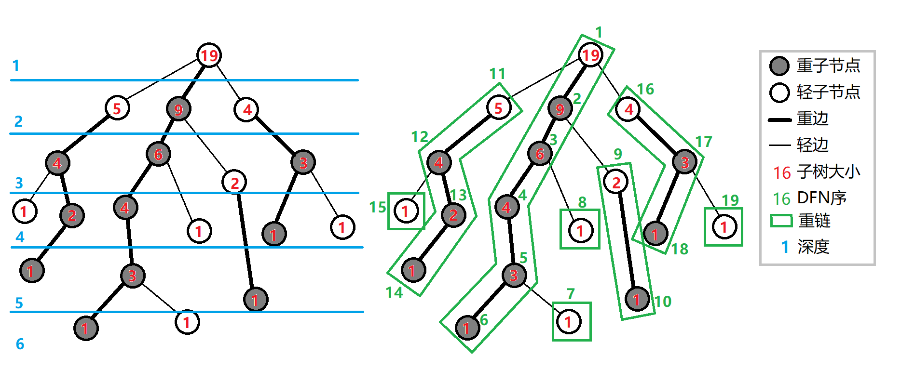
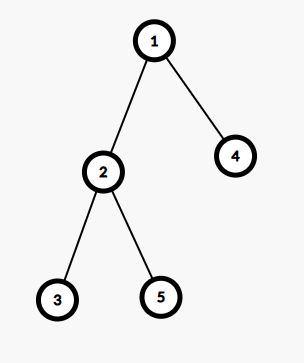
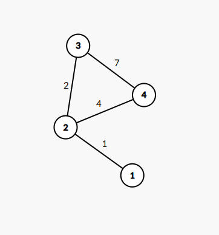
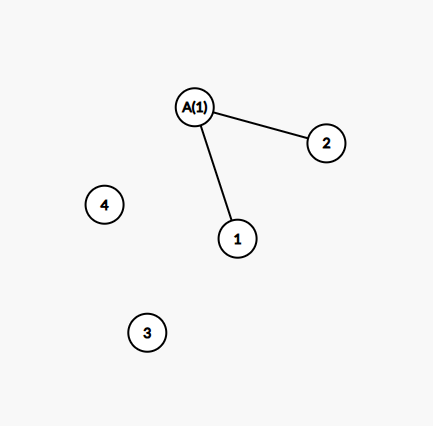
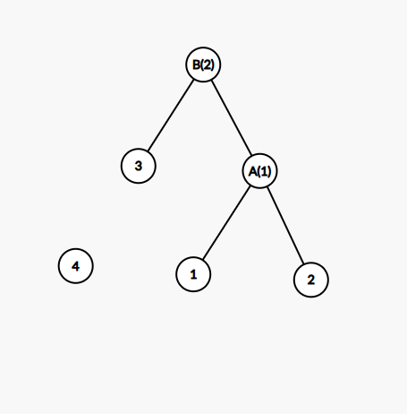
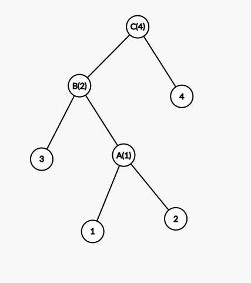
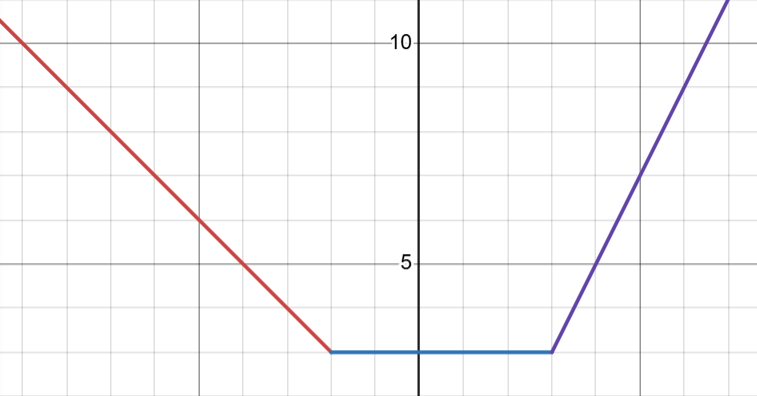

# Algorithm2 by wNightOvO


### 维护历史版本和

Sktn0089：[线段树维护区间历史版本和 ](https://www.cnblogs.com/Sktn0089/p/17755836.html)。

历史版本和问题常常配合扫描线食用。

可以快速求解类似 $\sum \sum f(l,r)$ 一类的问题，详细请见扫描线。

一个问题，你需要维护一个数列 $A_i$（初始全为 $0$），支持区间加，区间求和，**区间求历史版本和**（相当于维护一个序列 $B_i$，每次区间加后，都令 $B_i\gets A_i + B_i$）。

#### 解法一

一个比较简单的办法，我们维护一个时间 $t$，每次区间加后令 $t\gets t+1$，我们维护一个序列 $C_i$，每一次区间 $+v$ 后令 $C_i\gets C_i - t\times v$（这里的 $t$ 是加之前的时间），$A_i\gets A_i + v$，这样我们就有 $B_i=C_i + t\times A_i$。不过这个做法局限性比较大，需要考虑每一次修改对后续询问的影响。

#### 解法二

本题的操作只有区间加一个，对于普通区间加操作直接维护就行了，我们考虑两个历史版本和标记队列如何合并（pushdown 时需要合并标记），对于一个区间，假设当前有两个历史版本和标记队列 $q_1$ 和 $q_2$ 需要合并（即 $q_2$ 产生对该区间的影响），我们发现这个区间的和还会对版本和贡献 $|q_2|$ 次（$|q_2|$ 是 $q_2$ 中区间加操作的个数），并且版本和还要加上 $q_2$ 中的版本和的贡献，故我们需要维护区间和、区间加标记和、当前区间加标记的个数、当前区间加标记造成的历史版本和的贡献 $4$ 个元素。

### 扫描线

OI-WiKi：[扫描线 - OI Wiki](https://oi-wiki.org/geometry/scanning/)。

[Dregen_Yor](https://www.luogu.com.cn/user/478585)的洛谷日报：[浅谈扫描线 - 洛谷专栏](https://www.luogu.com.cn/article/f8q5bmnz)。

[liduoduo2021](https://www.luogu.me/user/529398)：[扫描线好题集](https://www.luogu.me/article/riw03n4n)。

[KazamaRuri](https://www.luogu.com.cn/user/776873)：[深入扫描线](https://www.luogu.com.cn/article/twzht4pt)。

对于一般二维数点问题（如求一个静态矩形内的点权和），可以离线后使用扫描线进行维护。

#### 单点加矩阵查询

给出一个长度为 $n$ 的数组 $a_i$，有 $q$ 次询问一个区间 $[l,r]$ 中有多少个 $a_i \in [x,y]$。

$1 \le n,q,a_i,l,r,x,y \le 10^6$

可以把每个询问拆分成 $2$ 条“线”，即拆分成位于 $[1,r]$ 中 $a_i \in [x,y]$ 的数量减去位于 $[1,l-1]$ 这个位置中 $a_i \in [x,y]$ 的数量（即差分），这样区间查询就转换为了两个前缀查询，离线下来后可做。然后对于这两个问题可以使用数据结构或分治解决。在这个问题中我们可以使用树状数组（或线段树）维护这两条线，具体地，先将询问的线按照右端点位置排序，每扫到一个位置就把 $a_i$ 所对应的位置加 $1$，询问时区间查询这个位置中 $[x,y]$ 上的权值和即可。 

#### 矩形加单点查询

对矩形做一个差分即可，把一个矩形加拆成两条“线”然后做个差分，第二维用数据结构维护即可。

#### 二维函数求和的应用

假设有 $q$ 次询问，每一次询问都形如 $\sum_{l=L}^{R} \sum_{r=l}^{R} f(l,r)$ 的形式，可以考虑扫描线，考虑当前右端点扫到 $r$，对于每一个 $l\in [1,r-1]$，我们需要加上一个数（或其他操作）使得 $f(l,r-1)\to f(l,r)$。考虑固定 $l$，这个 $l$ 产生的贡献即 $\sum_{r=l}^R f(l,r)$，这就是一个 $l\sim R$ 的版本历史和问题，由于在 $r \lt l$ 时没有任何贡献，所以也可以看作是 $1\sim R$ 的版本历史和问题，这样就转化为历史版本和了。

### 整体二分

ydtz博客园：[整体二分——二分的进阶版！](https://www.cnblogs.com/ydtz/p/16611664.html)。

[Miko35](https://www.luogu.com.cn/user/78372)：[整体二分](https://www.luogu.com.cn/article/wff0kib6)。

对于答案具有二分性质的询问（或者可以转换为有二分性质的询问，如将数组 $k$ 大或 $k$ 小问题可以二分后把大于 $mid$ 的数设为 $1$，小于或等于 $mid$ 的数设为 $0$ 后转换为二分答案问题）可以考虑整体二分。

如果题目有修改操作，需要满足修改对查询时的贡献相互独立。并且贡献需要满足交换律、结合律、可加性。

具体而言，每一次我们记录当前需要处理的操作区间 $[l,r]$ 和当前的答案区间 $[L,R]$，对于 $L=R$ 的情况就说明已经知道答案了，直接赋值即可。

接下来考虑 $L\ne R$ 的情况，我们二分一个 $M = \frac{L+R}{2}$，通过一些处理把所有操作都划分成左右两个区间，这个处理根据具体题目而不同。

当然还有整体二分维护不可加贡献。

### 后缀数组（SA）

OI-WiKi：[后缀数组和 height 数组](https://oi-wiki.org/string/sa/)。

[P3809 【模板】后缀排序](https://www.luogu.com.cn/problem/P3809)。

[P10469 【模板】后缀数组](https://www.luogu.com.cn/problem/P10469)。

下面是一些定义。

对于从 $1$ 编号长度为 $n$ 一个字符串 $s$，定义 $suf[i]$ 为 $s$ 的字串 $[i\cdots n]$。$rk[i]$ 为 $suf[i]$ 在 $\{suf[1],suf[2],\cdots,suf[n]\}$ 中的排名（按字典序），$sa[i]$ 为排名为 $i$ 的后缀串的开头下标，即 $sa[rk[i]] = rk[sa[i]] = i$。

现在考虑 $O(n\log n)$ 求出 $sa$ 数组。

最朴素的办法是把所有的 $n$ 个后缀提取出来，排一个序，复杂度 $O(n^2\log n)$，用哈希优化字符串比较可以做到字符串 $O(\log n)$ 的比较，优化到 $O(n\log^2n)$ 求后缀数组。

倍增优化，我们考虑每次求出以 $i$ 为开头长度为 $k = 2^s$ 的排名，即所有 $s$ 的字串 $[i\cdots i+k-1]$ 在其中的排名，若 $i+k-1 \gt n$ 则取 $n$，这样当倍增到 $k = 2^s \ge n$ 时就结束。

排名怎么求呢，因为我们是倍增，所以 $k' = 2^{s-1}$ 的排名已经求出来了，此时 $[i\cdots i+k-1] = [i\cdots i+k'-1] + [i+k'\cdots i+k-1]$，拆出来的这两个部分上一轮已经确定了排名，此时就变成了两个关键字的比较，用[基数排序](https://oi-wiki.org/basic/radix-sort/)可以做到 $O(n)$ 的排序，而倍增有 $O(\log n)$ 次，故总的时间复杂度为 $O(n\log n)$。

```cpp
void SA () {
	int m = 130;
	for(int i = 1; i <= m; i ++) tt[i] = 0;
	for(int i = 1; i <= n; i ++) rk[i] = s.at(i-1);
	for(int i = 1; i <= n; i ++) ++ tt[rk[i]];
	for(int i = 2; i <= m; i ++) tt[i] += tt[i-1];
	for(int i = n; i >= 1; i --) sa[tt[rk[i]] --] = i; // 1
	for(int w = 1;; w <<= 1) {
		int num = 0;
		for(int i = n-w+1; i <= n; i ++) y[++ num] = i; // 2
		for(int i = 1; i <= n; i ++) if(sa[i] > w) y[++ num] = sa[i] - w; // 2
		for(int i = 1; i <= m; i ++) tt[i] = 0;
		for(int i = 1; i <= n; i ++) ++ tt[rk[i]]; // 3
		for(int i = 2; i <= m; i ++) tt[i] += tt[i-1];
		for(int i = n; i >= 1; i --) sa[tt[rk[y[i]]] --] = y[i]; // 4
		for(int i = 1; i <= n; i ++) y[i] = rk[i]; // 5
		num = 1;
		rk[sa[1]] = 1;
		for(int i = 2; i <= n; i ++) {
			if(y[sa[i]] != y[sa[i-1]] || y[sa[i]+w] != y[sa[i-1]+w]) ++ num; // 6
			rk[sa[i]] = num;
		}
		if(num == n) break; // 7
		m = num;
	}
}
```

> 写后缀数组就要写 $25$ 行的，不写 $24$ 行也不写 $26$ 行。 ——胡开棣。

稍微解释一下。下文中的序号和代码中注释序号等价。

1. 这里是按照 $rk[i]$ 为关键字排序，因为要保证桶排序的稳定性（即相同的数靠后的排名大），所以倒序枚举存进 $sa$ 数组中。
2. 这里的 $y$ 数组存的是第二关键字的 $sa$（但是整体往前了 $w$），辅助后面的排序，如果第二关键字**完全**处于字符串外面（相当于字典序为 $0$），那么它一定最小，此时就只用按照顺序加入即可（因为要保证排序的稳定性）。
3. 表示按照 $rk[i]$ 为第一关键字排序，也就是合并为大字符串的前面的字符串的排名（前 $w$ 个）。
4. 把第二关键字的 $sa$ 即 $y$ 存进 $sa$ 数组中，这里已经默认按照 $rk$ 为第一关键字了，第二关键字的 $sa$ 也就是 $y$ 已经提前处理过了，所以这样是对的。
5. 此时 $y$ 的含义变化为旧的 $rk$ 数组，此时我们要更新 $rk$ 数组。
6. 我们要让相同字符串的 $rk$ 数组相同，这里按照 $sa$ 的顺序处理 $rk$，所以只有 $sa[i]$ 和 $sa[i-1]$ 这两个字符串完全相同的才说明 $rk[sa[i]]=rk[sa[i-1]]$，因为 $y$ 为旧的 $rk$ 只有前 $w$ 个，所以也要特别判断一下后 $w$ 个也要一样。**千万要注意 $y$ 数组要开两倍**。
7. 如果所有 $rk$ 都不同，就说明已经排序完成。否则要把桶的大小更新为 $num$，因为 $rk[i]\le num$。

### Height 数组

接下来来求 $height$ 数组。定义 $\operatorname{lcp}(X,Y)$ 为 $X$ 和 $Y$ 的最长公共前缀。$height[i]=\operatorname{lcp}(sa[i],sa[i-1])$，也就是第 $i$ 名的后缀和第 $i-1$ 名的后缀的最长公共前缀，$height[1]=0$。

下文我们用 $\operatorname{lcp}(i,j)$ 表示 $\operatorname{lcp}(s[i\cdots n],s[j\cdots n])$。

对于 $height[rk[i]]$ 有 $height[rk[i]] \ge height[rk[i-1]]-1$，即 $\operatorname{lcp}(i,sa[rk[i]-1]) \ge \operatorname{lcp}(i-1,sa[rk[i-1]-1])-1$。

证明：若 $height[rk[i-1]] \le 1$，则显然成立。考虑 $height[rk[i-1]] \ge 2$，即 $\operatorname{lcp}(i-1,sa[rk[i-1]-1]) \ge 2$，设 $s[i-1\cdots n]=\text{aAB}$，且 $s[sa[rk[i-1]-1]]=\text{aAD}$，其中 $\text{a}$ 为一个任意字符，$\text{A},\text{B},\text{D}$ 均为一个字符串且 $\text{A},\text{B}$ 非空且 $\text{B} \gt \text{D}$。则 $s[i\cdots n]=\text{AB},s[sa[rk[i-1]-1]+1]=\text{AD}$，因为 $s[sa[rk[i]-1]]$ 的字典序仅次于 $s[i\cdots n]$，所以有 $s[sa[rk[i-1]-1]+1] \le s[sa[rk[i]-1]] \lt s[i\cdots n]$，即 $\text{AD} \le s[sa[rk[i]-1]] \lt \text{AB}$，故 $s[sa[rk[i]-1]]$ 至少有前缀 $\text{A}$，故 $height[rk[i]]\ge |A|=height[rk[i-1]]-1$。

通过这个式子，按照 $rk$ 求 $height$，每次继承上一次的 $height-1$，之后暴力扩展即可，暴力扩展最多做 $2n$ 次，故时间复杂度 $O(n)$。

```cpp
void Height () {
	for(int i = 1, k = 0; i <= n; i ++) {
		if(rk[i] == 1) {
			height[1] = k = 0;
			continue;
		}
		if(k > 0) -- k;
		while(i+k-1 < n && sa[rk[i]-1]+k-1 < n && s.at(i+k-1) == s.at(sa[rk[i]-1]+k-1)) ++ k;
		height[rk[i]] = k;
	}
}
```

这样就求完啦。

后缀数组应用：

其实可以见 OI-WiKi：[后缀数组的运用](https://oi-wiki.org/string/sa/#%E5%90%8E%E7%BC%80%E6%95%B0%E7%BB%84%E7%9A%84%E5%BA%94%E7%94%A8)。

### 重链剖分

每个节点的儿子分为轻儿子和重儿子，重儿子为该子树内子树大小最大的儿子节点（如有多个取任意一个），重儿子与子树根的连边称为重边，其余为轻儿子，与子树根的连边称为轻边，若干条首尾衔接的重边构成重链。

重链剖分有一个重要的性质：**向下跳儿子时每经过一条轻边都会使子树大小至少减半**，反过来可以说**向上跳父亲时每经过一条轻边都会使子树大小至少翻倍**。也就是说一条树上的链至多经过 $\log n$ 条轻边，我们对于一条重链用数据结构区间维护，轻边直接修改即可保证复杂度（因为走完重链后下一条边一定是轻边，不然不符合重链的定义，这样轻重边交替一共最多走 $2\log n$ 条边）。

注意这条性质也可以用于树上启发式合并（DSU on Tree）。

### 长链剖分

定义每个节点的儿子分为重儿子和轻儿子，该子树的根的儿子中子树深度最大的定义为重儿子，子树的根与重儿子的连边称为重边，其余为轻儿子，其与子树的根的连边称为轻边，若干条首尾衔接的重边构成重链。



长链剖分一个重要性质：从一个节点到根节点最多经过 $O(\sqrt{n})$ 条轻边。

证明：假设当前节点到该子树内深度最大的节点的距离为 $k$，则每经过一条轻边都会使子树大小至少 $+k$（因为重儿子至少要有 $k$ 个节点），使得到该子树内深度最大的节点的距离 $+1$（经过一条轻边），也就是 $k \gets k + 1$，那么到根节点的时候这个距离至多为 $n-1$，也就是 $1+1+2+3+\cdots=n-1$，则至多有 $O(\sqrt{n})$ 个，证毕。

### 树上启发式合并（DSU on tree）

[Ein_Niemand](https://www.luogu.com.cn/user/122407)的洛谷日报：[dsu on tree学习笔记 - 洛谷专栏](https://www.luogu.com.cn/article/6028aw8w)。

OI-WiKi：[树上启发式合并 - OI Wiki](https://oi-wiki.org/graph/dsu-on-tree/)。

DSU on tree 可以通过 预处理或者离线解决一类不带修改的子树信息统计查询或路径信息统计查询问题，常规做法可能需要大数据结构或者树分治，拥有优秀的时间复杂度和常数。

算法实现。

1. 树链剖分。
2. 假设现在正在求解节点 $u$，先求解 $u$ 的轻儿子，求解结束后**不保留**轻儿子的贡献。
3. 求解 $u$ 的重儿子，求解结束后**保留**重儿子的贡献。
4. 统计节点 $u$ 的答案（再统计一遍轻儿子的贡献，和保留的贡献合并）。
5. 若当前节点 $u$ 为轻儿子，则清除当前节点的贡献（相当于为父节点清除）。

> 那么这里有人可能就要问了，为什么不保留求出的所有答案呢？这样复杂度就更优了啊？



如上图所示，如果我们先求解节点 $4$，求解完成之后不清空，那么在求解节点 $2$ 时贡献就会串了。由于重儿子是最后才进行求解的，所以保留重儿子的贡献并不会和求解其他子树时的贡献串在一起，对于每个节点都如此就不会错啦。

时间复杂度分析。

考虑每个节点被统计的次数。

>  对于树链剖分，有个经典的结论：一个节点到根的路径上最多只会经过 $O(\log n)$ 条轻链。
>
> 证明：每次经过一条轻链都会使子树大小减半，最多减小 $\log n$ 次，得证。

对于一个节点 $u$，若 $v$ 的轻儿子 $w$ 是 $u$ 的祖先，则在 $v$ 节点 $u$ 会被额外暴力统计一次，根据链剖分原理，如果暴力统计一次的复杂度为 $O(1)$，则 DSU on tree 的复杂度为 $O(n\log n)$。

### Kruskal 重构树

[ImmortalWatcher](https://www.luogu.com.cn/user/157857)：[Kruskal 重构树——洛谷专栏](https://www.luogu.com.cn/article/jsyjaruc)。

> 顾名思义，Kruskal 重构树就是基于 Kruskal 的最小生成树算法在无向图中得出的树所构造而成的树。——ImmortalWatcher。

考虑从小到大构建一颗 Kruskal 重构树的过程，假设原图为 $G$，大小为 $n$，原图的最小生成树为 $G'$，从小到大排序 $G'$ 中的边，对于一条边 $(u,v,w)$，我们新建一个虚拟结点，权值为 $w$，作为一颗新的树的根节点，其左右儿子分别为 $u$ 和 $v$ 所在树的根结点，不难发现，当合并完 $G'$ 中的 $n-1$ 条边后会形成一颗新树，大小为 $2n-1$ 条边，这一棵新树称为 Kruskal 重构树。实际上构建这一棵 Kruskal 重构树可以不用显示建出最小生成树，只需要仿照最小生成树的方式在原图上构建即可。

这是原图 $G$。



现在从小到大合并最短的一条边 $(1,2,1)$，新建一个点权为 $1$ 的结点记为 $A$。



再合并 $(2,3,2)$。



再合并 $(2,4,4)$。



这样就构建好了。

从小到大构建的 Kruskal 重构树的性质：
1. 这是一棵完满二叉树，且所有非叶子节点都是虚点，所有叶子节点都是原图中的结点。
2. 这是一个大根堆（如果从大到小构建则是小根堆）。
3. 两个叶子结点的 $\operatorname{lca}$ 的权值是原图 $G$ 中这两点之间的简单路径的最大边权的最小值（从大到小建树则为最小边权的最大值），这是一个很重要的性质。

### 2-SAT

[OIWiKi：2-SAT](https://oi-wiki.org/graph/2-sat/)。

> SAT 是适定性（Satisfiability）问题的简称。一般形式为 k - 适定性问题，简称 k-SAT。当 $k \gt 2$ 时此问题是  NP 完全的，所以我们只研究 $k=2$ 的情况。—— OIWiKi。

2-SAT 问题通常是给出 $n$ 个布尔变量，并且有若干个限制条件形如 $(\lnot)a\lor (\lnot)b$ 的形式，也就是 $a$ 变量为真（假）或 $b$ 变量为真（假），组成的一个布尔方程。

对于 $a\lor b$，我们连 $\lnot a\to b$ 和 $\lnot b\to a$ 的边，表示如果 $a$ 不满足则 $b$ 必须满足，$b$ 不满足则 $a$ 必须满足。

对于这样连边构成的图 $G$，应有 $2n$ 个结点，我们在图 $G$ 上缩点，得到一个有向无环图记为 $G'$。

> 推论 1. 如果存在一个变量 $x$，$x$ 和 $\lnot x$ 均处于同一个强连通分量中，则原布尔方程无解。

由图 $G$ 的定义知，在一个强连通分量中，里面所有变量要么全部满足，要么全部不满足，而 $x$ 和 $\lnot x$ 不可能同时满足或者同时不满足。

> 推论 2. 若布尔方程有解，则对于每一个变量，取其对应的强连通分量在图 $G'$ 中对应拓扑序较大的那一个，一定能构造出一种合法的解。

先考虑如下引理。

> 引理 1. 如果存在图 $G$ 上的一条单向边 $(u,v)$，则必定存在一条 $(\lnot v,\lnot u)$。

如果 $u$ 满足，则 $v$ 必定满足，那么就说明 $u \Rightarrow v$，根据高中所学知识可以知道 $\lnot v\Rightarrow \lnot u$，故存在 $(\lnot v,\lnot u)$。

> 引理 2. 若图 $G$ 中存在一条单向路径 $p(u,v)$，则必定存在一条单向路径 $p'(\lnot v,\lnot u)$。

对路径 $p$ 上的每一条边运用引理 1. 即可得到。

现在考虑推论 2.。我们不妨假设 $f(u)$ 为 $u$ 所在强连通分量在 $G'$ 上的拓扑序。

考虑反证法，假设存在 $f(u) \gt f(\lnot u),f(\lnot v) \gt f(v)$ 且存在单向路径 $p(u, v)$，则可以知道 $f(u)\lt f(v)$。

则根据引理 2. 可知同样也存在单向路径 $p'(\lnot v,\lnot u)$，则有 $f(\lnot v)\lt f(\lnot u)$，联立上述四个式子可得到 $f(u)\lt f(\lnot u),f(v)\lt f(\lnot v)$ 这与假设相矛盾，故假设不成立，也就是说我们选择拓扑序较大的变量并不能推出选择其他拓扑序较小的变量，说明全选拓扑序较大的变量一定可以作为一组解。

实际上，在用 tarjan 求解强连通分量时的强连通分量编号可以看作是**反拓扑序**，可以选取所在强连通编号较小的作为解。

### Slope Trick 优化

OI-Wiki：[Slope Trick 优化](https://oi-wiki.org/dp/opt/slope-trick/)。

rui_er 的博客：[Slope Trick 总结](https://www.cnblogs.com/ruierqwq/p/18017106/slope-trick)。

[NOI_Winner](https://www.luogu.com.cn/user/747900) 的洛谷专栏：[浅谈 Slope Trick：神奇的 DP 优化方法](https://www.luogu.com.cn/article/bn3a465i)。

[Lance ](https://www.zhihu.com/people/yu-long-shan-yls)的知乎：[保持凸函数性质的运算](https://zhuanlan.zhihu.com/p/348880379)。

> Slope Trick 通常用于维护具有如下性质的函数：
> - 二维函数且第二维连续。
> - 第二维是分段的一次函数。
> - 是凸函数或凹函数（上凸或下凸）。
> - 斜率的变化量较小，在 $O(n)$ 级别左右。

由于这个函数是下凸函数（或者上凸函数），此时斜率一定具有单调性，下文以下凸函数举例。

维护这个函数某一个段（一般是最左边或者最右边）一次函数的斜率 $k$ 和截距 $b$，以及每个斜率改变 $1$ 的分段点的可重集合（如果某个点的斜率变化量超过 $1$ 则加入这个点多次）。

假设现在有一个下凸函数。

$$
\Large{
f(x) = 
\left\{\begin{matrix} 
-x+4 &x \le -2 \\
-2 &-2 \lt x \le 3 \\
2x-3 &x \gt 3
\end{matrix}\right.}
$$



我们维护最右边的斜率 $k=2$，截距 $b=-3$，斜率分段点的可重集合 $\{-2,3,3\}$，因为在 $x_0=3$ 的地方斜率变化量为 $2$ 所以分段点的集合中有两个 $3$。

上述函数有几个常用的性质：

- 下凸函数和下凸函数相加仍是下凸函数，上凸函数同理。对于函数相加，直接把对于的 $k$ 和 $b$ 分别相加，斜率分段点的集合合并即可维护。
- 两个连续函数进行加、减、乘运算后仍然连续，除法运算当分母不为 $0$ 时仍然连续。
- 斜率每增加 $1$，则对于的截距减少 $x$，则对于对应分段点的截距可以通过维护分段点集合中的前缀和维护（这一部分通常使用数据结构，如平衡树或对顶堆维护）。相反，斜率每减少 $1$，截距就增加 $x$。**仅当函数连续时才使用，这也是 Slope Trick 优化的前提，但不等于函数不连续就不能用这个思想维护**。
- 对于下凸函数，每个点的斜率单调不降。对于斜率为 $0$ 处的截距即为该函数最小值。维护斜率等于 $0$ 的位置相当于维护一段大小为 $|k|$ 的连续段，$k$ 为最左边或最右边那一段的斜率。
- 对于下凸函数，如果取前缀 $\min$，即对于每个点 $x_0$ 变化为横坐标小于等于 $x_0$ 的最小值则相当于去掉所有斜率大于 $0$ 的位置的分段点。取后缀 $\min$ 同理。取前缀/后缀 $\min$ 后凸性不变。**注意更新 $k$ 和 $b$**。
- 对于函数的上下平移，改变截距 $b$ 即可。左右平移对分段点打上平移的 $tag$ 即可。
- 对于函数翻转同理打 $tag$。

## 简单图上判断两点是否有（经过的路径/边/点）不相同的路径（门杰定理）

给定一个 $n$ 个点 $m$ 条边的简单无向图。有两个给定节点 $s$ 和 $t$。三个命题。

一条简单路径没有重复的点或者边。

**问题 A**：$s$ 和 $t$ 之间是否存在两条简单路径，且这两条简单路径不完全相同。

**解决**：判断 $s$ 与 $t$ 的一条简单路径是否全是桥（割边），若全是桥则 $s$ 和 $t$ 之间只有唯一路径，否则存在这两条简单路径。

**问题 B**：$s$ 和 $t$ 之间是否存在两条简单路径，这两条简单路径不存在公共边。

**解决**：由 [Menger 定理](#门杰定理（Menger%20定理）)，当 $s$ 与 $t$ 在同一个双连通分量时，$s$ 与 $t$ 存在两条无公共边的简单路径。

**问题 C**：$s$ 和 $t$ 之间是否存在两条简单路径，这两条简单路径不存在除 $s$ 和 $t$ 外的公共顶点。

**解决**：由 [Menger 定理](#门杰定理（Menger%20定理）)，当 $s$ 与 $t$ 在同一个点双连通分量且 $s$ 与 $t$ 之间不直接以桥相连时，$s$ 与 $t$ 之间存在两条无公共顶点（除 $s$ 和 $t$ 外）的简单路径。

### 门杰定理（Menger 定理）

[门杰定理](https://baike.baidu.com/item/%E9%97%A8%E6%9D%B0%E5%AE%9A%E7%90%86/19137908)。

[Menger 定理](https://mathpedia.huijiwiki.com/wiki/Menger_%E5%AE%9A%E7%90%86)。

设**连通**图 $G$ 的边集为 $E(G)$，点集为 $V(G)$。

在图 $G$ 上，定义两条路径是**边不交**的，指它们不存在公共边；同理定义两条路径是**点不交**的，指它们不存在公共顶点。

在图 $G$ 上有两个不同的顶点 $u,v\in V(G)$。$E$ 为 $E(G)$ 的一个子集，如果满足每一条 $u$ 到 $v$ 的道路都经过 $E$ 中的一条边，则称 $E$ 为 $u-v$ 不连通集；同理，$V$ 为 $V(G)$ 的一个子集，如果满足每一条 $u$ 到 $v$ 的道路都经过 $V$ 中的一条边，则称 $V$ 为 $u-v$ 分离集。

**定理 1（Menger 定理的边形式）**：假设 $G$ 连通，$u,v\in V(G)$，则 $u$ 到 $v$ 之间的边不交的路径的最大数量是所有 $u-v$ 不连通集中包含元素最少的不连通集的大小。

**定理 2（Menger 定理的点形式）**：假设 $G$ 连通，$u,v\in V(G)$，则 $u$ 到 $v$ 之间的点不交的路径的最大数量是所有 $u-v$ 不连通集中包含元素最少的分离集的大小。

**推论 3（连通性的等价刻画）**：图 $G$ 是 $k$ 边连通的当且仅当对于任意 $u,v\in V(G)$ 有至少 $k$ 条边不交的路径相连；同理，图 $G$ 是 $k$ 点连通的当且仅当对于任意 $u,v\in V(G)$ 有至少 $k$ 条点不交的路径相连。

**推论 4（有向图的 Menger 定理）**：假设图 $G$ 连通，从 $u\in V(G)$ 到 $v\in V(G)$ 的弧不交的路径的数量最大值是所有 $u-v$ 不连通集中的包含弧最少的那个不连通集的大小。